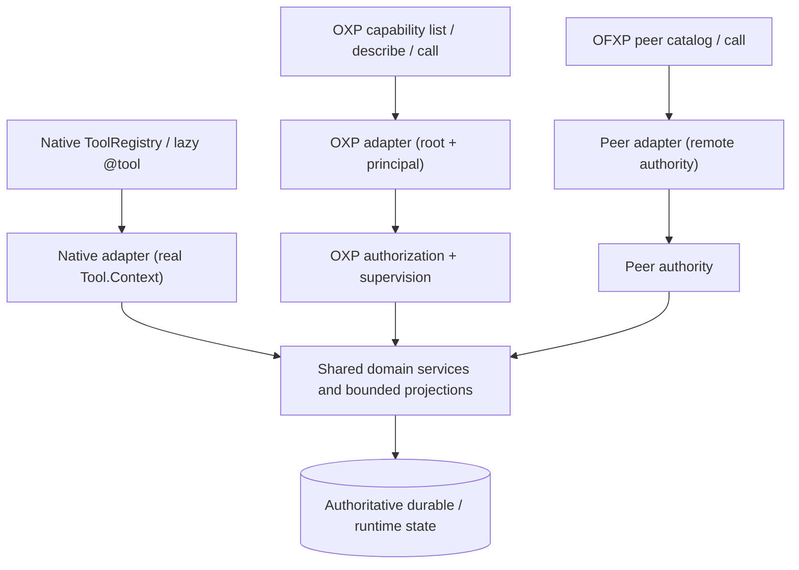

# OXP native-tool exposure parity

This is the **OXP-specific implementation ledger and verifier contract**.
The October 9, 2026 [AX/CoS/Codex investigation](./ax-oxp-cos-codex-2026-10-09.md) records scoped skill/symbol workdirs, MCP initialization-instruction improvements, verified fixture evidence, and explicit source-versus-deployed-host caveats.
The governing invariant now covers *every* supported OpenFork tool-calling
entry point: normal chat/worker Sessions, lazy native tools, Code Mode,
OXP, OFXP, ACP, MCP and future interfaces. See
[universal executable tool-surface parity](./tool-surface-parity.md).
OXP's passing inventory/dispatcher checks must not be interpreted as
certification of the other surfaces.

## Architectural contract

**Every provider-visible OpenFork builtin MUST have a discoverable, executable,
semantically equivalent OXP surface or a documented and reviewed security/lifecycle
exception.** This is a capability *contract*, not a demand to export
`Tool.Def.execute` with an invented `Tool.Context`.

The authoritative inventory is the native V1 `ToolRegistry`; the
`exchange/tool-coverage.ts` ledger records transport semantics, and
`oxp/tool-coverage.ts` enforces explicit exceptions. The executable OXP target
set comes from `OxpCapability.list("all")`, the direct `OxpSurface.DEFINITIONS`,
and the specific supported Session actions in `OxpSession.executableTargets()`.
An entry in the ledger alone is not evidence that a tool runs.

CI gates:

1. `ToolRegistry` asserts that all native builtin IDs have a coverage entry.
2. OXP tests assert that every mapped OXP target really exists.
3. OXP tests reject any native entry lacking an OXP target unless it is on the
   **explicit exception list**; no new exception may be added implicitly.
4. Tests compare the native lazy-load policy with the actual OXP catalog.
5. Leaf authorization is independently tested; discoverability never authorizes
   execution. A revocation between admission and data egress must fail closed.

## Shared-core implementation rule

### Durable Memory reads, October 2026

OXP's `memory` capability authorizes an explicit approved root before entering
the Exchange adapter. Memory `map/search/open/get/timeline` now use the shared
Core Memory domain over a Tier-1 durable-reader graph, **not** V1
`InstanceStore`/config/plugin bootstrap. Writes (`remember/forget`) retain the
V1 runtime for verified evidence, commit revalidation and project migration.
Historical Session recall is separately authorized for `session.search`, bounded
and directory-prefixed; memory-read authority never implies Session supervision.
The OXP response carries timing fields for authorization, identity resolution,
domain execution and egress so host-versus-connector latency can be compared.
The Core domain now applies workspace **and** project filters to all reads,
including stable-key timeline traversal; map/open never mutate SQLite. Scoped
topic/suppression migration follows canonical project-ID changes atomically.

These are source and direct-domain regression results, not a claim that an
already-running OXP sidecar has loaded the new code, nor proof of OFXP/ACP/MCP
transport conformance. See `docs/perf/2026-10-09-oxp-memory-latency.md`.

**Recall fidelity invariant:** Core applies scope, status and kind eligibility
before FTS top-N, and never resurfaces forgotten memories through
`includeHistory`. Exchange performs bounded, explicitly labeled lexical
fallback and the Session adapter diversifies only among already-authorized,
indexed candidates. The output declares unique Session count and source-index
completeness rather than portraying five messages from one transcript as
five independent sources. Adapters must not perform automatic index repair or
silently infer missing evidence from incomplete coverage. Test fixtures and
measurements: `docs/perf/2026-10-09-oxp-memory-recall-fidelity.md`.

#### Memory recall relevance continuation

The shared Core memory domain now obtains exact-index candidates only for
high-information query anchors, in addition to the bounded FTS top-N, while
requiring the same project/workspace, status, kind and full-text predicates.
The Exchange query planner excludes date-only and generic version tokens from
single-token broadening and preserves trailing named identifiers in long
queries. These are shared semantics, not new privileged operations. Core and
Exchange regression fixtures demonstrate the ranked positives and forbidden
scope negatives; **live OXP and other transport dispatcher parity are still
unverified pending controlled rollout**, not certified by source tests.
Evidence: `docs/perf/2026-10-09-oxp-memory-recall-fidelity.md`.

Current follow-up strengthens the **shared domain semantics**, without
changing the advertised capability or authorizations: `SessionRecall` now
requires the current V2 historical text projection as well as its original
base cursor before claiming query-complete results. The existing
operator-only bounded repair was verified against in-memory and file-backed
temporary SQLite fixtures, including an independently opened low-priority
connection, V1/V2 recovery, scope denial, and idempotence. Exchange uses a
two-token qualified fallback for short brands/acronyms where the query has
a second distinctive term; no Session access was enabled implicitly.
The portable semantics have Core+Exchange tests, but this **does not**
constitute live OXP/OFXP/ACP/MCP executable-parity certification. Source:
`docs/perf/2026-10-09-oxp-memory-recall-fidelity.md`.

The operator-only maintenance executable itself additionally passes a
separate-child-process CLI integration fixture against a disposable file
database. This is a maintenance command, not a newly exposed provider tool;
it has no automatic startup, recall, or Session side effects. It is **not**
evidence that the active OXP sidecar has been restarted, that its currently
incomplete production index has been repaired, or that external transports
have executed the newly loaded implementation.

The separate `inspect-memory-session-index.ts` diagnostic is strictly
operator-initiated, read-only, and intentionally **not** an OXP provider
action. It reports five cursor states without acquiring an Exchange
principal or changing a Session, migration or repair schedule. The shared
Exchange planner's longer-prompt identifier prioritization and uppercase
imperative filtering affect callers of the existing memory search executor;
they do not introduce a new authorization or transport contract. The
source-level regression tests cannot replace live dispatcher parity.

### Dreamer background agent, October 2026

Native lazy `dream` launches `dreamer` through the host-owned special-agent
entry point (`special-agent/dreamer-runtime.ts` ->
`SubagentDelegation.executeSpecialAgent`) on the shared V1 `task`
BackgroundJob/child Session owner. `dreamer` is a schema-classified host-owned
special agent, not a `subagent_type` target: generic Task-style delegation of
`dreamer` - including OXP `openfork_worker` or OFXP worker requests that name
it - now fails closed at the special-agent class fence, and no Dreamer-aware
external dispatch is implemented. The native `dream` tool remains a
Session-bound capability, not an unauthenticated standalone inference
endpoint. No OXP/OFXP adapter is permitted to manufacture a native
Tool.Context or grant the parent Session's authority. The source-level
coverage entry is not evidence of a successful model-executed OXP/OFXP
Dreamer child: those transport integrations remain **unverified** until
exercised against rebuilt running hosts.
Native `dream.cancel` delegates to BackgroundJob's existing owned-child
cancellation mechanism; the external counterpart must use its worker's
authorized abort action, not invoke this Session-bound leaf with a fabricated
context. Executable cross-transport cancel equivalence remains unverified.
See [Dreamer architecture](./dreamer-background-agent.md).

One domain owner produces state, validates semantics, and shapes results. Native
Session tools and external OXP/OFXP surfaces are **adapters**, not independent
implementations of the same algorithm. An external transport must never pass a
synthetic `Tool.Context` or gain ambient parent credentials.



For example, native `@usage` and OXP `usage` reuse the **same**
`projectSessionContext` bounded projection in `usage/inspection-contract.ts`,
backed by the same `Usage.Service`; native `runUsage` also delegates to that
projection. OXP performs Session admission and revalidates before egress; it
does not duplicate historical SQL aggregation or fake native Session tool
context. `@opencode-ai/schema/context-occupancy` owns only the browser-safe
data shapes; the pure **Core-owned** `@opencode-ai/core/session/context-occupancy`
projector is consumed by both the native Context pane and OXP to calculate the latest
provider-reported settled footprint, using `SessionTelemetry.snapshot` and a
bounded indexed historical fallback. File, process, Git, project, symbols,
archive and other tool families likewise retain their shared domain owners.

Native `@project.toolchain` and OXP `project(action="toolchain")` likewise
invoke `project/toolchain.ts` instead of running two sets of runtime probes.
This typed capability is gated by **both** the approved-root read grant and
the process grant; ordinary project summaries never require process
permission. Probes use a closed command list, bounded output, exact argv,
timeouts, and curated non-secret environment keys. The OXP projection also
redacts host-global executable paths and directory-bearing environment
variables that belong to the machine, not the approved workspace; native
Session diagnostics retain those paths.
The independent probes execute with a bounded **four-process concurrency**
limit instead of a serial startup waterfall, preserving declared runtime
order, per-attempt timeout, cancellation, and the same restricted argv.
An October 8 controlled eight-probe/75ms-delay fixture measured 612.86ms
serial versus 186.42ms with four-way concurrency (3.29x scheduling speedup).
This is a synthetic latency benchmark, not a promise of that ratio on every
real toolchain. Adversarial fixture coverage also rejects XML-forbidden
control characters and verifies machine-path redaction.

Native `@project` and OXP `project(action="snapshot")` now share the
`ProjectInspection` metadata producer across **all three snapshot tiers**:
`summary`, `structure`, and `full`. OXP's full tier exposes bounded
annotated scripts, tree, entry points, config/CI inventory, and file-type
counts/bytes without opening arbitrary source bodies; `summary` remains a
forced-lean alias even when `tier=full` is supplied. Native and OXP output
also share `ProjectInspection.escapeXml`: one XML-safe projection escapes
quotes, newlines and invalid scalars rather than allowing repository-controlled
manifest names/scripts to forge attributes or XML elements. OXP still does
**not** report native Git/worktree status or sampled LOC estimates through
this read-only projection; those facts require separate authority or an
explicit producer rather than invented substitutes. Full output stays inside
the existing 96KiB/500-line OXP projection budget.

Native `@read.grep` and OXP `read(action="grep", path, pattern)` use the
same `ReadFilesystem.grep` bounded search producer and native `renderGrep`
projection. OXP permits an exact approved-root file, rechecks its stat
fingerprint for concurrent modification and revalidates authority before
egress. Regex fallback, match count, 50-match limit, and read attribution
follow native behavior. Unlike a full-file read, search excerpts intentionally
**do not register an edit-grounding fingerprint**, preventing a grep-only
caller from bypassing prior-read checks for patch/edit.
Native `@read.outline` is also exposed directly as OXP
`read(action="outline",path)` via the one shared `Symbols.Service` AST/cache
domain; there is no Session fabrication or secondary parser implementation.
The file must resolve within the approved root and obey the shared 1 MiB
outline input cap. The output is root-virtualized, limited to 200 symbols and
bounded by the existing read output budget; neither this symbol outline nor
grep marks the file as fully read for edit grounding. Native `@read.around`
is exposed as OXP `read(action="around",path,symbol)` (or a bare `symbol`
parameter): the shared `Symbols.Service.locate` looks up an exact or
substring symbol with the same `aroundWindow` algorithm native uses, and
falls back to the shared per-file grep when necessary. The resulting window
is read through `ExchangeRead.execute`, preserving concurrent-file checks,
egress authority, cancellation and attribution while intentionally **not**
granting edit grounding. OXP caps these symbol windows at 80 lines and limits
symbol-indexed input to 1 MiB. The native `read` action family now has no
unmapped OXP actions.

**Coverage is not unrestricted scope.** A native tool may offer more actions
than its external adapter if the extra actions require host-private account
credentials, unapproved workspace access, or a real caller Session. Such a
difference is documented as a boundary, not presented as full action parity.

## Semantics and security

- Session-owned tools (question, task, todo, checkpoint, Goal, Swarm, session
  control) are projected as explicit Session supervision/delegation rather than
  creating a covert OpenFork Session for the caller.
- Filesystem/process/network tools retain approved-root path checks and the
  purpose-specific read/write/process/browser/integrations grants.
- Broker `capability` is lazy: list returns names and metadata; describe loads
  one schema; call validates the discovered contract and invokes an authorized
  leaf. OXP is not a blanket privilege amplification layer.
- Custom/plugin and MCP tool inventories are dynamic and workspace-dependent.
  They are not blindly promoted from local Session permission or credentials;
  OXP's `namespace=mcp` requires an explicit root and independent authorization.
- **Usage:** OXP `usage` is a lazy, read-only capability for `action=context`
  and an explicit existing `sessionID`. `OxpSupervision.resolve` verifies
  Session ownership and approved-root admission before the authoritative
  `Usage.sessionContext` read; admission is revalidated before egress. The
  output is bounded, omits system prompts, account identifiers, and raw history,
  and identifies cumulative/durable accounting. When available, a single
  bootstrap-free telemetry snapshot provides the latest **settled** provider
  context footprint and percentage; old Sessions fall back to the indexed last
  settled generation, with explicit provenance. It intentionally does **not**
  guess an in-flight request's final context-window occupancy. Neither the
  cumulative Session token total nor an unrelated ChatGPT conversation can
  substitute for that measured provider footprint. Native cross-project totals, breakdown, timeline,
  maintenance, and model profile remain unavailable over OXP until a separately
  authorized project/global analytics boundary is implemented.
- **GitHub and quota:** ambient GitHub and model-provider credentials/accounts
  belong to the host principal. OXP must never silently inherit them. Dedicated
  external-principal integrations may be added with their own authentication
  and authorization, not by reusing the native `github` or `quota` Tool.Context.
- **Invalid tool:** transport schema rejection replaces native invalid-tool
  behavior. **Plan exit:** interactive local plan-mode exit has no remote
  Session transition and is currently an explicitly tracked gap.

### Calling lazy usage through OXP

An OXP caller needs an existing, supervised **OpenFork** Session. This does
not inspect the calling ChatGPT conversation or create a placeholder Session.

1. Use `openfork_info(action="status")` to identify enabled roots and grants.
2. Call `capability(action="list", namespace="openfork", query="usage", load="lazy")`.
3. Call `capability(action="describe", capability="usage")` and retain the
   returned broker contract; listing alone never grants execution authority.
4. Call `capability(action="call", capability="usage", contract=<exact descriptor
   contract>, rootID=<approved root ID>, args={action:"context",
   sessionID:<existing OpenFork Session ID>})`.

The structured response distinguishes cumulative durable usage
(`totals`), the latest **settled** model request footprint
(`settledContext`, `contextWindowUtilization`,
`contextWindowUtilizationSource`), and unavailable **live in-flight**
occupancy (`liveContextWindowUtilization:null`). A percentage is
`null` when its last known context limit or settled request is missing.
The catalog advertises `usage` as `lazy`; discovering it does not hydrate
the Session's full history or force a workspace execution Instance.

For new native tools, identify domain ownership, external-principal semantics,
authorization class, capability name and load policy *before* adding UI wrappers.
Update the coverage ledger, executor and parity tests in the same change.

The native `browser` tool is itself a `list/describe/call` broker, whereas
OXP exposes the concrete browser operation union directly. CI compares every
native browser operation ID with the actual OXP union (not merely the broker
name), so introducing a new browser operation without exposing it externally
is a test failure. Native `read` outline/grep/jump operations similarly retain
explicit equivalents in OXP `symbols`, `find`, and bounded `read`; these
are action aliases rather than fake same-schema wrappers.

## Native tool exposure matrix

This table is generated from the shared native/external transport ledger.
Do not hand-edit it. A regression test checks the exact generated rows.
Regenerate after changing the ledger with
`bun packages/opencode/script/generate-oxp-tool-parity.ts` from the repository
root, then run the OXP parity and capability tests.

<!-- OXP-NATIVE-PARITY-MATRIX:START -->
| Native tool | OXP equivalent | Semantic boundary | Load policy |
| --- | --- | --- | --- |
| `@apply_patch` | `patch` | augmentation | default |
| `@archive` | `archive` | augmentation | lazy |
| `@background` | `process` | augmentation | default |
| `@bash` | `process` | augmentation | default |
| `@browser` | `browser` | augmentation | default |
| `@checkpoint` | `openfork_session.checkpoint` | supervision | lazy |
| `@code` | `code` | augmentation | default |
| `@dream` | `openfork_worker` | delegation | lazy |
| `@edit` | `edit` | augmentation | default |
| `@find` | `find` | augmentation | default |
| `@git` | `git` | augmentation | default |
| `@github` | **Explicit exception** | parent-native | lazy |
| `@goal` | `openfork_session.goal` | supervision | default |
| `@invalid` | **Explicit exception** | transport | default |
| `@json` | `json` | augmentation | lazy |
| `@lsp` | `lsp` | augmentation | default |
| `@memory` | `memory` | augmentation | default |
| `@models` | `models` | augmentation | lazy |
| `@ofxp` | `ofxp` | augmentation | default |
| `@patch` | `patch` | augmentation | default |
| `@plan_exit` | **Explicit exception** | parent-native | default |
| `@project` | `project` | augmentation | default |
| `@question` | `openfork_request` | parent-native | default |
| `@quota` | **Explicit exception** | parent-native | lazy |
| `@read` | `read` | augmentation | default |
| `@refactor` | `refactor` | augmentation | lazy |
| `@runtime_refresh` | `runtime.refresh` | augmentation | default |
| `@scheduled_task` | `schedule` | augmentation | default |
| `@session` | `openfork_session` | supervision | default |
| `@skill` | `skill` | augmentation | default |
| `@sqlite` | `sqlite` | augmentation | lazy |
| `@swarm` | `openfork_swarm` | delegation | lazy |
| `@swarm_create` | `openfork_swarm` | delegation | default |
| `@swarm_member` | `openfork_swarm` | supervision | default |
| `@symbols` | `symbols` | augmentation | default |
| `@sympy` | `sympy` | augmentation | lazy |
| `@task` | `openfork_worker` | delegation | default |
| `@test` | `test` | augmentation | lazy |
| `@todowrite` | `openfork_session.todo` | supervision | default |
| `@tool` | `capability` | augmentation | default |
| `@typecheck` | `typecheck` | augmentation | default |
| `@usage` | `usage` | supervision | lazy |
| `@web` | `web` | augmentation | default |
| `@write` | `write` | augmentation | default |
<!-- OXP-NATIVE-PARITY-MATRIX:END -->

## Exact-edit AX recovery (October 10, 2026)

The native Session `@edit` and OXP `edit` exact oldString/newString routes
now share an optional `selection` input through `tool/edit/match.ts`.
`mode:"one", atLine:N` targets exactly one verified exact match on that
source line; `mode:"selected", atLines:[N,M]` targets a verified subset in
a single atomic plan; and `mode:"all", expectedMatches:N` asserts the
complete exact-match count. Omitting `selection` preserves existing
uniqueness, match-tier, and replaceAll behavior. Explicit line-based targeting
never falls back to fuzzy/nearest matching. Both adapters retain their
own authority, prior-read grounding and commit-time source revalidation.

**Executable evidence:** `test/tool/edit.test.ts` (native Session tool
invocation), `test/tool/edit-selection.test.ts` (shared selector invariants),
and `test/oxp/edit.test.ts` (authorized OXP adapter execution). This
is **source-runtime evidence**, not proof that the currently connected OXP
host has hot-reloaded; the connected host reports runtime refresh unavailable.
OFXP, ACP and MCP must still be checked on their actual dispatch paths rather
than inferred from name/catalog/schema parity. Batch exact-op selectors and
patch-hunk identity tokens are not included in this slice.

## Explicit action-level boundaries

An executable capability **name** does not establish identical actions or
credential/Session lifetime semantics. The following intentionally narrower
adapters are checked against both native and OXP parameter schemas.

<!-- OXP-NATIVE-ACTION-SCOPES:START -->
| Native tool | OXP actions | Native-only actions or aliases | OXP-only actions | Boundary |
| --- | --- | --- | --- | --- |
| `@code` | `search`, `describe`, `run` | `save`, `call` | — | Native saved-run publication and invocation require the real Session capability inventory. |
| `@project` | `snapshot`, `summary`, `structure`, `recent`, `toolchain` | — | `structure` | Native/OXP snapshot supports summary, structure and full tiers through shared metadata inspection; OXP additionally requires process authority for toolchain. |
| `@read` | `read`, `tail`, `grep`, `outline`, `around` | — | — | Native/OXP grep shares bounded read/search; outline and around reuse shared Symbols AST/cache, with around snippets never granting edit grounding. |
| `@usage` | `context` | `totals`, `breakdown`, `timeline`, `maintenance`, `profile` | — | Global and cross-project usage analytics require separately authorized accounting access. |
<!-- OXP-NATIVE-ACTION-SCOPES:END -->

## Deployment boundary

### Native Swarm staged-admission action (October 9, 2026)

The V1 native `swarm_create`, lazy `swarm` action `delegate`, and approved-root OXP `openfork_swarm` action `delegate` invoke the same `SwarmCommand.delegatePartial` host workflow. It filters independently invalid member profiles and rejects only invalid/dependency-unsafe initial task components; the surviving DAG still goes through the original strict `SwarmCommand.delegate` creating-to-active fence. Every rejection is included in the creation `admission.failures` receipt and the persisted Swarm ID is returned even if some entries are rejected. Durable `active` remains distinct from a partial *request outcome*.

The new lazy `swarm` action `member.batch` and OXP `openfork_swarm` action `member.batch` invoke the same `SwarmCommand.addMembersPartial` owner with independent `created|satisfied|failed` member receipts. Both authenticate their actual coordinator. Native requires a `swarm.member` leaf grant; native optional `force=true` also requires a separate scoped `swarm.force` grant, but **OXP never inherits native force** and uses a connector-owned coordinator plus approved-root `delegation=spawn` authority, revalidated before each write. Native also rechecks coordinator authority before every write. Begin with a small batch when failure risk is unknown; optimize later based on measured per-batch success, up to the eight-member ceiling. There is no universal two-agent rule. Eager creation uses a flat worker schema; lazy/OXP batch uses canonical nested `desiredProfile` / `workspacePolicy`.

Every rejection includes the zero-based original input index; staged retries distinguish existing active matching members (`satisfied`) from stopped members (`failed`). Initial dependency exclusion runs in O(V+E) via reverse adjacency propagation and Kahn traversal. The Core `addMember` insert transaction enforces an optional active/paused admission-status fence; strict bootstrap still permits its original `creating` state. Concurrent same-name writes are reconciled against the refreshed durable roster before returning a failure, and an inactive Swarm suppresses all remaining staged inserts.

### Patch-style staged task admission (October 9, 2026)

Native lazy `swarm(action="task.batch")` and OXP `openfork_swarm(action="task.batch")` now use one shared `SwarmTaskBatch.add` service. Both execute through their real authorized dispatchers; the native leaf requires `swarm.task` and its recorded Session coordinator (or separately approved `swarm.force`); OXP requires its connector-owned coordinator plus a delegation grant revalidated before every write. Neither surface manufactures a parent Session. The accepted wire shape is `tasks: [{key,title,dependsOn?,reservedMemberName?,...}]`, with 1–8 tasks accepted; batch sizing is driven by task dependencies, failure risk, and measured reliability rather than a fixed two-task limit.

Task keys are scoped to a Swarm and deterministically mapped to task IDs via `SwarmTaskKey.id` in both initial `delegate` and incremental `task.batch`, enabling references to initial and previously staged task keys. The batch uses O(V+E) topological traversal and preserves valid independent components. Core creates each task and its complete dependency edges **in the same transaction**, with a new optional transaction-time `active|paused` status fence on staged and ordinary `task.create`; original bootstrap in `creating` stays unchanged. Receipts are ordered by original input index and distinguish `created`, exact durable `satisfied`, and actionable `failed`; changed intent on an existing key is a conflict. Revalidation/cancellation is not converted to an ordinary validation receipt, and previously committed sibling tasks survive an interrupted call. Attachment handles on incremental tasks are intentionally rejected because the initial coordinator's manifest and per-run grants are absent; this is a narrow authorization exception, not inferred implicit access.

Executable evidence: `packages/opencode/test/swarm/command.test.ts` tests partial DAG admission, replay, lifecycle race, authority revocation, initial-to-staged key dependencies, and invalid reservation isolation; `packages/opencode/test/oxp/swarm.test.ts` invokes `task.batch` through the real approved-root OXP dispatcher, verifies partial receipts, durable dependency readiness, and satisfied replay. `packages/opencode/test/tool/swarm.test.ts` invokes `task.batch` through the native V1 registry/Session-authorized tool dispatcher and confirms the `swarm.task` permission. `packages/opencode/test/tool/swarm-schema.test.ts` verifies action-specific required fields, bounded batching, and helpful errors. Independent Code/OFXP/ACP/MCP executable dispatcher certification for this new action has **not** been completed; successful native/OXP calls are not evidence of those distinct routes.

Evidence: `packages/opencode/test/swarm/command.test.ts` exercises both shared owner paths, including DAG filtering and idempotent satisfied retries; `packages/opencode/test/tool/swarm.test.ts` executes native lazy dispatch and denied noncoordinator; `packages/opencode/test/oxp/swarm.test.ts` executes the approved-root OXP adapter and verifies failed profiles do not create members. The host Code gateway reaches the V1 lazy registry, while ACP/editor and MCP-hosted Session callers use that same Session tool path when permitted; **this is not a claim of independent OFXP/ACP/MCP dispatcher certification**, which still requires dedicated action-level smoke evidence. The external connected OXP binary can remain stale until its host restarts or updates; source tests do not live-refresh an unrefreshable connector.

Limits: schema-invalid envelopes and whole-Swarm authority failures still fail closed, and a crash during original multi-step initial creation may require abandoned-`creating` recovery. `member.batch` is retry-idempotent for existing matching names, but separate identical `swarm_create` calls can create distinct Swarms; inspect the roster and Swarm list after a lost receipt rather than blindly replaying. Partial admission never overrides task authorization, model preflight or dependency closure.

### Swarm AX (Agent Experience) audit and worker continuation repairs (October 9, 2026)

See [source-backed AX-16 audit and test plan](./swarm-agent-experience-audit-2026-10-09.md). Native creation and lazy delegate now share a bounded, explicit `SwarmAX.creation` receipt instead of returning the full creation aggregate: persistence is **not** evidence that workers are running, and the result names verification and staged-add actions. The native `swarm_member` schema now rejects incomplete send/fail/shared.put/publish requests before any Session/permission/DB work. Keyless `shared.get` consumes Core `blackboardPage.nextKey` via `afterKey` and advertises completeness. The Core `memberInboxPage` and native worker `inboxCursor` support exact bounded keyset continuation, including equal timestamp ties.

In a live attached OXP broker audit, `openfork_swarm` described **33 actions, 53 fields, zero descriptions, an 8,878-character broker descriptor** with neither `member.batch` nor `task.batch`. Current checkout source projects **35 actions, 53 annotated fields, and a 13,613-character full input schema**. The source has now gained a strictly reviewed `focusAction` schema for `delegate` (6,089 chars), `member.batch` (4,451 chars), and `task.batch` (2,026 chars), with exact action-bound broker tokens and source-owned validation unchanged. Unreviewed actions continue using their full schema; the attached external binary does not yet expose these changes. Independent Code/OFXP/ACP/MCP parity remains unverified; the OXP-specific verifier cannot certify it.

The source tree and a running ChatGPT OXP connector are distinct deployments.
When a host reports `runtime.refreshable=false`, rebuilding source does not
alter the existing OXP connection. Verify the rebuilt host in a newly launched
runtime before asserting live availability.

### AX continuation: focused Swarm contract and at-most-once initial creation

The earlier October 9 three-action focus measurements are historical, not the
current checkout. `src/oxp/swarm-focus.ts` now supplies **31** explicitly
reviewed connector-side actions, all narrowed on demand to their action's
required fields and conditional constraints. Native-only `admin.*` and
`force/sourceSwarmId` are deliberately excluded. The broker's focused
contract remains action-bound; execution still enters the canonical OXP
decoder, approved-root grant, trusted coordinator authorization, and Core.
The common JSON Schema projection preserves executable input fields literally
named `description`, without mistaking them for drop-safe prose annotations.
Malformed arguments receive compact, action-scoped guidance without reflecting
untrusted peer message/task/profile content.

`src/swarm/creation-key.ts` and Core `Swarm.create` add caller-scoped
**optional** `requestKey` creation identity shared by eager native
`swarm_create`, lazy native `swarm(delegate)`, and OXP `delegate`.
A duplicate key fails closed as a conflict referencing the already-persisted
Swarm ID. This prevents duplicate initial Swarm *rows*, **not** a proof that
the first multi-step admission finished or that any worker ran. A duplicate
request with changed intent never receives an erroneous success receipt.
Callers should inspect durable Swarm state and reconcile failures; creating
an immutable intent/receipt journal remains an open design.

Existing code, namespace authority, and source tests are not evidence that
the attached unrefreshable OXP host has incorporated these changes, nor
independent OFXP/ACP/MCP execution parity. See the [updated AX audit](./swarm-agent-experience-audit-2026-10-09.md).

### AX continuation: deterministic creation-key inspection

The OXP `openfork_swarm` adapter now exposes **`creation.lookup` as a read-only
action**, along with native lazy `swarm`. Both delegate to the same
`SwarmCreationKey.lookup` source owner. It derives the durable Swarm ID from
the **trusted** caller principal, original project/workspace, directory and
requestKey; the model cannot supply a Session, connector owner tag or ID
to impersonate another coordinator. It returns `found=false` or a bounded
current snapshot and marks unfinished `creating` aggregates explicitly.
It does not infer worker Session execution from the fact that a task is
`ready`, nor treat a repeated key as a request for a new Swarm.

With this new action, the reviewed OXP focus catalog comprises **32 actions**
(still omitting four native-only `admin.*` operations), not the 31 covered in
the earlier historical source measurement. The initial `delegate` remains
mutating and checks the connector's commit grant; `creation.lookup` is
classed as read-only and enforces the connector's approved-root read grant.
This newly introduced OXP action has shared-domain, native V1, and OXP
dispatcher tests, but **not** independent ACP, OFXP, or MCP certification.

## Reproducible release gate

Run the first-party verification entry point from the OpenFork repository root:

```sh
bun packages/opencode/script/verify-oxp-native-parity.ts
```

It runs Core context-footprint projection tests, then OXP broker, native-parity,
usage, shared-domain, hostile-XML, per-file grep/outline/around, edit-grounding,
and stale-window regression tests; **native `tool.project` in a separate
process**; and the app's context-occupancy regression in its own package
process. On Windows, keep the
Effect test deadline explicit (`OPENCODE_EFFECT_TEST_TIMEOUT_MS=30000`) and
the Bun deadline at 45 seconds **per test**, not per suite. The verifier
sets both independently, invokes exact argv without a shell, stops on a failing
process exit, and does not treat a runner crash as a passing test.

Use `--quick` for the Core and OXP-focused regression, or `--with-typecheck`
to add strict independent Schema, Core, App, and OpenFork-host typechecks.
Unlike test failures, compiler errors are collected across all four
packages so concurrently responsible owners can see every blocker.
These options must not be
interpreted as a way to suppress or ignore TypeScript diagnostics.

On October 8, 2026, the full verifier rerun with direct OXP
`project.snapshot`, all five `read` actions, shared Symbols location,
stale-window protection, and adversarial XML projection passed all four
independent stages: **Core 4 tests (8 assertions), OXP 99 tests
(1,018 assertions), native project 19 tests (116 assertions), and App 10
tests (12 assertions)** — **132 tests, 1,154 assertions, zero failures**,
exit code zero. The native stage took 157.34 seconds on that run; results
are not a platform-wide runtime performance guarantee.
An earlier native process exited abnormally on Windows
(`0xC0000409`); that abnormal exit did **not** recur in the isolated
full-suite run. Do not infer a platform-level fix from one successful run.

The most recent October 8 OpenFork-host TypeScript check was blocked by
**16 diagnostics across eight modified or untracked files** involved in
simultaneous development. Those files
were `script/smoke-acp-sqlite-worker.ts`,
`src/cli/cmd/debug/support-bundle.ts`,
`src/server/routes/instance/httpapi/handlers/global.ts`,
`src/server/routes/instance/httpapi/handlers/session-read.ts`,
`src/tool/swarm.ts`, `test/cli/debug-support-bundle.test.ts`,
`test/compat/canonical-openfork-isolation.test.ts`, and
`test/compat/t3code-account-alias.test.ts`. None of these diagnostics
identified an OXP parity or shared toolchain source file. An intermediate
strict verifier run did catch two errors in parity-test helpers; both were
corrected and the **subsequent host typecheck confirmed zero diagnostics
in the OXP parity implementation or tests**. Concurrent work can change
the total at any time; use a fresh `--with-typecheck` run as the
authoritative release gate rather than treating any snapshot as permanent.

The Schema and Core package-wide checks separately report unrelated
failures in `test/v1-turn-provenance.test.ts`,
`script/everything-bench/*`, `test/search-everything.test.ts`, and
`test/session-attachment.test.ts`. The App strict TypeScript check is
green. All of these package-wide failures remain release blockers; do not
interpret passing focused tests as global TypeScript success.