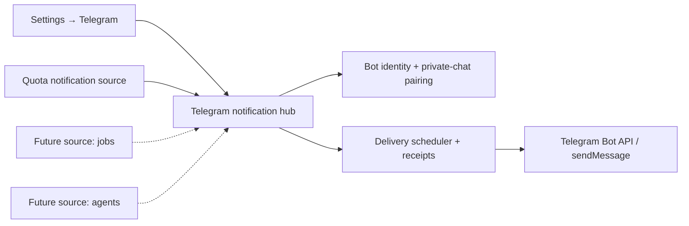

# OpenFork Telegram Notifications

**Status:** Feature integration underway; partial automated evidence, not yet a production-certified delivery service.
**Product surface:** Settings → Telegram.
**Owner:** Process-global OpenFork sidecar, not a user Session, quota panel, workspace instance, or LLM agent.

## Primary design invariant

**Telegram is a transport and notification destination. It is not a quota bot.**

The Telegram platform owns one user-configured bot, one authenticated private chat, one opt-in master switch, one delivery scheduler/receipt ledger, and one Settings tab. Sources are independently registered sub-services. The first is `quota`, but quota must never own the shared Telegram credential, destination, deep-link pairing, update offset, or delivery mechanics.

Future sources might include:
- Agent-run or Goal lifecycle events
- Session-provider outages or recovery
- Build/test failures
- Task deadlines
- Background job completion
- System or hardware events
- Repository/CI activity

These are **examples, not implemented integrations**. Each must be explicitly registered and individually enabled. No arbitrary model-produced message can implicitly activate a source.

## Architecture

### Repository ownership

- `packages/opencode/src/notification/telegram/index.ts`: process-global service construction and source registration.
- `packages/opencode/src/notification/telegram/hub.ts`: generic bot configuration, pairing, delivery schedule and duplicate suppression, with the source interface.
- `packages/opencode/src/notification/telegram/quota-source.ts`: **quota-only** subscription/configuration, authoritative reset agenda consumption, time-window verification, and notification intents.
- `packages/opencode/src/quota/telegram-reset-policy.ts`: pure, testable reset matching and verification.
- `packages/opencode/src/quota/telegram-bot-api.ts`: bounded, narrowly scoped HTTPS Bot API transport (should ultimately move under `notification/telegram`).
- `packages/opencode/src/server/routes/instance/httpapi/groups/telegram.ts`: channel-wide control API and the first source-specific settings endpoint.
- `packages/app/src/components/settings-v2/telegram.tsx`: a Telegram **Settings tab** using standard dense Settings components. Bot connection/status, delivery master switch, Services collection, and quota controls coexist on this tab.

### Extensibility contract

Source interface (in `hub.ts`):
- `id`: stable namespaced source key; unique across the registration set.
- `title`: UI-facing source name.
- `initialize()`: read own source-state lazily.
- `active()`: whether the source is independently opted in.
- `collect(now)`: return an array of semantic `{id,text}` intents. Zero means no event. A source cannot see bot token, recipient/chat ID, pairing details, or network credentials.
- `clear()`: remove own pending user configuration when Telegram disconnects.

Registration belongs to the process-global notification composition root. New source authors do not copy or fork the Telegram transport, do not create new bot instances, and do not add another timer. A future improvement should move UI metadata/forms behind a source-settings descriptor, rather than requiring hand-editing a monolithic Settings component for every new source.

## Telegram setup and Settings design

The Settings tab has these sections:

1. **Connection** — bot token from BotFather (one-time submission), sanitized bot username and health, verified chat pairing via single-use private `/start <nonce>` deep link, rotation/disconnect.
2. **Delivery** — global opt-in, last send/last error, one-message test, server-online limitation.
3. **Notification services** — list of independently registered sources, their enabled state and settings panels.
4. **Quota resets** — first source, opt-in, provider/account/model/window subscriptions, currently known deadlines, and confirmation/uncertainty language.

Do not call the whole tab `Telegram quota`, place account toggles in bot credential setup, or require quota registration to test generic bot connectivity.

`/global/telegram` is the channel API. Source-specific settings are subordinate paths such as `/global/telegram/services/quota`. Avoid `/global/telegram-quota` and avoid embedding provider IDs into the generic transport API.

## Trust and correctness

- Pairing nonce must be high-entropy, short lived, one-use, and checked only against a `private` Telegram chat. Telegram documents `start` deep links with up to 64 base64url characters. No webhook is necessary, and no Telegram inbound command may execute OpenFork tools.
- Bot credentials are a bearer secret; never expose in GET status, log/trace stack, UI, persistent event payload, URL or notification.
- Existing OpenFork Auth uses a mode-0600 local JSON credential vault; **this is not OS-backed encryption**. OS-protected credential storage is a security hardening gate before describing the implementation as encrypted at rest.
- Telegram messages are not end-to-end encrypted. Opt-in is explicit and account labels should be disclosed before delivery.
- A scheduled quota reset is not a proven replenishment. The quota source requires post-deadline provider-reported new-window evidence before emitting \"quota reset confirmed\".
- Delivery receipts are namespaced by chat/source/event. Bot API does not offer a general idempotent send key, so network timeouts create an at-most-once-vs-possible-loss tradeoff. Current model favors duplicate suppression. Document last-error and make outcomes inspectable.
- Only one sidecar process should own the monitor; a PID-file lock is an interim solution and is not a certified transactional lease. Test crashes, PID reuse, re-entrant enable/disable, concurrent sidecars, stale lock replacement and shutdown cleanup.
- Keep Telegram strictly outbound outside pairing. One timer for all sources; disabled must mean **zero Telegram polls and zero source polling**.
- Never bootstrap workspace execution to read global notification settings. Treat it as Tier 0, independently authenticated.
- Notification sources must be isolated: one provider failure must not block future independent sources. Bound per-cycle source collection and delivery; supply backoff on Telegram 429.
- Subscription identity must use stable account IDs, not disambiguated display labels.

## Evidence and remaining gates

Pure quota policy: 6 passing tests. Minimal Telegram Bot API transport: 5 passing tests. Quota selection presentation: 3 passing tests. Integration-wide type checking, real private-chat pairing and send testing, crash recovery, secure secret storage and multi-process ownership remain separate production gates; no successful Telegram delivery has been claimed.

Official Telegram Bot API: https://core.telegram.org/bots/api
Telegram bot deep-linking: https://core.telegram.org/bots/features#deep-linking
