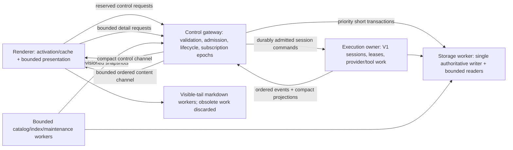

# OpenFork performance regression investigation and priority architecture

Date: October 1, 2026. Investigation window: September 24–October 1, with September 20–22 changes included where they establish the affected architecture. Times in prose are America/Chicago (UTC−5); artifact timestamps use UTC.

Status: **implementation goal remains active; full-application timeline/startup gates remain open**. The isolated production Markdown renderer gate now passes its hidden/reveal, dense-code, oversized text/code, and 1/3/6 tail cases; this does not close the separate full-app ResizeObserver/layout and packaged cold-start gaps. The October 2 current-source closeout below supersedes historical pending checks only for the listed slices. The running development application has not been refreshed by this campaign. Whole-renderer closure still requires reconciling the earlier multi-second native layout observations separately from the corrected HTTP/1.1 fixture starvation.

The active goal now also includes a recurring differential audit of upstream OpenCode performance reports: use reported symptoms to find equivalent current OpenFork ownership paths, patch only defects reproduced in this fork, and add a negative ownership invariant plus production-shaped validation. Track each upstream report and its evidence in [the October 3 crosswalk](./investigation-2026-10-01/upstream-issue-crosswalk-2026-10-03.md). Upstream issue status and source are leads; they do not establish that OpenFork has the same defect. The latest sweep added #41078 (large provider catalog gating retained TUI first content) and #52271 (background-service retry/startup delay). The TUI is outside OpenFork's product surface, and no matching catalog gate was found in the default desktop; packaged cold-start remains a separate unmeasured path. The upstream retry loop was not found in OpenFork's default V1 sidecar path.

### Handoff reconciliation

The latest handoff reports green Core/App/Desktop/Opencode typechecks and the focused source aggregate recorded below. Inspection confirms the native gate now uses `createDesktopFetch` through preload IPC and separate production admission/control Electron sessions, and that heavy analytics use the Database-scoped lazy `scanDb()` owner. The diagnostic module-probe error window is no longer present; the current probe script passes `node --check`. No running application or swarm was stopped or restarted during reconciliation.

Qualification: the native gate records frame gaps and tail convergence, but does not currently assert a bounded background DOM/layout commit. Its corrected transport topology resolves the sixth-admission socket-pool failure; that alone cannot establish that the earlier 2.8–4.1-second native renderer layout stalls are eliminated. The completed-history DOM identity and reserved Shiki-lane tests establish useful structural invariants for streaming updates, while initial large-history DOM materialization remains a separate evidence question.

That specific cold-mount path has since been repaired: browser mounts begin with an empty result, gate parsing and DOM reconciliation on shared visibility ownership, and use bounded cooperative commits for large content. The production Markdown Electron gate now passes the hidden-mount/reveal, oversized block, exact-copy, bounded-frame, and teardown cases. Full-app ResizeObserver warnings and long frames remain a separate timeline/virtualizer issue; see the current upstream crosswalk and renderer ledger rather than treating Markdown mount as still open.

Further acquisition audit found that a failed/interrupted `scanDb()` initialization could retain its partially opened worker in the Database lifetime until teardown. Acquisition now stages each candidate in a child scope, closes that scope on failure/interruption, and transfers successful cleanup to the Database owner. Fresh reader/scan checks pass **4 tests / 29 assertions**, including six concurrent cold requests returning the same connection and surviving short caller scopes. The live-port isolation helper now explicitly rejects port 5173 even if an ephemeral reservation returns it; its actual Vite binding/cache test passes **1 test / 8 assertions**.

Fresh reconciliation checks: Core typecheck now passes after explicitly classifying `session.next.input.completed` as input-owner state with no conversation-history mutation; focused input/history checks pass 9 tests / 38 assertions. App and Opencode typechecks pass after canonical swarm model-requirements and narrow test-service dependency repairs; five targeted HTTP suites pass 55 tests / 202 assertions. The registry inventory expectation now includes the already-defined and dispatched `refactor` capability; the full registry suite passes 37 tests / 168 assertions. These results qualify, rather than overwrite, the earlier handoff.

Global bootstrap now fails at its owning global surface instead of falling back to instance APIs when global path/project endpoints fail. Its negative gates pass 25 tests / 61 assertions, proving zero fallback calls on missing metadata and 404/405/503 responses. Workspace routing decodes only encoded caller headers, preserves literal percent sequences in durable/query-decoded locations, and rejects relative directories before instance loading; routing/context suites pass 20 tests / 59 assertions. Canonical unified SDK regeneration passes. Successful scan acquisition and publication into the Database cache are interruption-atomic, while opening/configuration remain interruptible.

Electron fixture isolation is also being tightened: effective `userData`, `sessionData`, logs and crash paths must be run-owned and verified before readiness. Chromium cache belongs under `sessionData`; `cache` is not a supported Electron path name. Profile negative tests pass 2 tests / 14 assertions, and Desktop typecheck passes. SDK gate entrypoints now undergo a built-CJS syntax preflight. New renderer and full-app fixtures have not yet been launched at this entry.

Renderer acceptance review additionally found that a byte-bounded rich block is not a frame budget: several template parses or sanitize continuations could run in the same turn, and subthreshold highlighted code could synchronously materialize thousands of token nodes. Exact owner-key disposal also missed nested paragraph parse keys. Other rejected closeout conditions include silently dropping capacity subscribers after 64 waiters, empty text tasks making no progress, and rebuilding every remaining visibility observer target on each dense teardown. These are active repair requirements, with queue/source convergence and actual cold dense-code frame timing required alongside DOM identity. The full-app gate likewise requires a fresh tail marker and idle convergence for each 1/3/6 cycle; old text from an earlier scenario cannot satisfy later streaming assertions.

## October 2 continuation — implementation remains active

The goal resumed after the previous run reached its usage limit. Current source and fresh checks, rather than earlier agent completion messages, remain the evidence for acceptance.

- Selected-provider initialization now follows the location-owned Provider snapshot -> selected provider materializer -> model/SDK resolution -> prompt path. The reverse demand carries the selected provider identity; it no longer requests every plugin model/auth/custom loader or unconditional TypeSafe metadata. Baseline metadata reads the cached/bundled models.dev projection. Explicit runtime `Provider.list()` remains the all-provider operation. A per-provider permit shares successful initialization and allows retry after interruption/failure; a permanent cached interrupted exit would poison subsequent prompts. Later provider materializations revise the catalog contribution, while repeated reads do not republish unchanged state. Mandatory config/plugin construction remains shared and is still an open performance gate.
- The selected-provider negative gate passes 48 assertions across 1/3/6 requests: selected model/language resolution completes while unrelated model/auth/catalog callbacks remain uninvoked, with config name/options/variants/filter parity and one base initialization. Wider parity checks exposed and corrected detached model mutation in anonymous Zen and deferred allowlist filtering. Full-suite final rerun and interruption-specific checks remain pending at this entry; no first-prompt closure is claimed.
- Fresh final provider parity rerun: **122 passed / 373 assertions**, with the allowlist and anonymous hosted pricing cases green. Additional held-hook tests prove one initialization for 1/3/6 same-provider callers; interrupted initialization retries successfully instead of caching cancellation (2 focused tests / 16 assertions). Opencode typecheck is clean. Cold metadata-cache population and TypeSafe-specific metadata coverage remain under review; these checks do not prove the complete packaged first-prompt path.
- Further producer removal: the Provider base no longer normalizes and JSON-copies every models.dev provider before a selected prompt. Location-owned memoized projections normalize/copy only demanded providers; environment eligibility scans shallow provider metadata. A deliberately unreadable unrelated model catalog now remains unread across selected 1/3/6 requests. Wider parity rerun: **124 passed / 389 assertions**. Additional cold-selected and TypeSafe-specific tests each pass 11 assertions: disabled selection performs zero catalog fetches, six cold callers share one selected metadata resolution, unrelated execution performs zero decision-metadata reads, and TypeSafe 1/3/6 demands share one decision projection without populating the language catalog.
- ModelsDev construction now reads disk/bundle without outbound fetch. An explicit selected demand may populate an entirely empty catalog once; a miss in a nonempty catalog stays a normal miss. Cold population rechecks disk under the cross-process lock and refreshes the cached snapshot. Its successful result is memoized under one permit; interrupted/failed fetch exits are not cached permanently. Fresh owner tests: 2 passed / 15 assertions, including interrupted first request followed by successful retry; Core typecheck passes. Periodic network refresh begins after the five-minute TTL rather than service construction.
- Provider catalog contribution revisions no longer await transient event listeners in selected execution. The owner commits the redacted projection synchronously and sends coalesced location revisions through one scoped worker; snapshots/pending notifications are capped at 32 locations and revisions stay monotonic across eviction/re-entry. An actual Provider.getModel gate progresses at 1/3/6 concurrency while a catalog-update listener is blocked; the final revision converges after release. Contribution/T3 suite: 4 passed / 38 assertions. Notification interruption remains interruption, preventing teardown from recovering cancellation into more publication work.
- Active Permission/Question responses now route through an exact process-owned request/session/directory handle into the authoritative V1 owner, bypassing workspace construction. Owner state and waiting Deferred settle before transient response notifications enter a bounded scoped worker. The agent's real HTTP 1/3/6 gate reports zero InstanceStore loads, with blocked response-listener gates for both services. Durable permission-policy ordering is retained. Queue saturation can drop transient notifications and remains a reconciliation limitation. Canonical unified SDK regeneration completed successfully after a transient Windows write failure; generated session-path/SSE verification passed 18 tests / 129 assertions.
- The broader 147-test Permission/Question/session-HTTP run passed 143 and exposed four failures: two attribution tests assumed synchronous transient notification delivery (now corrected with actual event barriers), and two session creation/listing tests exposed raw directory persistence. `Session.createForLocation` now resolves the explicit location at the authoritative producer, preserving canonical directory identity previously supplied by InstanceStore. Equivalent trailing hints and the Windows global-worktree sentinel now pass their focused real HTTP checks (2 tests / 9 assertions). No implicit workspace runtime or missing-location cwd fallback was introduced. Attribution, literal-percent location, overflow recovery, and wider post-fix reruns remain in progress.

- October 2 first-project reload error: the live installed app logs identify `GlobalHttpApi.sessionStatus` failing with `Service not found: @opencode/v2/SessionExecutionOwner` (references `err_d40d8d03`, `err_b02e71c1`, `err_8b72a390`). The second failure immediately follows first initialization of webseal; the same failure occurs on other cold projects. The served HTTP app graph omitted `SessionExecutionOwner.node`, while cancellation routes and test harnesses supplied it separately. The production graph now explicitly owns that process-global service. Global status handlers capture execution/status owners during construction, making omissions fail at graph construction instead of first-project bootstrap. A standalone production-route test deliberately supplies no outer execution-owner node; global and cold-directory reads pass at concurrency 1/3/6. A separate blocked-Instance test proves all ten cold-directory requests succeed with **zero InstanceStore.load calls**. Fresh targeted result: 2 tests, 24 assertions. The installed application has not been rebuilt/restarted; these are source and isolated real-HTTP results, not a claim that the running old binary has changed.
- End-to-end error path: durable execution leases + process-global SessionStatus -> execution/status owners -> authorization-only `/session/status` -> unified SDK bootstrap request -> directory bootstrap error aggregation -> `Failed to reload <project>` toast. Reverse demand is first-project/new-session bootstrap requesting a compact working-session map; it requires no plugin/tool/provider initialization, message history, or workspace Instance. The original defect was dependency ownership, not a reason to suppress the toast or add retries. Existing handler-unit mocks had concealed the production graph omission; the new standalone graph test catches that class of defect.
- Attribution limit: the execution-owner status projection is an uncommitted working-tree addition, absent from `HEAD`'s global handler. The installed runtime error confirms that projection exists in the deployed development artifact, but Git cannot assign this wiring omission to a committed change from the earlier week. This defect is a campaign wiring regression, not evidence that all original symptoms share this cause. Fresh wider root/global/replay/fence/ownership HTTP suite: **56 passed, 224 assertions**. Its first run exposed an older fixture still mocking Session root census instead of supplying durable Database ownership; supplying the actual narrow database owner repaired the fixture without changing production census behavior.
- V1 creation has now been promoted to the urgent transport lane only after its real HTTP 1/3/6 zero-Instance admission test passed. Runtime prompt admission and retained current `/api/session` creation remain in the separate admission pool. Fresh actual Electron production IPC gate: six prompt admissions held at the peer while urgent interest completes in **6.62 ms** and V1 creation transport completes in **3.02 ms**; trust rejection and all six aborts still pass. This is actual IPC/network isolation against a private peer, paired with separate real-domain HTTP ownership proof, not an integrated native production-sidecar timing claim. App/desktop transport tests: 8 passed, 59 assertions.
- Canonical unified SDK regeneration including SessionCreateApi now passes. Two immediate format attempts hit transient Windows file-open errors; the final complete build succeeds. A new actual generated-client contract test confirms global session lookup, V1 session lookup and message-detail requests substitute session identity before reaching fetch. Package typecheck currently has only the in-progress Electron real-HTTP fixture's unknown service-environment and optional-ID diagnostics; the production graph and updated global handler harness diagnostics are resolved.
- Integrated Electron fixture now passes through actual `Session.Service` producers, EventV2Bridge and production `HttpApiApp.routes`, unified SDK/SSE, ServerSync/session stores and visible Markdown. All 1/3/6 tails converge; interest acknowledgements, offset-gap repair and zero-root teardown pass. The real test observed 18 SSE frames. Combined real-server and fake-peer Electron gates: **2 passed, 25 assertions**. The fake peer separately proves cursor reconnect and first-repair-503 recovery. This is an isolated Bun HTTP domain runtime, not the native packaged sidecar executable or provider processor. The placeholder-session request observed during bring-up was a fixture missing its seeded-ID environment variable and is resolved; the earlier speculation about client serialization was not confirmed. Fresh App and Desktop typechecks pass. Opencode typecheck passed after the fixture correction, then the next permission/question owner slice introduced temporary in-progress diagnostics; no full-campaign typecheck closeout is claimed while that slice is being completed.
- T3 account catalog parity now has a mocked Console HTTP integration through the authoritative credential resolver, shared account transforms and projection owner. Exact account aliases/defaults/connected sets/filtering/redaction, committed credential changes, withdrawal, failed-fetch partial status and bounded-backoff retry pass (26 assertions). One secret-free bounded credential change observer invalidates known location projections; full prompt execution independence remains a separate gate.
- Optional sharing now resolves model metadata in its background flush owner, with one active flush per session and convergent scope teardown. The shared-prompt test holds model lookup while two publications finish, then verifies both wire batches and no internal `model_request` leakage. Unshared session/message/part/diff observers now defer structured copying until an actual share exists; repeated live content must not pay sharing-copy cost for an unshared session. Complete suite after lazy-copy change: **10 passed, 45 assertions**.

- Reserved-tail Markdown now has an actual Electron production-component stress result: an 8 MiB background parse remains active for roughly 12–13 seconds while the selected tail commits in 4–21 ms and completes projection/parsing in 19–39 ms in 1/3/6-component scenarios. This proves one selected tail's independence; all concurrent visible tails, visibility transitions, oversized fallback and stream-store integration are being extended. The attempted 16 MiB fixture exited Electron with a generic error of unresolved origin; no full renderer closure is claimed.
- V1 abort is mounted outside InstanceContext middleware. Durable location/producer checks and execution-generation fencing precede matching local Runner cancellation. The route test verifies zero InstanceStore.load calls; RunState 1/3/6-handle and stale-generation tests pass. BackgroundJob-only cancellation and job-admission interleavings remain under correction.
- Provider GET is split from runtime actions and uses a deliberate global or explicit absolute-directory projection. It remains incomplete until configured models/defaults/connected behavior, account-model projections, and selected-provider execution initialization are validated. Session creation still crossed full Instance middleware on inspection and is now an explicit remaining admission fix.
- Fresh root checks: Core and App typechecks pass; real HTTP live-detail recovery passes (1 test, 4 assertions). Combined app session/bootstrap/child-store/catalog-event checks pass (123 tests, 324 assertions). Canonical unified SDK build passes after serial regeneration, but Opencode typecheck remains red because the provider list operation identifier currently generates a different SDK method; the owning agent is correcting the identifier while retaining a distinct route group. Two earlier build attempts encountered concurrent-generation signature patching and a transient Windows file-open error; no partial generator output is accepted as a successful build. The SSE signature patch now accepts its already-correct known form and still rejects an unknown form.
- Fresh actual Electron IPC/transport/native-worker checks pass (2 tests, 13 assertions): urgent IPC completes in 8.54 ms with six admissions still held, untrusted renderer dispatch rejected, all six held admissions aborted. Ordinary HTTP saturation leaves separate control at 8.53 ms; fake SSE 1/3/6 streams retain expected byte totals. Heavy native SQL takes 382 ms with 29 parent heartbeats. The separate native Node transaction/interruption/value fixture also passes. These fixtures use private test peers and do not prove the integrated production domain path.
- Periodic WAL checkpointing now uses a database-owned, separately acquired maintenance connection with zero busy timeout instead of the foreground connection permit. In-memory storage skips this file work. Fresh regression tests prove checkpoint completion while the foreground writer remains reserved and preserve rollback state; combined checkpoint/quiet-gate tests: 3 passed, 5 assertions. This isolates checkpoint admission, not SQLite's shared single-writer lock or every maintenance transaction.
- ShareNext's inline MessageUpdated observer previously called provider.getModel for a worker prompt even when no share existed. It now checks the share owner before that optional model projection. The actual integration test proves an unshared human prompt invokes zero model lookups; complete ShareNext suite: 9 passed, 40 assertions with the configured 30-second fixture timeout. An earlier default-five-second run timed out in the existing host-continuation test; that exact case passed in 1.24 seconds on rerun. Shared-session model sync semantics are retained; broader inline plugin/event callback CPU isolation remains open.
- Provider SDK review found a second wiring defect: the served ProviderCatalogApi was absent from canonical OpenCodeHttpApi, so a successful generator run omitted provider.list entirely. The canonical graph now includes the distinct providerCatalog group and provider.list operation; regeneration and fresh typecheck are in progress. Earlier API-drift diagnostics are not yet recorded as resolved.
- Canonical graph correction is now regenerated and verified. PublicApi OpenAPI suite: 19 passed, 230 assertions, including a new negative invariant retaining provider.list and its optional explicit-directory query. Cold schema generation takes 5.2 seconds here; the first default-five-second targeted run timed out, so that schema test uses a 30-second fixture allowance. Fresh Opencode typecheck now reports only an in-progress provider route test's unknown-to-string narrowing error; generated provider method/type drift is resolved.
- Expanded actual Electron production Markdown + createServerSession gate passes: all 1/3/6 visible tails progress while the 8 MiB background parser stays active for 13–16 seconds. Tail projection/parsing completes in 30.8/42.8/72.6 ms; maximum six-tail reserved-lane wait is 61 ms. Tests include activation without router/tab changes, six-session interest, held offset-gap repair, viewport background/tail reprioritization, obsolete generations, full oversized fallback output, and convergent teardown. Desktop typecheck and seven admission checks pass. Events/pages remain a mock V1 producer, so actual SDK SSE transport and real domain sidecar integration remain open and are the next fixture extension.
- October 2 native-sidecar closure supersedes the fixture limitation above. The gate now launches the current Node sidecar artifact and Electron renderer, but routes desktop control/admission traffic through the production `createDesktopFetch` -> preload IPC -> `createSidecarControlTransport` topology instead of raw Chromium fetch. The earlier 6-session failure was reproduced as a fixture-only HTTP/1.1 pool artifact: one long-lived SSE request plus five raw renderer POSTs exhausted Chromium's six per-origin sockets and queued the sixth POST client-side. With the production transport, 1/3/6 prompt admissions all reach the model and return 204, all tails converge in the store/DOM, exactly one SSE connection remains open, and the fixture records 10 admission-lane requests. A deliberately overlapping urgent interest POST succeeds in every scenario while admissions are active; this proves the control lane is not sharing the renderer SSE/admission socket pool. The current native gate passes 12 assertions and leaves zero model requests pending. Scratch fixture directories are ignored and still explicitly cleaned by the test.
- Cancellation closeout now generation-fences both the HTTP owner and in-process V1 stop path. A stale expected-generation abort returns `false` instead of falsely reporting accepted cancellation; the legacy compatibility adapter rejects that result, and session rollback no longer proceeds after a swallowed interrupt failure. `SessionRunState.stopCurrent` supplies its registered local generation to durable interrupt ownership. Process-local `BackgroundJob` cancellation keeps an exact session admission fence across teardown and unrelated cancellation epochs, while saved handles remain generation-fenced across ID reuse. Focused BackgroundJob validation passes 8 tests / 414 assertions; the existing Core/V2 `/api/session/:id/interrupt` handler was rechecked and already delegates to `SessionV2.interrupt`, so no duplicate path was introduced.
- Markdown closure now proves block-granular reuse directly instead of inferring it from write counts. The Electron gate captures completed-history block DOM nodes before appending live tails and verifies object identity is preserved afterward at 1/3/6 visible sessions. Each open fenced JSON tail produces exactly one successful `highlight` worker completion on reserved lane 1 per session and rendered token spans in the Shiki code DOM. Latest-generation supersession, viewport background-to-tail reprioritization, held offset-gap repair, the 8 MiB background parser, oversized plaintext fallback, and zero-root teardown all remain in the same gate. Fresh result: 1 test / 27 assertions, green.
- Node SQLite packaging exposed a separate request-path tax: the Node adapter implements each `withBackfillDb` call as a fresh worker thread + evaluated worker source + `DatabaseSync` open/configure + close/terminate. A production-shaped CJS microbenchmark measured fresh open/query/close at 32.08 ms median (44.62 ms p95) versus 0.069 ms median (0.297 ms p95) for a query on a persistent worker, roughly 463x median setup overhead. `Database.Service` now owns a lazy `scanDb()` lane for heavy read-only analytics: no third worker is created at startup; the first file-backed use builds one query-only connection in the Database service scope, concurrent acquisition is serialized, later calls reuse it, and `:memory:` aliases the primary handle without installing `query_only`. Usage summary/model-profile and Zen-free history scans use this lane; writer-oriented search repair/backfills, retention, sealing and WAL maintenance retain their deliberately separate one-shot/background connections. File-backed reader/scan tests pass 3 tests / 22 assertions, including persistence across a short caller scope, query-only enforcement, independent progress while the primary permit is held, and safe `:memory:` aliasing.
- The repeatedly observed ~7 second first provider-test result is not evidence of a production provider-specific stall. Fresh-process runs show the same cold tax on unrelated provider tests and steady-state tests in the same process fall to roughly 0.4–0.5 seconds. Attribution is the test/runtime graph: per-test Effect layer construction, a large models.dev fixture parse, fresh temp Instance state, and process/module warm-up. The desktop V1 model/provider bootstrap now uses the standalone `ProviderCatalog` operation rather than runtime `Provider.list()`. Legacy full materialization remains on lower-priority compatibility/CLI surfaces, but the cold-test number itself requires no production provider rewrite.

Aggregate source verification is now complete in the current worktree; the consolidated results are recorded in the current-source closeout section below. Deployment evidence is intentionally still separate: the installed/running development application has not been rebuilt or restarted during this campaign, so do not infer that the currently running binary contains these source fixes. Event/coalescer and WAL-maintenance audits found no new foreground blocker; SQLite's shared single-writer fairness remains an accepted lower-level residual rather than a reason to move heavy analytics back onto the interactive reader.

Automatic review rejected cleanup of eight root fixture temp directories and three renderer-agent stale fixture directories as blocked by policy; agents left them untouched. New fixture-scoped cleanup succeeded. No alternate deletion path was attempted after rejection.

## October 2 closeout evidence — current source

The continuation above has now closed the production-facing gates that were still open in the October 1/early-October-2 entries. Historical measurements remain in place above; the statements below supersede earlier "still required" language for these exact slices.

- **Desktop transport / native sidecar:** the earlier six-session native fixture failure was a harness topology error, not proof that the production desktop transport still starved. The fixture declared a desktop Platform but sent prompt admission through raw renderer fetch, so one long-lived SSE request plus five prompt POSTs exhausted Chromium's six HTTP/1.1 same-origin connections and queued the sixth request client-side. The fixture now uses the production createDesktopFetch classifier, a sandboxed preload/IPC bridge, and production createSidecarControlTransport with separate Electron admission and urgent sessions. The real Node sidecar + Electron + generated SDK/SSE + visible Markdown gate passes 1/3/6 concurrent sessions: all ten prompt_async admissions return 204, every expected model start is observed, all tails render and stores converge, one SSE connection remains live, and an urgent interest mutation completes while admissions are active. The observed run recorded 10 admission-lane requests and 7 urgent/control-lane requests with exactly one SSE open.
- **Cancellation semantics:** V1 abort now distinguishes generation-CAS success from a stale request. A delayed abort that loses to a newer generation returns false, does not cancel automation, and the V1 compatibility adapter surfaces that failure instead of treating the request as accepted. SessionRunState.stopCurrent fences its durable interrupt with the locally registered generation, preventing an old local runner from writing cancellation intent onto a newer durable owner. The page rollback/revert path no longer swallows interrupt failure and continue-mutates a still-running session. Process-local BackgroundJob cancellation also retains an exact session admission fence through teardown and unrelated cancellation epochs, with generation-fenced saved handles across ID reuse. Fresh focused checks include RunState abort 13/13, stale HTTP abort 1/1, app compatibility 21/21, and BackgroundJob 8/8 with 414 assertions.
- **Provider cold-path attribution:** the historical ~6-8 second isolated Provider setup observations do not reproduce as a production provider-specific cost on current source. Fresh first-test runs show a process/test-layer warm-up premium plus repeated per-test Layer/temporary-directory/catalog fixture construction; the historical hosted-provider case now completes in subsecond time. The desktop/app model-picker path already reads the bootstrap-free ProviderCatalog (/provider on V1, current Catalog service on current protocol) rather than Provider.Service.list(). Full-materialization config.providers remains for retained TUI/ACP/CLI semantics and is a migration/parity follow-up, not a desktop startup blocker. Fresh selected-execution closure passes 3/3 tests / 64 assertions: unrelated cached catalogs remain unmaterialized, one/three/six selected callers coalesce on one held hook, and selected resolution does not wait for blocked unrelated provider setup. The focused ProviderCatalog suite passes 4/4 / 38 assertions. No broad Provider.list() rewrite is justified by the old test timing.
- **Markdown/render closure:** the production Markdown Electron gate now renders 27 top-level history blocks per visible session, includes fenced JSON/Shiki work, and runs 1/3/6 simultaneously visible tails while an 8 MiB background parse occupies the background worker. Every live fence dispatches one highlight job on reserved lane 1 (1/3/6 respectively); actual Shiki-styled spans are present; stale generations, interest/gap repair, viewport reprioritization, oversized plaintext fallback, and teardown remain covered. The gate captures the initial completed-block DOM nodes and proves object identity is preserved after the live suffix update, so completed history is not rewritten. Latest run: 1 test / 27 assertions passed in Electron 42.3.3; six-tail DOM commits were about 12 ms on that run while the background parse remained active. Timing remains evidence, not a brittle pass threshold.
- **SQLite analytical reads:** Node's worker-backed SQLite adapter was measured directly under a production-like Node CJS call shape. Twenty fresh worker/open/SELECT 1/close iterations had median **32.08 ms** and p95 **44.62 ms**; the same query on an already-open worker had median **0.069 ms**, about **463x** lower at the transport layer before query work. Usage.summary, Usage.modelProfile, and Zen-free snapshot scans no longer create a fresh withBackfillDb worker on each cache miss. Database now owns a lazy persistent, query-only scanDb lane: it allocates zero extra worker at startup, deduplicates first acquisition, isolates heavy scans from the latency-sensitive readDb, binds the native connection to the Database service lifetime via Layer.buildWithScope, and aliases :memory: to the primary handle without installing query_only. Fresh database reader/scan validation passes 3/3 with 22 assertions, including progress while the primary permit is held; Usage/Zen-free focused suites are green. The cross-process usage-watermark cache also passes 12/12 tests / 54 assertions, and Core package typecheck is green.
- **Verification qualification:** the current Core, App, Desktop, and Opencode package typechecks all pass on the shared live worktree after campaign-owned scratch probes and test-harness errors were removed/fixed. The final focused aggregate is also green: Core campaign suites 23/23 / 490 assertions, RunState cancellation 13/13, stale-abort HTTP 1/1 / 7 assertions, V1 compatibility 21/21 / 48 assertions, selected-provider execution 3/3 / 64 assertions, ProviderCatalog 4/4 / 38 assertions, native sidecar/Electron 1/1 / 12 assertions, and Markdown Electron 1/1 / 27 assertions. The stale-abort integration race has a scoped 15-second Effect-test allowance because cold fixture construction can exceed the generic five-second harness budget under concurrent load; its internal race joins remain independently bounded at two seconds. This verifies the current source, not every unrelated behavioral change in the heavily modified repository.

The implementation campaign still shares a heavily modified live worktree with other active projects, so this is a closure of the performance/correctness regression slices above, not a claim that every unrelated repository change is release-ready or that the user's installed app has been rebuilt/restarted.

## Active implementation goal — October 1, 2026

The user requested a new goal to comprehensively solve the identified regressions. The new persistent goal covers narrow catalog ownership, priority admission/activation/cancellation, ordered content and recovery, sidecar/storage isolation, producer publication, markdown/render work, and representative real Electron validation. Preserve V1/fork execution/API and V2 presentation; preserve unrelated dirty source. The earlier investigation goal was completed; this implementation goal remains active until the full fixes and verification are finished.

| Owner | Current implementation assignment | Status/evidence |
|---|---|---|
| `/root/control_priority` (GPT-6 Luna) | Latest-desired interest, critical activation/teardown admission, generation headers/POST, autonomous repair and hydration fallback | In progress; owns app context/helper/test files |
| `/root/server_ownership` (GPT-6 Luna) | Narrow Tier-2 catalog source/service/V1 adapter instead of broad runtime acquisition | In progress; owns catalog/service/routes/tests; preserve auth/account semantics |
| `/root/renderer_markdown` (GPT-6 Luna) | Shared markdown worker admission, visible-tail priority, supersession and bounded render work | In progress; owns session-ui workers/transports/tests |
| `/root` | Server interest generations, producer deadline, integration/storage/process isolation, verification and ledger | Initial server+producer patches below; isolation and Electron gates remain open |

Initial concrete changes:

- Shared stream-interest registry now accepts an optional monotonic generation, rejects old revisions and conflicting same-revision updates, preserves idempotent retries, and seeds reconnect registration from a generation header. The V1/fork interest endpoint returns current applied generation. This is a registry acknowledgement, **not** a content cursor/reconciliation barrier.
- V1 provider event consumption now arms a scoped flush alarm only while unpublished deltas exist. A silent provider cannot retain a small fragment indefinitely. Provider events and alarm flushes have one serial consumer, and interruption/completion flushes pending content and tears down the alarm.
- First targeted results: stream deadline tests 3 passed; interest registry tests 9 passed (including out-of-order/reconnect/idempotency/malformed-revision invariants). Unified SDK regenerated through its canonical build command. Processor integration suite is running; its first cold fixture hit its default five-second timeout, while subsequent cases passed. Attribution/rerun remains pending, not dismissed.

Further implementation progress:

- Client control patch and [control implementation ledger](./investigation-2026-10-01/implementation-control-ledger.md): critical activation/release, latest-desired transport, generation POST/header, and optional session hydration capability guard. Initial targeted app suite: 143 passed; app typecheck passed. Parent review found a superseded-generation retry could resend the same generation indefinitely; a correction/test is in progress before acceptance.
- Markdown patch and [renderer implementation ledger](./investigation-2026-10-01/implementation-renderer-ledger.md): one admission owner across parse/project/highlight/dispose and two affinity workers, shared viewport observer, live-tail priority, fairness and queue byte/count bounds. Initial session-ui suite: 256 passed; typecheck passed. Parent review flags lower-priority capacity eviction and oversized-visible-job handling as open correctness checks.
- Node SQLite adapter now delegates native open/prepare/execute/checkpoint/close to one worker per existing connection. The ordinary connection permit is scoped through asynchronous execution; transaction permit/ordering is preserved, and dispatched SQL settles before interruption may trigger rollback. Query CPU/lock waits no longer execute on the sidecar JS thread. The unused Node synchronous Drizzle layer was removed after source search found no consumer; EffectDrizzle remains authoritative. Worker RPC keeps the prepared-statement cache and BigInt/array/blob semantics, bounds outstanding requests, and closes idempotently. A separate reviewer is adding native Node transaction/interruption/heartbeat tests; this change is not yet accepted or packaged/Electron verified.
- Processor suite: 23 passed and one cold-fixture timeout at default five seconds; the exact failing case passed with the configured 30-second package timeout (6.33 seconds in the case). No processor assertion failed. Deadline mechanism tests remain 3 passed.
- Server typecheck passed. Core/opencode checks currently report a pre-existing `oxp-activity/retention.ts:82` generic error; opencode also reported incomplete Root API harnesses during catalog-group integration, being repaired by the owning agent. These checks are not recorded as passing.

Latest verification and review corrections:

- The latest-desired controller now rebases a rejected generation against the server acknowledgement instead of retrying the same revision. The focused app checks pass. Markdown admission now rejects a lower-priority incoming job instead of evicting queued live-tail work; oversized plaintext fallback yields between bounded escaping chunks.
- Desktop control requests now use an independently validated main-process IPC bridge and a separate ephemeral Electron network session. Ordinary renderer reads and remote-server traffic retain their existing transport. Transport tests and desktop typecheck pass; actual Electron isolation verification is in progress. See [transport ledger](./investigation-2026-10-01/implementation-transport-ledger.md).
- Native SQLite worker verification now passes under Node: parent heartbeat during heavy SQL, exact integer/blob/array values, shared close, transaction isolation/rollback, and interruption without leaking a write. Combined coalescer/native-worker suite: 17 passed, 313 assertions. The retention type error was repaired by retaining the existing branded invocation ID; Core typecheck passes. Actual Electron native-worker packaging remains to verify.
- The producer deadline and complete processor suite now pass together: **27 tests, 117 assertions**, using the package's configured 30-second fixture timeout. A gated provider remains silent after 50 fragments until publication is observed; that test proves deadline publication while the attempt is still running, observes the live producer prefix, and verifies transient-part teardown after completion.
- Live V1 text deltas are not durable until a part boundary. Recovery previously read only stored parts, so a still-running provider could have an absent prefix. A process-global borrowed-part registry now exposes detached producer snapshots only to explicit detail reads; provider input/export/history owners retain durable semantics. Offset-bearing deltas use UTF-16 positions, skip already-covered snapshot content, and trigger repair on gaps. Server and client coalescers preserve earliest offsets and treat gaps/mixed versions as barriers. Detail-route integration and final graph wiring remain under verification.
- Detail-route graph wiring is now fixed and the real HTTP recovery test passes: live producer prefix returned, durable history unchanged, and registry release restores stored-part reads. The app store test proves an offset gap autonomously repairs an already-visible session without tab activation, ignores already-covered snapshot overlap, and appends the next fragment once. Combined app session/catalog-revision checks: 100 passed, 227 assertions; app typecheck passes.
- Actual isolated Electron gate now passes (Electron 42.3.3 / Node 24.15 / Chromium 148): control fetch 8.08 ms with six ordinary requests still held, cancellation observed at the fake peer, mock stream bytes delivered at concurrency 1/3/6, and a 305.94 ms native SQLite query with 24 main-process heartbeats. This validates Electron transport/native-worker mechanisms, not real sidecar middleware, production IPC registration, actual model execution, or visible Markdown DOM. Visible renderer validation remains open.
- Catalog ownership review found a second startup gate in the client: directory provider queries were disabled until **all** auxiliary runtime/config requests finished. They now have independent explicit catalog demand and can start while path/LSP/reference work remains gated. A picker can request one directory catalog without bootstrapping its session index. Explicit directory catalogs no longer fall back to another global catalog when empty. Enrichment invalidates one scope/location query, coalesces revisions, survives a cold-fetch race, and permits retry after a failed refresh. Backend provider projection is still in progress, so this slice is not ready for a performance closeout.

Remaining major gates: full provider catalog narrowing; server control capacity and cancellation ownership; detail recovery route integration; priority writer admission and broader process isolation with leases/transactions preserved; markdown granularity under real visible load; actual Electron transport/native-worker and 1/3/6+ active-session comparisons. Unit mechanism tests do not close these gates. The live app/server has not been restarted.

## Active goal and investigation ledger

Updated at the user's request on October 1, 2026:

**Investigate the past week's OpenFork performance and correctness regressions comprehensively, identify measured causes and the changes that introduced them where evidence permits, and design an end-to-end priority architecture that prevents unrelated background work from blocking session admission, activation, cancellation, live streaming, and visible rendering. Use this document as the authoritative evidence, progress, and follow-up ledger.**

Acceptance criteria:

- Separate confirmed runtime measurements, reproducible source mechanisms, and unresolved hypotheses; distinguish installed artifacts from the dirty checkout.
- Trace each symptom from authoritative producer/storage through service, middleware, transport, client cache, and presentation, including the reverse demand path.
- Explain every relevant shared resource and where existing priority protection ends; identify work that should be removed before adding scheduling.
- Specify concrete control/execution/background owners and isolation at transport, server event loop, storage, event delivery, worker queues, and rendering.
- Require session-critical operations to progress while unrelated catalog/index/maintenance work is deliberately stalled. Include subscription acknowledgement and autonomous recovery without tab switching.
- Define 1/3/6+ active-session Electron verification and negative ownership invariants; do not close the regression using idle/unit results alone.
- Keep an upstream performance-issue differential as a recurring goal input: map relevant reports to OpenFork's active owner/path, classify each mechanism as present, absent, or unverified, and patch only after proving the corresponding OpenFork behavior and regression invariant.

Progress: initial live evidence, retained-log analysis, scheduler reproduction, focused test results, installed-asset fingerprints/excerpts, three reviewed GPT-6 Luna audits, the source-built Electron 1/3/6 full-app and Markdown gates, and the October 3 upstream issue differential are recorded below. The recurring upstream audit has now led to two source repairs: the V1 drain no longer reloads all legacy history per provider/tool cycle, and models.dev network fetches no longer hold the cross-process cache lock. Remaining proof includes long-history/provider-copy measurements, per-drain multi-tool query counts, renderer causal attribution, and exact stage attribution for the original installed-build stalls. The currently running installed binary has not been rebuilt/restarted.

The available goal tool supports status changes only, so this ledger records the revised investigation objective and its recurring upstream-issue differential. Completion of this investigation deliverable is separate from implementing its architecture or closing the performance incident.

### October 3 continuation — upstream sweep and projection reuse

The live Markdown Electron gate passed 1 test / 68 assertions, exercising visible 1/3/6 tails, dense token rendering, stable completed-history DOM nodes, hidden/offscreen suppression and re-entry, multi-megabyte plaintext and fenced-code reveal/copy, and zero-root teardown. At six sessions, max tail queue wait was 34.5 ms and max frame gap was 116.6 ms. This closes the isolated Markdown-renderer gate only; the full-app timeline/layout and packaged cold-start gates remain open.

The upstream #18136 differential found repeated `filterCompacted` work after the prior drain-scoped DB hydration repair. `makeDrainHistory` now memoizes the compacted ordering by durable projection revision and invalidates on each accepted session event or consistent reload. Its focused history suite passes 2 tests / 33 assertions, including same-array reuse between unchanged reads and a fresh projection after a part update. The whole Opencode typecheck was rerun and still reports diagnostics in unrelated dirty compatibility and capability-invocation tests; it reports none in the changed drain source or regression test. `git diff --check` passes for the touched files.

The latest upstream sweep classifies #52271 as a V2-only daemon-reuse symptom with no equivalent retry loop in OpenFork's default V1 desktop sidecar path. #41078 does match retained TUI startup, where catalog/config/agent/project reads gate its loaded state, but the TUI is explicitly outside the OpenFork product surface; the default desktop defers provider catalog demand. Its packaged cold-start timing is still not covered by the current fixture gate.

A broader GitHub issue search added two more candidates to the recurring differential. #20977 describes native file-watcher cost on huge Git-ignored workspaces; initial source inspection found that the root watcher passes static folder/glob exclusions but does not project arbitrary repository ignore rules into the native subscription. #25629 describes main-process stalls from repeated Electron-store serialization; OpenFork coalesced each persisted key for 120 ms and cached parsed stores, but each resulting `store-set` still serialized the complete store synchronously. The latter has now been patched at the IPC owner as recorded below; its live switch trace remains unmeasured.

The #25629 source audit confirmed the synchronous whole-file sink, so desktop IPC now batches renderer key updates by store for a fixed, bounded 32 ms window while mutating the cached value immediately. `store-delete`, `store-clear`, and app shutdown flush pending data first; the queue falls back to immediate writes at a bounded key/byte ceiling and retries failed disk writes. Its focused test passes 6 cases / 16 assertions, including 100 keys coalescing into one flush and a continuous stream that cannot defer persistence indefinitely. The live app was not restarted, so actual switch-path IPC counts and main-thread write durations remain unmeasured. The #20977 owner audit then confirmed the root watcher is reached on the active desktop V1 prompt path; a Git-aware native-pruning repair and adversarial fixture are now in progress.

### Delegation and recollection ledger

All three audits used GPT-6 Luna at the user's request. They made no production changes or app/server restarts. Their conclusions have been reviewed against source and live evidence; the main ledger owns the final qualifications.

| Agent | Audit artifact | Reviewed finding / remaining limit |
|---|---|---|
| `/root/server_ownership` | [Server ownership audit](./investigation-2026-10-01/server-ownership-audit.md) | Catalog reads cross broad ownership boundaries; previous V1 agent endpoint also used instance middleware, so relative regression cost remains unproven. SQLite handles share the sidecar event loop. |
| `/root/control_priority` | [Control priority audit](./investigation-2026-10-01/control-priority-audit.md) | Queued obsolete interest blocks new activation; no generation/cursor acknowledgement. Subsequent installed excerpts confirm these mechanisms and the repair retry code are shipped. Cached history must paint before live readiness is established. |
| `/root/renderer_markdown` | [Renderer/markdown audit](./investigation-2026-10-01/renderer-markdown-audit.md) | Independent transport queues share two CPU workers; current dense indicators differ from historical spinners. Corrected historical count to 12 animated rectangles per spinner, 24 per duplicated session; active current rendering remains unmeasured. |

Final review by `/root/control_priority`: [completion review](./investigation-2026-10-01/completion-review.md). Integrated cancellation accepted/completed semantics and a controlled cold/warm comparison of both catalog paths. Active-session interest-to-paint tracing remains a specified follow-up, not an executed closeout.

### Investigation delivery audit

| Requested outcome | Current evidence | Verdict |
|---|---|---|
| Create a persistent goal and use GPT-6 Luna subagents | Persistent goal record; three named audits and final review above | Delivered |
| Use this document as evidence/progress/delegation recollection ledger | Artifact index, delegation table, reviewed corrections, measurements and explicit follow-ups | Delivered |
| Comprehensive investigation of startup, session visibility, streaming, markdown and sidecar regressions | Sections 1–6: installed/live/log/source evidence and reproduced mechanisms; exact initial stall and active rendering attribution explicitly unresolved | Investigation delivered; incident not closed |
| Explain missing priority and propose the best architecture across the real path | Section 7: narrow owners, three work classes, gateway/execution/storage topology, transport reservations, epochs/cursors, cancellation semantics, fairness and renderer boundaries | Proposal delivered; not implemented |
| Make unresolved attribution and verification concrete | Section 7a discriminating experiments; section 8 implementation gates and actual-load negative invariants | Follow-up protocol delivered; experiments not represented as passing |

No request to patch/deploy the proposed architecture is inferred from this investigation request. The implementation sequence is proposed future work. In particular, the captured hidden window does not prove active-session performance, the three hydration failures remain failures, and no report section asserts that the user's symptoms have been fixed.

## Findings that matter first

The complaint has measurable support. The running installed build retained startup requests lasting **94–101 seconds**, and its own request scheduler recorded **74–97 seconds of queue wait** for unrelated background work. Session stream-interest bookkeeping waited **80.3 seconds**, then completed in at most **298 ms**. Cheap work is becoming slow because it waits behind slow work.

There is a renderer priority scheduler, but there is **no demonstrated end-to-end priority boundary**. It reserves capacity for requests classified `critical`; visible stream activation is classified `interactive`, and clearing stream interest is `background`. Its test explicitly requires that classification. Server execution, synchronous SQLite, graph initialization, transport delivery, and rendering have other shared resources the renderer scheduler cannot reserve.

Startup switches from the V1 agent catalog to `/api/agent` even when protocol detection selects V1; installed excerpts confirm that path. The current route constructs the broad location service graph to answer a catalog read. Today's `/api/agent` request took **93.6 seconds**. The previous V1 endpoint also crossed instance middleware. This establishes a slow affected path and a broad ownership boundary, but does **not** prove that the switch introduced a more expensive tier or identify which service consumed those 93.6 seconds.

Separate problems also exist: recurrent bootstrap/stream failures, a previously measured sidecar CPU hang, previously measured compositor saturation under large fan-out, recovery coupled to activation/hydration, and markdown work competing on the renderer. A single queue-size adjustment cannot repair all of them.

## 1. Evidence and scope

### Running build versus checkout

- Checkout HEAD: `b7930a2920`, September 29, 23:11 local. Most recent commits concern T3 compatibility and WakaTime; broader session/runtime/UI changes landed September 20–22.
- Initial diff summary: **527 files, 77,554 insertions, 40,607 deletions**. A later status snapshot counted 539 tracked dirty entries. These are snapshots of a shared changing checkout, not immutable build manifests.
- Running application: installed `OpenFork Dev.exe`, version `1.18.30`, packaged, main PID 1000, renderer PID 55784, sidecar utility PID 55828, sidecar `127.0.0.1:12328`.
- Installed `resources/app.asar`: September 30, 15:45:42 local. This is a filesystem timestamp, not proof of its Git revision or exact source contents.
- Development handshake named another launch/PIDs that had exited. It was not used to select the live backend. The installed app's initialization bridge supplied the connection for authenticated probes, with credentials kept inside the renderer.
- The running window was **hidden, with zero mounted timeline rows**, during the snapshot. It had 1,519 elements, 12 sidebar rows, zero spinners, and four animations. This is not the user's active streaming workload.

Evidence captured in [investigation-2026-10-01](./investigation-2026-10-01/):

| Artifact | What it establishes |
|---|---|
| `live-snapshot.json` / `.js` | Actual renderer resource durations, request scheduler counters, stream counters, and DOM/visibility census |
| `global-probe.json` / `.js` | Nine authenticated, direct Tier 0 reads against the actual sidecar |
| `log-summary.json` / `.mjs` | Counts and startup markers from retained logs for 50 run directories |
| `priority-repro.json` / `.ts` | Deterministic reproduction against the actual request scheduler implementation |
| `app-tests.log` | 134 passing tests, three failing hydration tests |
| `markdown-tests.log` | 43 passing parser/worker queue/transport tests |
| `build-fingerprint.json` / `.js` | SHA-256 hashes and sizes of installed main/renderer assets; fingerprints do not identify a Git revision |
| `build-excerpts.json` / `.js` | Installed current-first agent selection, stream repair retries, queued-interest serialization/classification, and broad location graph construction |

Historical evidence: [September 28 fan-out investigation](./2026-09-28-oxp-fanout-desktop-degradation.md). Its live A/B and CPU measurements are historical evidence, not measurements repeated today.

### Measurement limits

Resource Timing exposed duration and start time but not response timing/status for the cross-origin sidecar resources. `ttfb: null` is intentional; zero exposed response fields cannot support a TTFB or successful-response claim. Scheduler `serviceMs` is elapsed time after admission, including fetch, decode, and the scheduled callback; it is not server CPU time. Counters are cumulative and do not prove every operation overlapped.

The phase trace existed but was not enabled; its zero counters are not evidence of zero markdown/reducer work. Retained log counts can include intentional shutdowns and rotated/incomplete history. They are occurrences, not distinct bugs or failure-rate denominators.

## 2. Confirmed delay propagation

### Today’s startup/resource evidence

Launch at 13:14:01.664; sidecar ready at 13:14:04.264; loading task finished at 13:14:04.405. A renderer bootstrap failure appeared at 13:15:50.658. Shell readiness therefore did not mean functional workspace readiness.

| Operation | Resource elapsed | Scheduler max queue wait | Scheduler max service time |
|---|---:|---:|---:|
| Provider list `/provider` | 101,086.6 ms | 239.1 ms | 101,187.5 ms |
| Agent list `/api/agent` | 93,566.1 ms | 0 ms | 93,567.0 ms |
| Directory config | — | 96,731.4 ms | 615.9 ms |
| Session lists | — | 96,629.7 ms | 2,421.2 ms |
| Session telemetry | — | 93,302.9 ms | 1,070.5 ms |
| MCP list | — | 81,175.0 ms | 4.3 ms |
| MCP resources | — | 81,179.3 ms | 3.5 ms |
| Stream-interest updates | — | 80,322.7 ms | 298.2 ms |
| Commands | — | 78,389.5 ms | 2,785.8 ms |
| Session message pages | — | 76,895.7 ms | 176.2 ms |
| References | — | 74,030.2 ms | 7.0 ms |

Critical requests had a maximum queue wait of 1.7 ms in this captured run. That means the critical reserve did protect the requests assigned to it; it does not mean everything necessary to show a session had the right classification.

Unscheduled/global resources were also slow during startup: `/global/preferences` reached 92.1 seconds, `/api/skill` 93.6 seconds, and `/fork/usage` 76.2 seconds. Consequently, the client queue is a demonstrated amplifier, **not a sufficient explanation of the initiating stall**. Sidecar CPU, database locks, connection contention, and shared initialization need attribution during that stall.

After it settled, direct authenticated global health, identity, and preferences reads returned 200 in **2.4–7.2 ms** across three serial rounds. There is no evidence here of a permanent uniform delay imposed on every endpoint.

### Where priority exists now

`packages/app/src/utils/server-request-scheduler.ts` owns renderer finite-request admission. `server-sdk.tsx` creates it with total concurrency five and background concurrency two. One slot is reserved from noncritical traffic; foreground pressure reduces background admission. It records queue wait separately from service time and supports keyed promotion/cancellation of queued work.

Limitations:

1. The scheduler owns only calls explicitly sent through it. It is not a server-wide policy or a dedicated transport pool.
2. It cannot preempt an already running callback, synchronous server work, a SQLite native call, or bytes already queued to a connection.
3. Visible stream interest is `interactive`; empty interest is `background` (`server-sdk.tsx:720`).
4. `remoteInterestInflight` represents both a queued update and an admitted update. A newer visible interest cannot submit a replacement while the older promise remains pending. The existing scheduled closure also captures the older session set.
5. `createDirectoryBootstrapGate` serializes an entire directory's auxiliary wave. A slow dependency can postpone every later directory's auxiliary initialization.

The reproduction holds four interactive jobs, submits a visible-stream-interest job, then submits a critical prompt-admission job. Critical admission succeeds immediately; stream activation remains queued until a hold releases. This proves the classification gap independently of machine speed.

**Required behavior:** showing a session and requesting its live content are foreground control operations. Disposing/clearing interest is also control-plane work because it releases downstream work and resources. Neither should sit behind provider discovery.

## 3. Ownership and graph initialization

### Agent catalog: a concrete recent change

Authoritative facts: workspace/global agent configuration and the domain-owned resolved catalog. This is Tier 2 configuration metadata.

Current changed path:

```text
configuration -> current AgentV2 state
-> /api/agent + LocationMiddleware
-> LocationServiceMap.get(explicit directory)
-> compile the entire locationServices group
-> catalog response -> query cache -> startup/Agent Studio/composer
```

Reverse demand: opening a workspace or needing agent choices enables `loadAgentsQuery`; the uncommitted implementation deliberately prefers the current route on V1 because it returns richer system-prompt information. Before this diff, the V1 branch called `legacy.app.agents()`.

`packages/core/src/location-services.ts` groups agents with plugins, catalog/AISDK, integrations, filesystem/index/watchers, PTY, tools, snapshot/checkpoint, session runner/model, auditors, and other services. `LayerNode.compile` flattens and composes that group, and the location map retains the graph for up to 60 minutes of idle time. Individual services may defer portions of their implementation, but the graph acquisition still covers far more than the agent catalog owner.

This violates the intended narrow catalog boundary and unnecessarily exercises the current runtime from V1 startup. Fix the owning projection: give V1 consumers the needed resolved agent facts through a narrow fork-owned Tier 2 owner. Share authoritative config/catalog logic where appropriate; do not use rich current-runtime bootstrap as the price of one extra UI field.

### Provider catalog: another blocking owner

```text
provider configuration/auth/catalog/discovery
-> Provider service
-> /provider + WorkspaceRoutingMiddleware + InstanceContextMiddleware
-> InstanceStore.load -> project discovery + InstanceBootstrap.gate
-> config + plugin initialization + tool reload
-> detached workspace warmup
-> provider response -> client catalog query -> model selectors/composer
```

Reverse demand: a consumer asks for model choices; the route's group-level middleware materializes execution ownership first. Plugin initialization can perform dependency preparation and external hook initialization. Provider loaders can perform discovery. The 101-second request demands per-stage profiling; neither a small response nor a background classification makes it cheap.

Correct boundary: scoped, resolved provider catalog owned by a Tier 2 service. Serve a truthful materialized snapshot and revision; refresh discovery as bounded owner work. Execution-only services and plugin tool/watch startup belong to an explicit Tier 3 execution request. A missing catalog entry needed for execution gets a specific resolution operation, not a forced whole-catalog refresh on every prompt.

### Remaining implicit location risk

`packages/server/src/location.ts` still falls back to `process.cwd()` when neither location query nor directory header is supplied, then calls the location service map. This is an architecture defect regardless of whether the inspected agent request supplied its directory. Today's agent request is not evidence that this particular fallback ran.

Require explicit or session-derived location for Tier 2/3 work. Tier 0/1 reads must use the durable/global owner directly. Do not probe this defect by intentionally creating more instances.

## 4. Session starts but does not appear until tab navigation

Backend truth is session execution/status plus durable messages. The producer emits lifecycle/content events; the transport filters content by foreground interest; `ServerSession` reduces admitted events; the timeline model controls activation and hydration.

```text
V1 execution/messages -> event bridge/replay -> global stream + interest control
-> SSE reader interest/visibility gate -> bounded renderer queue
-> ServerSession cache -> timeline projection -> virtualized rows -> markdown
```

Reverse demand: route activation calls `resume(sessionID)`, advertises interest, hydrates initial history if missing, and repairs a stale cache if known content was dropped. Tab switching can repeat activation or history reads, making already-produced backend output visible without proving the backend started again.

Two plausible mechanisms need separate reproduction:

- interest registration is delayed or stranded, so the producer runs while the foreground has not subscribed to its content;
- a content gap/hydration failure leaves the cache stale/suspended, and activation retries the repair.

Current uncommitted source adds repair retries with exponential backoff and activation-triggered `repairStreamContent`. Its comment describes the former failure: a failed repair left the timeline stale until a tab revisit recreated the resource. Installed asset excerpts confirm both the retry loop and activation repair are shipped. They also confirm queued-interest serialization and interactive/background classification remain. The symptom therefore cannot be explained solely by missing repair code; whether retries execute successfully under the failing workload remains unmeasured.

The current hydration tests also have three failures: split assistant turns, synthetic causal roots, and historical state-shaped rows. All throw at `typeof client.session.message` when the supplied client has no `session` object. This is a real failing fallback/capability guard in the tested current path, but the fixture shape alone does not prove that the installed generated client has that shape. Record it as an independently reproducible correctness issue, not the established cause of today's UI complaint.

Architectural repair: one activation owner with an epoch, explicit subscription acknowledgement/cursor, and snapshot reconciliation. Interest is latest-state control; history snapshots and live deltas converge through one owner. Failures must retry while the route remains active. Readiness must not depend on remounting, window focus, or another tab click.

## 5. Streaming and markdown

### Producer delta deadline and upstream bandwidth reports

The V1 producer now has an actual flush deadline. `SessionProcessor` buffers text/reasoning updates up to 2,048 code units, and `consumeWithFlushDeadline` arms one scoped alarm while unpublished content exists. Provider silence therefore flushes the pending prefix by the 32 ms deadline; events and lifecycle boundaries share the serial consumer, and teardown flushes remaining content. The mechanism is covered by `packages/opencode/test/session/stream-flush-deadline.test.ts` and is distinct from the downstream 16 ms SSE coalescer.

This closes the previously documented source gap, but does not by itself establish reduced total CPU or bandwidth. The live Electron gate currently proves one SSE and visible-tail convergence, not producer publish counts, serialized bytes, or DB/event work per provider token. Keep the upstream #14114 disposition as “bounded with impact unmeasured” until representative streaming captures those costs. The newer Core runner's immediate per-delta publisher is not the production execution path under OpenFork's V1-first runtime policy and should not be used to characterize the active application.

### Renderer work is independently paced

- SSE reduction: nominal visible flush interval 16 ms, hidden interval 1,000 ms, drain budget 6 ms.
- Message display: `createPacedValue` uses a 24 ms timer and staged catch-up for backlogs over 512 characters.
- Markdown projection/parsing/highlighting: two affinity-based worker lanes, with distinct transports and per-key latest-request replacement.
- DOM sanitization, morphing, decoration, row measurement, and compositor work remain renderer responsibilities.

These are distinct stages, not a proof of a constant total latency. Background suppression is useful, but foreground needs a maximum content-age target and immediate first content. Prefer rendering the latest accepted text at bounded frame cadence over manufacturing a long animated catch-up backlog. Worker parse, projection, and highlight requests need priority for the visible tail, cancellation for obsolete keys, and coherent aggregate worker admission; separate transports each having capacity are not a single shared worker budget.

43 markdown stream/queue/transport tests pass. They establish local correctness, not production Electron latency under 1/3/6 concurrent streams. No active markdown trace was captured today; claiming the parser is the primary current bottleneck would be unsupported.

### Historical renderer saturation and what changed

September 28's investigation measured 84 working sessions appearing twice in the sidebar, with 12 animated SVG rectangles per spinner: 2,016 animations. Removing those animations in a reversible live A/B raised frame rate from 4.4 to 34.4 fps and reduced long-task occupancy from 93% to 6%. The expensive work was mainly Blink/compositor, not reducer JavaScript.

Current source uses `DenseWorkingIndicator` in the chat sidebar, a narrower indicator with visibility-dependent animation. The old spinner problem cannot simply be asserted unchanged. Verify all repeated navigation surfaces and visible/off-screen behavior in the actual installed build. Historical limits-panel remount/history-scan findings also require checking the changed limits/telemetry implementation rather than reusing the old verdict.

## 6. Sidecar hangs, startup errors, and persistence

Retained September 24–October 1 logs contain **99 bootstrap-failure lines, 221 stream-failure lines, 33 SessionBusyError occurrences, and 12 SqlError occurrences** across 50 run directories. September 30's 15:57 launch alone has 87 bootstrap-failure lines. Logging often reports only `Unexpected server error`; that prevents attribution to a route/stage/database failure.

Startup timing is variable: today's 12:57 launch reached server ready in 2.40 seconds; the 13:04 development launch took 17.74 seconds; the installed 13:14 launch took 2.60 seconds. These launches differ in build/runtime/workload and are not a controlled before/after benchmark. Some launches have no ready marker.

September 28's historical investigation separately measured a sidecar with one core pinned, flat memory, zero I/O, no heartbeat, and HTTP timeouts. It also documented an orphaned sidecar holding execution leases after a user relaunch. The exact CPU loop remains unproven. Today's healthy Tier 0 probe does not close that failure.

The Node SQLite adapter runs synchronous `statement.all` on the sidecar thread. The database service sets a writer busy timeout of 5,000 ms and a reader timeout of 250 ms. A lock wait or expensive query can therefore block the event loop hosting request and stream control. Existing separate read handles and maintenance quiet gates help ownership but do not create event-loop isolation. A FIFO single-connection semaphore is not priority-aware database admission.

The current launch also logged an mDNS service-name collision and a missing tool-hot-reload source directory. Neither is proven responsible for the 94–101 second stall. WakaTime and T3 compatibility are recent changes worth including in bisection, but there is no measured causal attribution to either.

## 7. Architecture: make session priority real at every boundary

### Operating law

**A user action that admits, activates, steers, stops, or displays a session must not wait for unrelated catalog discovery, background hydration, indexing, maintenance, or cosmetic rendering.** Background means scheduling treatment, not session ownership: an agent running in another tab still owns required provider/tool/persistence work. Do not throttle its execution merely because its presentation is hidden.

There are three workload classes, with explicit owners:

| Class | Work | Admission and isolation |
|---|---|---|
| Session control | durable prompt admission, cancel/steer, activation/interest, lifecycle/permission/status, first visible snapshot | Reserved control transport and server budget; short transactions; no catalog/discovery dependency |
| Required session execution/content | provider runs, tools, ordered deltas, active detail history, tail projection | Per-session ordering and fair execution; bounded aggregate CPU/I/O; visible content has display priority |
| Optional/background projection | unused catalogs, previews, index refresh, usage aggregation, archival/maintenance, inactive decoration | Separate bounded queues/pools; cancellable latest-state work; bounded transactions; cached materialized projections |

### A. Narrow owners before queues

1. Durable session indexes/status/telemetry are Tier 0/1 projections. No Instance or full location graph.
2. Agent/provider choices are Tier 2 configuration projections. No execution, PTY, watcher, snapshot, or tool initialization simply to list choices.
3. Execution graph acquisition is Tier 3, attributable to a specific session/location/reason. Expensive capabilities initialize when actually requested.
4. Fix graph composition so a narrow catalog route asks for the narrow graph. Replacing consumer scheduling while retaining the broad graph would preserve the initiating defect.

### B. Separate control transport capacity from bulk traffic

Keep existing V1/fork HTTP contracts. Introduce explicit control, foreground-detail, and background clients/dispatchers with independently reserved connection capacity; verify this at the actual Electron fetch boundary. Merely constructing multiple SDK objects or using a second port in the same blocked process is insufficient.

Interest updates are versioned latest-state operations. Activation, replacement, and teardown must bypass catalog queues. A newer epoch supersedes a queued older update; an obsolete acknowledgement cannot mark the new epoch ready. The server acknowledges effective interest with epoch/cursor. Initial activation should advertise interest as part of establishing the content connection where practical, reducing the race with a separate registration call.

For events, preserve one process-wide compact control subscription and at most one shared visible-content subscription per server/window. Control carries lifecycle/status/permission and producer-owned summaries. Content carries selected-session deltas exactly once. No per-row/per-session subscription multiplication and no duplicate raw stream for summary derivation. Separate bounded queues and connections prevent content bytes already queued from sitting ahead of cancellation/status. A multiplexed transport is acceptable only if measured byte scheduling/control latency gives equivalent protection.

### C. Reserve server control execution, then isolate blocking work

Route classification belongs to the server, not an arbitrary client priority header. Give control requests a separate admission queue with bounded work and deadlines. Do not hold a control slot across provider discovery, plugin loading, broad history reads, or external I/O. Durable prompt admission returns an acknowledgement/input identity before waiting for execution completion; a session-local runner owns promotion and provider work.

CPU-heavy indexing/search/projection/discovery and untrusted plugin work need worker/process boundaries where synchronous code cannot stall the control event loop. Required execution also needs bounded CPU slices or isolation so a runaway session cannot freeze cancellation. Async concurrency alone does not create that boundary. Preserve one authoritative session/execution owner and durable lease semantics across any worker move.

Cancellation has two distinct acknowledgements. **Accepted** means the owner has recorded the cancellation intent for a specific run/epoch and will not admit further work for that run. **Completed** means provider consumption and owned child/tool work have stopped or reached a documented terminal boundary, final persistence has committed, and the lease has been released or fenced against late writes. The UI may show stopping after acceptance; it must not show a completed stop merely because the HTTP call returned. Retry the same cancellation identity idempotently. A stale worker must not resurrect a cancelled run. External side effects already committed cannot be undone by fencing; report incomplete/non-cooperative termination truthfully and use the existing recovery policy. Measure user-action-to-accepted and accepted-to-completed separately.

### D. Give storage its own priority boundary

Move synchronous SQLite execution off the control event loop behind a storage service. Preserve existing schema, transaction semantics, write ordering, and authoritative execution leases. Use a short-transaction priority writer queue for admission/lifecycle versus chunk maintenance; preserve fairness so required execution persists reliably. Keep bounded read workers/handles for history and bulk inspection. Background maintenance yields between chunks and never monopolizes the writer reservation.

Do not split authoritative session state into a second writable database as a shortcut. Separate connections alone cannot reserve SQLite's single writer or stop native blocking on the same JS thread. Cancellation does not undo a transaction already committed; acknowledgements must remain truthful.

### E. Make rendering a consumer of live truth

One activation state machine owns `inactive -> subscribing -> snapshot/reconcile -> live -> repair`. Each transition has epoch/cursor and failure recovery. Paint available cached/durable history immediately; distinguish that from live subscription readiness. Subscribe and hydrate without losing the intervening deltas. A mounted active route repairs autonomously; it never requires tab navigation.

Control events update compact state immediately. Content uses bounded coalescing and a real producer flush deadline. Foreground markdown uses latest-text/frame cadence and visible-tail worker priority. Hidden detail stops render work while required execution continues. Dense UI consumes scalar metadata; off-screen rows create no animated paint work or history hydration.

### F. Make priority observable

Every operation carries classification, owner, session/location, epoch, enqueue/start/finish timestamps, and cancellation outcome. Report queue wait separately at renderer, connection, server admission, service initialization, DB admission/execution, event publication/delivery, worker dispatch/compute, and DOM commit.

Bounded production counters remain available without enabling a verbose trace. Record stage and correlation ID on generic server errors. Build manifests need Git revision, dirty source fingerprint, sidecar source/runtime, and asset fingerprints; version `1.18.30` cannot distinguish the builds involved here.

### Recommended topology and tradeoffs

The target is a small **control gateway plus isolated execution and storage owners**, preserving V1/fork contracts. This is a proposed destination, not a claim that these boundaries already exist:



The gateway must never import/acquire the full workspace graph to authorize or route a control operation. It may wait for a narrowly scoped durable transaction: prompt admission cannot truthfully acknowledge persistence before it commits. A storage worker isolates native CPU/lock waits from the gateway, but SQLite still serializes writes; short transactions and admission policy are necessary in addition to moving threads. Cancellation reaches the execution owner through an independently bounded mailbox. If a worker cannot cooperate, termination/recovery uses the existing durable lease/fencing policy rather than spawning a competing owner.

Start with one execution owner behind the gateway, not one OS process per session. Isolate CPU-heavy/untrusted capabilities separately and expand sharding only when measurements justify it. This minimizes serialization/IPC overhead and avoids multiplying provider, watcher, plugin, and database owners. A blocked asynchronous provider request need not consume gateway capacity; a synchronous plugin loop cannot be permitted to run in that gateway. Worker count and bytes remain bounded across all sessions.

Two SDK objects are insufficient transport isolation. Reserve capacity in the actual Electron/network dispatcher, verify socket/stream occupancy, and reserve independent IPC admission if desktop control travels through Electron main. For control events that describe content progress, retain per-session sequence/cursor semantics: prioritized delivery may announce a gap, but cannot claim that unseen content has been applied. Slow consumers recover from a compact revision/snapshot; optional data may be replaced or dropped, while durable input/lifecycle transitions cannot silently disappear.

Priority must include starvation policy. Give control a small bounded reserved capacity and age necessary execution/persistence work; bounded control bursts must not permanently prevent a running session from committing. Background owners use cancellable latest-state refreshes and yield between chunks. There is no universal numeric concurrency setting: choose initial limits from measured CPU/DB/connection capacity and expose queue age/bytes so overload is visible.

The renderer still has one main thread. Reserve control reduction ahead of content batches, yield after bounded CPU/byte slices, and cap synchronous projection work. Worker priority cannot preempt an already-running lexer/highlighter; obsolete jobs must be bounded/cancellable at safe boundaries, and large synchronous tasks need smaller units or isolation from visible-tail work. Measure compositor load separately because JavaScript scheduling cannot fix thousands of animated paint targets.

## 7a. Discriminating experiments for unresolved causes

These are follow-up experiment specifications, **not experiments claimed as executed**. Do not restart the shared app/server or manufacture production prompts to run them. Use an isolated sanctioned desktop benchmark fixture, or capture a naturally occurring incident in the live app.

| Question | Required capture/intervention | Observation that distinguishes the cause |
|---|---|---|
| Is the initial stall inside the sidecar or before HTTP admission? | Correlate renderer enqueue/start, network dispatch, server receive, handler start, and response end for the same request; sample gateway heartbeat/event-loop delay during the stall. | No server-receive span means connection/dispatch is still suspect. Receive followed by event-loop starvation points to synchronous process work. A live heartbeat with a blocked handler points to a service/dependency wait. |
| Which bootstrap stage accounts for 94–101 seconds? | Span project resolution, location-map acquisition, config dependency wait, each plugin init, tool reload, provider discovery hook, SQL admission/execution, and response serialization. Record parent request/location and graph reuse. | Time attributed to an awaited stage changes the next fix. Idle stack traces or a post-stall fast health probe cannot identify that stage. |
| Did current-first agent selection regress relative to V1? | On identical immutable source/build/config and explicit directory, compare narrow V1 catalog and current catalog with cold/warm graph state recorded. Suppress neither graph's real dependencies. | Compare owned work and stage time, not just response bytes. Both broad routes may be wrong; a faster old endpoint does not by itself establish a correct destination. |
| Does stale interest cause the tab-switch symptom? | In a deterministic fake-server or isolated desktop fixture, hold an obsolete interest update, activate B then C, emit sequenced content for each, release requests out of order, and fail the first repair. Record desired/applied epoch, cursor, stale state, and paint. | Cached content paints immediately; latest activation becomes live and converges without another navigation. Old acknowledgements must never mark C ready. This tests the actual coupling beyond the scheduler classification fixture. |
| Is markdown delay producer, reduction, worker, or paint? | Emit a single fragment followed by silence, then a burst/large code block; timestamp producer publication, SSE receipt, store reduction, worker enqueue/start/end, and DOM commit. Capture renderer and compositor traces with 1/3/6+ streams. | A fragment held upstream proves a flush-deadline issue; worker wait with fast compute proves scheduling; long compute proves task granularity; timely DOM updates with poor frames points to paint/compositor work. |
| Is SQLite responsible for whole-sidecar stalls? | Use an isolated copy/fixture and controlled long reader/writer/native CPU work; capture busy waits, transaction duration, gateway heartbeat and cancel admission. | Heartbeat freezing during native SQL proves same-event-loop coupling. A responsive gateway with slow durable acknowledgement identifies remaining writer/transaction contention after isolation. |

For causal attribution, archive an immutable source snapshot and build manifest before each run; retain config/workload fingerprints without secrets. Compare one change group at a time: catalog routing/graph composition, scheduler/interest/repair, provider/plugin bootstrap, storage/maintenance, and renderer/markdown. Because the live checkout contains hundreds of uncommitted files, committed-history bisection alone cannot recreate this installed build. Never reset or patch the shared checkout as the bisection mechanism. A finding is causal only when the controlled intervention changes the failing metric and the ownership invariant survives the actual trigger state.

## 8. Implementation sequence and proof requirements

| Order | Deliverable | Gate that would catch the observed failure |
|---|---|---|
| 1 | Narrow V1/fork agent/provider projections; eliminate broad graph acquisition from startup catalogs | A stalled plugin/discovery owner cannot delay global/session metadata or create runtime graphs from a catalog read |
| 2 | Dedicated control admission/transport and versioned interest updates | Hold catalog/background jobs indefinitely; admit/activate/cancel a session and receive acknowledgements without releasing them |
| 3 | Activation/snapshot/cursor repair owner | Drop content, fail one repair, change visibility/interest during repair; timeline converges without another tab click |
| 4 | Profile and isolate server blocking stages and synchronous DB work | Index/maintenance/slow SQL/CPU-heavy plugin load cannot stop health/control heartbeat or cancellation |
| 5 | Producer flush deadlines and visible-tail markdown priority | One fragment then provider silence is displayed within the chosen publication deadline; latest text cannot sit behind hidden parsing jobs |
| 6 | Production Electron scenario suite and build fingerprints | Capture real sidecar plus chrome/sidebar/timeline under 1, 3, 6+ streams and historical high fan-out |

Do not begin with more throttles or a wholesale runtime/API migration. The V1 execution/local API target and V2 UI direction remain intact.

Scenario measurements must include prompt-to-durable-ack, activation-to-interest-ack, first provider event-to-visible content, cancel-to-observed stop, publication-to-reduction, worker wait/compute, frame/long-task/compositor time, DB wait, and teardown. Record payload size and session/history/row counts. Deterministic tests assert independence/ordering/completion; machine-specific latency distributions belong in benchmarks, not brittle unit-test thresholds.

Negative invariants: zero implicit cwd instances; zero full execution graphs for Tier 0/1 or catalog-only reads; zero metric-only history hydration; no N-per-row streams; no control requests queued behind catalog tasks; bounded content bytes; no stale interest acknowledgement winning a newer epoch; no retry requiring navigation; no off-screen animation multiplication; no background writer monopoly; convergent teardown and lease release.

## 9. Attribution and process audit

Upstream issue reports are now a recurring input to this goal. Each report must be mapped to OpenFork's current producer and owner, then classified as the same mechanism, a related mechanism, or absent before we patch it. The [upstream issue crosswalk](investigation-2026-10-01/upstream-issue-crosswalk-2026-10-03.md) records evidence and disposition; those reports guide OpenFork fixes but do not create an upstream compatibility obligation.

The production V1 analogue of upstream #18136 now uses one drain-scoped legacy Message/Part snapshot and incremental durable-event updates. Unchanged history reads within a drain also reuse the same compacted-history projection by revision, avoiding repeated full-transcript filtering and array reconstruction; a focused invariant verifies identity reuse and event invalidation. The drain's initial Part query uses indexed `Part.session_id` rather than one bind per historical message; a 1,500-message test enforces bounded query shape. Full provider-message conversion, retained-history memory, and many-tool 1/3/6 query/heap measurement remain open. The crosswalk also found two renderer matches: ResizeObserver callbacks synchronously applied virtual row measurements, and session summary diffs explicitly disabled the existing file-diff virtualizer. Measurements now coalesce by row key and apply in one animation-frame batch, and timeline diffs opt into virtualization.

The clean full Electron gate passes 1/3/6 prompt admissions and visible-tail convergence with 60 assertions and a matching source fingerprint. In the latest run admission measured 676/92/224 ms and selected-tail convergence 452/143/583 ms. The six-session controlled user-scroll scenario retained its visible anchor, and no applied virtual row-size write ran inside a ResizeObserver callback. The gate observed no ResizeObserver error callbacks; long-animation-frame entries were 8/9/16 across 1/3/6 scenarios, with a 159 ms maximum. Timings varied substantially across successive clean runs (tail convergence ranged from 143 ms to 1,875 ms), so the observer-write fix is validated but overall renderer performance remains open. New-session and detail readiness measured 6,371 ms and 5,244 ms in this run; these instrumented stage timings vary and do not establish production startup latency. The separate production Markdown hidden-mount and bounded-commit gate passes, but does not close full-renderer behavior.

The broad shared pipe was accepted because work was classified by the consumer's name and response size, then defended with queue limits. Tests prove that a request *already labelled critical* wins, while explicitly keeping stream activation outside that reserve. Neither test asks whether all dependencies of showing a session can complete with catalog work blocked. Richer agent metadata was acquired by selecting an available current SDK method rather than narrowing the authoritative catalog owner.

Upstream #18136 also exposed a production V1 history ownership defect. The active V1 drain now takes one legacy Message/Part snapshot with the durable event frontier, then applies committed message and part updates in memory for subsequent provider/tool cycles. A session-local listener is sequence-ordered and bounded; gaps, promoted inputs that materialize legacy rows without V1 message events, and revert boundaries trigger a new consistent snapshot. Its initial Part hydration is indexed by session, avoiding message-count-sized bind lists. Compaction continues through the existing `MessageV2.filterCompacted` semantics. The focused projection test proves that five repeated model-history reads after a part update issue no extra Message/Part queries and that a 1,500-message snapshot uses a session predicate; the basic provider-loop integration passes. Full parity coverage across compaction/revert and a real many-tool 1/3/6 Electron query-count gate remain required before closing this upstream finding.

Upstream #47328 exposed a second concrete ownership defect: a cold models.dev fetch held the cross-process cache lock while waiting on HTTP. Catalog reads and selected-provider initialization remain explicit owners, but one slow network request could still make unrelated processes wait on that global lock. `ModelsDev.populate` and `refresh` now fetch before acquiring the lock; the lock protects only the recheck and atomic disk commit. The focused owner test stalls the HTTP client, acquires the same lock from a second owner, and then releases the request. It passes. This does not remove the bounded wait for an explicitly selected provider whose metadata truly is absent from disk and the bundled snapshot.

Upstream #31548 also pointed to a hidden DOM multiplier in OpenFork: session summary diffs forced `virtualize={false}` even though the shared file renderer supports virtualization. The timeline now enables that path, while existing large-input options cap expensive line diffing and tokenization. Follow-up remains a large adversarial diff render test on Windows; the upstream report's duplicate sync and dual-store claims have not been proven equivalent in OpenFork and remain unchanged pending source-level evidence.

The October 3 recurring upstream differential found two direct matches and both now have owner-level repairs. For #41675, saved permission auto-accept policy now synchronizes through an explicit-location sidecar route: session and directory choices are per-key patches, startup is merge-only hydration, the sidecar persists with a Flock-protected monotonic revision, and `Permission.ask` evaluates policy before publishing an Asked event. The route also settles already-pending asks, so hidden renderer delivery is not on the decision path. App projection, per-location request order, sidecar policy, and HTTP route tests pass. A hidden/occluded Electron BrowserWindow gate remains unmeasured. For #42538, session deletion copies remote share identity into a durable cleanup outbox before cascade, then local deletion can finish while a bounded asynchronous retry owner performs remote DELETE. A held-DELETE restart/retry integration test passes. These fixes are recorded with their detailed limits in the [upstream issue crosswalk](investigation-2026-10-01/upstream-issue-crosswalk-2026-10-03.md).

The expanded upstream sweep also checked #32452 and #32441. The synchronous `marked` parse path reported upstream is already in OpenFork's dedicated Markdown worker, with host sanitization admitted through bounded cooperative frame work; packaged startup with a user's real history remains unmeasured. The repeated per-tool snapshot multiplier in #32441 is absent from OpenFork's V1 call graph: tool mutations invalidate the materialized snapshot but do not capture it, and capture is single-flight per revision. Large tracked worktrees can still make `diff-files` expensive at checkpoint boundaries, so large-worktree capture count and duration remain an explicit benchmark gap rather than a proven match.

A follow-up trace attempt added CDP tracing and a 48-turn history seed to the full-app Electron gate. The first trace (`stream-1`, 15,255 events, 3.1 MB) showed a maximum `Layout` of 12.9 ms and `UpdateLayoutTree` of 3.6 ms, which did not explain the earlier ~100 ms long-animation frame. The history-seeded run then failed at concurrency 3 because the selected tail did not become visible within the gate timeout. Treat this as a failed diagnostic run, not a product regression or successful 1/3/6 validation. Its trace remains under `packages/desktop/test/.fg-19a855b9-Loo4LJ/traces/stream-1.trace.json`; repair the fixture's scroll state before using it to attribute long-history rendering cost.

That fixture failure was repaired by waiting for actual DOM scroll height and three stable timeline bottom-anchor frames after removing the diagnostic viewport constraint. The clean rerun passed **1 test / 64 assertions** with a matching source fingerprint and traced all 1/3/6 scenarios after 48 history turns. Timeline rows numbered 146/149/152; tail convergence measured 0.5/105/552 ms. The 6-stream trace showed max renderer `FunctionCall` 18.1 ms in `server-sdk.tsx:948`, max Markdown-visibility call 7.8 ms, max `Document::UpdateStyleAndLayout` 11.9 ms, and four tagged stream LoAFs up to 60.6 ms. The earlier 157 ms LoAFs were recorded while seeding history. A 140 ms frame gap and compositor `display_scheduler` work remain, but this instrumented run disables GPU and does not isolate the production compositor path. It rules against long synchronous timeline layout as the direct cause in this fixture; it does not close #43982 or establish production frame latency. Evidence is `packages/desktop/test/.fg-b08908f3-ppq20k/evidence.json` with traces beside it.

The recurring upstream audit added #31195, #30906, and #33195. Their synchronous renderer diff stack is absent in the inspected OpenFork path: `FileDiff` and `VirtualizedFileDiff` receive the `@pierre/diffs` worker pool, and very large inputs disable line-level diffing. Worker saturation and adversarial medium-sized diffs remain open measurements. It also added #41365, where a stream appears stalled mid-reasoning; a generic client timeout would risk interrupting valid provider work, so this needs an explicit producer progress signal before a recovery policy is safe. The IPC priority gate now exercises the previously missing trusted-abort case under six held admissions: interest, create, and abort completed in 2.6–10 ms on two Electron 42.3.3 runs while all six admissions remained open. The full-app source fingerprint now includes `sidecar-control-request.ts`, the classifier that determines which requests use reserved IPC transport. A server-side held-scan/active-repair gate is still needed to prove activation and repair progress during real maintenance work.

The source-fingerprinted full-app run after adding that classifier completed 48 turns and passed **1 test / 64 assertions**. In this run, cold Home took 1.75 s, new-session readiness 6.49 s, and visible-row readiness 480 ms. The 1/3/6 tail timings were 3/136/239 ms; however, this diagnostic run recorded 83 long-animation frames with a 232 ms maximum, most tagged during history seeding, and a 231 ms maximum frame gap. This contradicts any broad claim that long-history rendering is already smooth. The gate reports no renderer, console, alert, or ResizeObserver errors, but its current traces do not attribute these history-seed frames to a production task owner. The evidence is `packages/desktop/test/.fg-fa588649-e1Mjpl/evidence.json` and its three trace files; keep long-history startup/layout open and capture task attribution before another renderer patch.

A follow-up attempt to record a CDP trace around only the final four history-seed turns did not produce a trace; `Tracing.tracingComplete` did not arrive before the 30-second diagnostic timeout, and the app gate consequently produced no result marker. The temporary trace hooks were removed. Treat this as a failed instrumentation experiment, not a product regression or a new clean gate result.

The upstream #34803 sweep found a separate remaining scaling path: streaming token updates no longer regroup the full transcript, but each structural `SessionMessageInfo` append still rebuilds/equality-checks the full structural list, scans for context rows, and calls `Timeline.groupTurns` over full history. Repeated turn appends can therefore accumulate quadratic projection visits. A production Electron trace now measures 48 history turns: 23,444 projection-row visits, 25.5 ms in grouped projection, and 143.6 ms in row construction, while the full seed takes 38.2 seconds across sidecar admission, provider release, and idle polling. The measured projection work is not a material explanation for this seed's wall time, though the scan growth remains asymptotically quadratic. A 320+ turn append run and attributed renderer-task profile remain open before designing an incremental index.

The full-app new-session metric was also corrected: the former `newSessionReadyMs` ended after both route mount and a completed `/config` request, so it was not a usable-composer readiness measure. A source-fingerprinted 1/3/6 run after adding a real `/provider` hold measured route mount at 8.87 seconds, composer usability/focus immediately afterward, and `/config` service time at 0.745 seconds; the provider response was still pending before release. This rules out provider catalog response completion as a prerequisite in that fixture, while the gap between Home action and route mount remains unexplained. The run completed the stream scenarios but failed only on an invalid assertion that composer readiness must precede config completion. A later rerun then failed at the 3-stream tail and produced no passing result. Test-only module-evaluation marks are now added for DraftRoute and NewSession; capture a clean result before assigning the delay to either lazy import, server bootstrap, or main-thread work.

The same gate exposed a separate compile/runtime defect in the shared worktree: the new limit-recovery composer shelf called `useLimitRecovery()` without mounting its server-scoped provider on the canonical target-session route, and its new DateTime/event handling did not typecheck. The provider now wraps that route beneath `ServerSDKProvider`/`ServerSyncProvider`, and DateTime comparisons plus event narrowing are corrected. App and Desktop typechecks pass.

A proposed held-`scanDb` plus Electron event-gap repair check was also withdrawn before it could produce evidence. The fixture injected a bad-offset update and then waited on an explicit renderer `session.sync()` call; Electron reached that await but emitted no subsequent history request, so the callback timed out. That trigger does not yet demonstrate the real session-page activation/repair path, and the timeout does not establish that a production scan blocks repair. No product code was changed for this experiment. The persistent scan-lane unit/isolation evidence remains valid, while concurrent real HTTP repair under maintenance stays an open end-to-end proof requirement; replace the fixture with a page-owned activation and observed event-cursor gap before retrying.

### October 4 continuation — selected-tail visibility and upstream #34803

The full-app gate intermittently failed after a 48-turn seed: the Prompted user bubble appeared, reducer and timeline stores held the completed assistant tail, and the assistant row was in the virtualized timeline. A part-level DOM snapshot showed the final assistant Markdown still contained only its hidden placeholder. Its row started just below the timeline scroll viewport, so the Markdown visibility owner was correctly withholding work; the actual defect was that bottom-follow had anchored on the structural append before the new assistant row finished mounting/measuring. `MessageTimeline` now schedules one additional bottom anchor on the following frame and rechecks both `shouldAnchorBottom` and user-scroll state before applying it. This keeps visible-tail work on demand and avoids parsing offscreen history.

The source-fingerprinted Electron gate now passes **1 test / 67 assertions** at 1/3/6 concurrent streams, including the selected tail appearing in DOM without tab navigation and the six-session scroll-anchor case. The run seeded 48 turns in 40.2 s, measured 0.5/165.5/497.7 ms from model release to visible tail, and recorded no renderer/console/ResizeObserver errors. It also recorded 145 long-animation frames (186.7 ms maximum) and a 153.8 ms frame gap across the entire instrumented run; this does not close history-seeding smoothness. New-session composer usability was 5.01 s from Home action, `/config` service time 507 ms, and the provider response remained held until afterward. The fixture does not show provider completion as a composer prerequisite, but 5.01 s of route readiness remains unexplained. Evidence: `packages/desktop/test/.fg-76a1c127-PDbUwk/evidence.json`.

Two earlier reruns either observed the same offscreen tail failure or completed scenarios while the source fingerprint changed. The stable-source run confirms the tail-anchor fix. Upstream #34803 still has a separate source-level scaling hypothesis: each structural append scans/maps full session structure, groups all turns, and rebuilds row indexes. The 48-turn seed's wall time includes sidecar/provider/checkpoint work, and current traces do not attribute the long frames to this projection, so no incremental-index rewrite is claimed. Add bounded projection-visit accounting and a renderer task attribution before designing that separate fix. The crosswalk now distinguishes the reproduced selected-tail defect from this unproven structural-growth candidate.

Recent candidate groups, in investigation order:

1. Installed V1-to-current agent catalog switch and its shared location graph: measured slow affected path; prior V1 route also broadly owned, so comparative cost and causal attribution require stage traces.
2. Request scheduling plus interest gating/repair: measured queue amplification and reproduced classification defect; exact introducing changes require dirty-source build attribution.
3. Provider/plugin/config/discovery and startup auxiliary waves: measured slow path, specific slow service unresolved.
4. Database/chunk maintenance/lease behavior and synchronous CPU paths: historical whole-sidecar failure, current coupling confirmed, exact hang unresolved.
5. Timeline/provenance/history and markdown/sidebar changes: tested fallback failures plus historical compositor proof; active current performance still needs a trace.
6. WakaTime/T3/retry/build-watch changes: date-aligned candidates, no causal proof yet.

The report does not assign blame to an agent or claim one commit caused every symptom. Asset fingerprints and excerpts establish which mechanisms shipped, but the dirty checkout and missing source-to-build manifest prevent exact commit attribution. Existing ownership rules already describe these invariants; the enforcement gap is in route graphs and scenario tests, not missing prose.

## Reproduction and investigation side effects

Run the scheduler reproduction from repository root: `bun docs/perf/investigation-2026-10-01/priority-repro.ts`. App tests were run from `packages/app`; markdown tests from `packages/session-ui`. Scripts in this evidence folder are manual diagnostics, not normal test-discovery additions.

The existing `%TEMP%/openfork-perf/main-eval.mjs` inspector helper was reviewed and used to inspect the actual renderer through Electron main. Node's debug activation was invoked for PID 1000, opening a local inspector (9229); client connections were closed after each inspection. The listening inspector remains for the lifetime of that process. No `inspector.close()` was called from an attached session. DOM state, session content, configuration, and localStorage were not modified. Nine authenticated Tier 0 reads were the only deliberately added sidecar requests.

The storage-routing guide and map were read on October 4; both files were present. The checkout was reported as an ordinary directory, with no LinkType/Target. No storage relocation, cleanup, or recursive usage scan occurred.

### October 4 continuation — upstream performance issue differential

The active goal now includes checking upstream-reported performance defects against OpenFork source and patching only a matching OpenFork ownership path. The current differential is recorded in `docs/perf/investigation-2026-10-01/upstream-issue-crosswalk-2026-10-03.md`. A follow-up source audit found expanded edit/write tool results in the session timeline still passed `virtualizeDiff={false}` even though `packages/session-ui/src/components/file.tsx` supports worker-backed `VirtualizedFileDiff`; the timeline now enables that path. This bounds mounted diff rows but still needs an adversarial large-diff Electron scenario to close runtime behavior. Upstream #30440's quadratic summary-diff deduplication is already absent: `uniqueSummaryDiffs` uses a `Set` and one reverse pass. The #34803 append-scaling candidate remains unclosed and the busy-stream event-replay barrier remains unproven; neither is being patched with a scheduler or guessed cache.

### October 4 continuation — upstream issue sweep and long-history measurement

The refreshed upstream issue search added #46392 (OOM after a several-hundred-kilobyte HTML paste) to the differential. The active V2 composer converts plain-text pastes of 8 KB or more to an attachment before editor insertion. The production Electron gate now dispatches 486,026 characters into a cold new-session composer while draft/provider reads are held; the attachment mounts in 47.6 ms and the editable DOM remains at zero pasted characters. The production-shaped source fingerprint matched before and after the run. This closes the reported direct-DOM paste mechanism for the tested plain-text clipboard path; packaged Windows memory-pressure behavior and very large attachment storage remain separate measurements.

An earlier 320-turn Electron run measured 1,026,856 scanned rows, 1,460.6 ms grouped projection, and 3,973.9 ms row construction over 233.3 seconds, which justified the incremental projection repair. That artifact is historical pre-fix evidence; the current-source rerun is recorded below. It also showed that 1/3/6 admission and tail convergence stayed responsive under the seed workload, while long-frame attribution remained open.

The browser-side benchmark remains unavailable because Windows reports the Playwright cache mount as a detached volume while scanning `C:\Users\slooshied\AppData\Local\ms-playwright\.links`; no browser repair or install was attempted. The real Electron gate now supplies the high-history evidence while the separate browser cache issue remains unresolved.

The October 4 full-app Electron rerun then failed at the 3-stream selected-tail assertion after 113.8 seconds. The server-side event reached the reducer, including the expected tail text, but the DOM snapshot still showed earlier history, and the production timeline reported `shouldAnchorBottom=false`, `hasScrollGesture=false`, with `scrollTop=10372` and `scrollHeight=11421`. This contradicts the earlier selected-tail pass, so that fix is reopened rather than treated as closed. The failing test did not establish whether its restored scroll position is a valid user intent or a missed initial-bottom anchor; inspect the gate's pre-stream scroll/anchor state and task owner, then rerun the exact trigger. The run did not exercise a file diff, so it says nothing about the new diff-virtualization path.

The next source-fingerprinted Electron run exposed the missing term: the timeline's `autoScroll.userScrolled` latch was true even though the gate had no current scroll gesture. `handleListScroll` was treating “away from the tail” as proof of user intent, then refreshing the gesture window itself; a virtualizer/browser scroll correction could therefore permanently suppress bottom-follow. The handler now interprets deltas only during an explicit wheel, touch, pointer, or keyboard gesture, and an off-tail programmatic scroll cannot mint that gesture. The cold-history V2 path also had a distinct race: `applyV2` discarded content events while `loaded` was false even when the initial history `messageLoads` reconciliation was active. It now reduces those events so the authoritative page merge preserves their touched message. A deferred-history regression proves a live V2 text delta survives the first snapshot.

The matching full-app Electron rerun passed **1 test / 67 assertions** with the source fingerprint unchanged before and after. It seeded 48 turns in 46.94 seconds and reached the selected tail after 4.2/148/532.5 ms for 1/3/6 streams; all three tails were visible in the DOM, with 146/149/152 timeline rows and 31 virtual rows. It recorded one SSE, zero ResizeObserver warnings, and zero renderer/console errors. The six-stream user-scroll case remains included. This closes the reproduced tail-follow failure for that trigger, not general long-history smoothness: the diagnostic run still reported 140 long-animation frames (193.1 ms maximum) and a 141.9 ms frame gap, primarily during history seeding, without attributable script owners. Cold Home measured 2.58 seconds and new-session composer usability 6.49 seconds, so startup latency remains open. Evidence: `packages/desktop/test/.fg-d2d4d0b4-xDbU68/evidence.json`.

The control scheduler now has an independent one-permit lane for stream-interest updates and session interrupts. Foreground history sync/repair and active message hydration remain critical content work in the ordinary bounded pool; background prefetch stays capped and is promoted on activation. Scheduler regressions prove control completes while every ordinary slot is occupied and critical content can start while control is held. The native Electron 1/3/6 gate above confirms the production event path still reaches every visible tail after this classification change. A cold foreground history operation no longer occupies the separate control permit.

The follow-up cold-draft probe found an avoidable Suspense coupling in `PromptInputV2Composer`: it created a `createResource` that immediately requested the workspace skill catalog during composer mount. Reading `.latest` avoided an accessor-level wait but did not make the request's resource lifetime independent of the route Suspense boundary. Skill suggestions now load on explicit context-autocomplete open, share one in-flight request, and settle into a non-Suspense signal. The full Electron gate asserts the new-session route issues no `/api/skill` call before suggestion demand. With `/api/reference` deliberately held unresolved, the production composer was already visible and editable; `/provider` was also held through route readiness. The held reference request itself took 5.58 seconds after release, yet did not prevent input. This supports the eager skill resource as the startup-coupled work, while the fixture does not isolate a controlled before/after skill-only hold and should not be read as a causal latency estimate.

In the first source-fingerprinted full-app run, Home action to the route-mounted checkpoint measured 10.36 seconds under the instrumented 48-turn / 1-3-6 stream campaign, with high variance from earlier 5.0–6.5 second observations. The later import-attributed run measured the composer visible and editable by the six-second post-navigation probe while `/api/reference` was still held. Its old 9.11-second route-mounted timestamp was recorded only after awaiting the held response, so it includes response-release latency and is not a valid readiness measurement. The dynamic import began 8.6 ms after navigation and resolved 2.52 seconds later; an earlier run's module execution mark was 4.13 seconds after navigation. This isolates seconds of source-built Vite graph loading, but the exact remaining render interval and packaged cost remain open. Provider also remained pending through composer readiness. No history hydration or session creation occurred on the draft route. The eager skill request is fixed. A timestamp-corrected rerun did not produce final evidence after reaching the three-stream trace, so the passing full-app run above remains the validation baseline; rerun the corrected measurement gate before quoting a precise readiness number. Evidence for the passing import-attributed run: `packages/desktop/test/.fg-78b4c9d4-K7mrdR/evidence.json`.

Upstream reports were also checked against their actual owners: #41078 still matches only the retained non-product TUI's startup barrier; the V1 desktop defers provider-catalog demand. #14114's high-rate SSE concern is already bounded by the production V1 producer flush deadline and transport coalescer, but bytes/events per token remain unmeasured. #43355/#34038's ResizeObserver renderer-freeze symptom has no current warning in the passing gate; long frames remain separately unowned. These distinctions and the full list of mapped reports remain in the upstream issue crosswalk. Do not claim the remaining history-seed or cold-start latency is fixed from this gate.

The follow-up on upstream #40591 found a broader but lower-severity version of the same startup multiplier in OpenFork: each writable config directory previously launched a background `Npm.install(@opencode-ai/plugin)` check, even when it held only skills/commands or was empty. The exact `@local` invalid version is absent here, but an empty `node_modules` directory still sends Arborist into package resolution. Config startup now limits that install to directories that contributed configured or auto-discovered plugins, while preserving `.gitignore` initialization. The package config test file's `beforeEach` had called `Config.invalidate()` without an instance; the config service now skips instance-state invalidation when no `InstanceRef` exists while still invalidating global and location projections. The full config suite passes **119 tests / 224 assertions**, including negative no-plugin and positive local-plugin Npm probes. OpenCode package typecheck still reports unrelated compatibility and session-actions test errors.


The `#34803` follow-up adds opt-in per-pass projection scan counters to `phaseTrace` for message indexes, assistant-parent indexes, structural/context projections, and turn grouping. A focused reactive projection test passes 1 test / 3 assertions and proves an assistant content update does not rerun structural turn grouping. The long-history streaming benchmark now reports scan deltas and asserts content-only streaming performs zero structural-history visits. App source and E2E typechecks pass. The targeted Playwright benchmark did not reach the browser because Chromium launch returned Windows `spawn UNKNOWN`; structural-append growth is therefore still unmeasured and no incremental projection rewrite is justified yet.

### October 4 upstream differential additions

The continuing upstream sweep checked reports #32486, #3526, and #42538 against current OpenFork owners. The all-session child-navigation scan from #3526 is absent: `Session.children()` queries `SessionTable.parent_id`, which has `session_parent_idx`. The synchronous remote-share deletion from #42538 is absent: deletion writes a durable share-cleanup outbox row and returns while the independent worker performs/retries the DELETE; `share-next.test.ts` verifies behavior while the remote DELETE is held. For #32486, desktop already deferred prompt history and capped it at 100 entries, but large individual prompts could still dominate the persisted payload. Prompt history now has a 256,000-character per-entry limit and 1,000,000-character aggregate limit, retains newest entries, and migrates older values through the same bound. History tests pass 7/7 / 46 assertions and App typecheck passes. This prevents continued unbounded payload growth; parsing an already huge legacy value still has a one-time cost, and is deferred until after first paint.

The current full Electron gate also exposed a timing-dependent assertion: `/api/reference` can be pending at composer mount or not yet demanded, while the composer remains visible in either case. The gate now checks that captured pending counts match the actually held reference/skill paths instead of requiring a request to exist. It passes **1 test / 71 assertions** with a stable source fingerprint, six held optional reads, 48 seeded turns, and 1/3/6 sessions. Cold Home measured **2.47 s**, composer readiness **3.35 s**, admission **100/100/122 ms**, and selected-tail convergence **0.5/204/488 ms**. Provider catalog remained held through composer readiness; renderer exceptions and ResizeObserver warnings were zero. The run still recorded 66 long-animation frames with a 178 ms maximum, so route/admission isolation is verified while frame smoothness remains open. Evidence: `packages/desktop/test/.fg-9c5c7936-mnWpFS/evidence.json`.

### October 4 continuation — upstream #28844 large-history transport

The V1 timeline route previously limited message count but still hydrated every `PartTable` row for each selected message. It now uses one indexed SQL window query to return at most 64 parts per message under a shared 384 KiB page budget; a separate compact count query supplies omitted-part metadata. A real SQLite fixture inserts 80,000 parts and verifies the page hydrates only 64 and reports 79,936 omitted, with 141 ms query time (2.54 s for whole fixture/test setup). Full V1 keyed/runtime reads remain complete. The current Protocol timeline response is bounded to 32 content items / 192 KiB per message / 960 KiB per page and carries omission metadata, while its embedded JSON row is still decoded whole on the server. The app shows a recovery row, permits one-shot recovery only for small untruncated omissions, and blocks the full keyed read before transport for large/truncated messages. A real Electron gate now seeds 80,000 parts, opens the session through the normal Home click, returns 64 parts / 13,524 response bytes, reports 79,936 omitted, and proves no keyed full-message or part read occurs; composer readiness was 3,392 ms and the renderer/console error lists were empty. That timing is diagnostic only. Initial open is bounded, while progressive detail access, current-Protocol full-row decode, and pathological individual content remain open. See the #28844 disposition and test evidence in the [upstream crosswalk](investigation-2026-10-01/upstream-issue-crosswalk-2026-10-03.md) and `packages/desktop/test/.fg-e47ff84c-R9FnVW/evidence.json`.

The #34803 result recorded in the crosswalk superseded the pre-fix scan count for its source snapshot, but nine of its 63 measured source files later changed. A current-source rerun is recorded below; do not use either historical run as proof for the present tree.

### October 4 continuation — reasoning visibility and global session census

A production-shaped six-stream Electron gate exposed a renderer defect hidden by the isolated Markdown component gate: the selected live reasoning block remained a placeholder until the provider finished, even though text deltas had reached the session store and the document was visible. The shared visibility observer had not admitted the selected tail, and the renderer returned before painting any live text. The Markdown owner now shows the current streaming prefix immediately as escaped text nodes in bounded 16 KiB chunks, independent of visibility admission; expensive rich parsing/highlighting still uses the shared visibility and worker owners. The full-app gate fingerprints the production Markdown source and asserts the first marker (chunk 0) becomes visible. The latest same-fingerprint run with six live reasoning streams showed chunk 0 in 103 ms; Stop handler lag was 7 ms, interrupt acknowledgement 93 ms, and five unrelated streams were still live. Client samples confirmed the selected part advanced from zero to 512 and then 1,280 rendered characters before completion. The final run had no renderer errors, console errors, or visible alerts. This is an observed run, not a hard latency threshold.

The same end-to-end trace found a Tier-1 ownership leak: global event delivery called the session-root census with the transport sentinel directory="global" and no project identity. The client canonicalized that sentinel as a workspace directory, allowing a cwd-relative session census. The session-list owner now rejects global before deriving a location key, and the real Electron gate asserts that no such request occurs; one explicit workspace root remains. This is a negative ownership invariant against implicit workspace discovery. Expected cancellation errors are also filtered before console logging, so Stop does not produce false error noise.

Fresh verification after these changes: session-ui Markdown typecheck passes; the focused Markdown visibility/stream/large-block suite passes 44 tests / 204 assertions; app typecheck passes; the full production Electron gate passes 1 test / 92 assertions with source fingerprint stability. The gate seeds 48 turns before six concurrent reasoning streams; history seed took about 25 seconds and new-session composer readiness was 2.37 seconds after the route trigger while optional provider catalog work remained held. That startup value is diagnostic, not a packaged cold-start claim. The running development app/server remains untouched; these results apply to the source-built gate.

The upstream #43982 row is updated by this evidence: OpenFork had a matching reasoning-not-visible-until-completion defect despite earlier tail convergence/layout traces. Its isolated cause is now patched and covered in full Electron. A separate agent report of 7.6 seconds did not reproduce on a fresh run of the same source fingerprint; the matching client/DOM samples show visible incremental text. The earlier instrumented run's unexplained compositor frame gap and packaged startup timing remain separate open measurements; do not generalize this one fix to all renderer lag reports.

The current upstream sweep also rechecked #41675, which remains open upstream. OpenFork's V1 execution path already stores automatic permission policy with the sidecar and evaluates it in `Permission.ask` before publishing an interactive event, so hidden-window timers are not required for saved auto-accept behavior. Focused sidecar and HTTP-route regressions pass again (7 and 6 assertions respectively), covering no renderer event delivery and automatic settlement of an already-pending ask. This does not establish that all renderer-side background tasks progress while occluded; packaged hidden-window behavior remains unmeasured.

### October 4 continuation — current-source 320-cycle Electron gate

The full production-shaped Electron gate was rerun with `OPENFORK_FULL_APP_GATE_HISTORY_CYCLES=320` against source fingerprint `173ea39191389d6488ab60e5994b67f654a652438f81883ad4e797f190a81712`, identical before and after. The history seed completed 320 cycles in 189.7 seconds. Projection ran 8 times; the measured passes visited 2,008 rows total, all in `group-turns`; `messages`, `assistant-parents`, `session-structure`, and `context-structure` each recorded zero scan visits. Turn projection took 8.3 ms and row construction built 52,669 rows in 3,167 ms. The gate passed its 1/3/6 active-session path: admission was 77.5/105.5/86.8 ms, selected-tail visibility 0.2/79.3/316.4 ms, and each final timeline exposed 31 virtual rows. Six concurrent reasoning streams still showed the selected marker in 132 ms; real Stop handling took 18 ms and interrupt acknowledgement 95 ms while five streams remained live. The gate passed 1 test / 92 assertions with no renderer, console, ResizeObserver, or alert errors. Evidence: `packages/desktop/test/.fg-64d5d9df-onoYe4/evidence.json`.

This validates the bounded append-scan invariant against the current measured source and supersedes both earlier 320-cycle scan figures. It does not close overall smoothness: the same 320-cycle instrumentation recorded 278 long-animation frames up to 126.8 ms and a 111.2 ms maximum frame gap, mostly during synthetic history seeding; attribution had no script owners. The cold draft route's Vite `new-session.tsx` module import took 1,976 ms, and composer readiness followed 2,340 ms after route navigation with provider catalog work still held. Those are source-built development observations; production packaged cold-start and the specific module-graph cost remain open.


A production-route SSE churn regression now covers the remaining #39729/#28492 listener-lifecycle proof: the actual Server.Default().app /global/event handler holds three overlapping streams, reads each server.connected frame, cancels all three, then runs twelve sequential connect/read/cancel cycles. Each disconnect requires GlobalBus event listeners to return to the pre-test baseline and the process-lifetime event.replay listener count to remain unchanged. The test passes with the rest of httpapi-compression.test.ts: 11 tests / 65 assertions. This closes the source-level listener-retention question for ordinary response cancellation under this in-process production route; half-open OS socket behavior and sustained provider-load CPU remain distinct runtime cases.

### October 4 continuation — first draft input independent of the rich composer

The previous full-app trace measured the `new-session.tsx` lazy import at 1,976 ms, with composer focus 74 ms after the import resolved. The dependency path was `draft-route -> new-session -> new-session-draft-controller -> prompt-input-v2.tsx`; the final module statically included session-only revision, limits/usage, goal, and model-management affordances. The draft route now imports a small shell that renders a text editor backed by the existing `Prompt` draft owner. Focus or typing requests the rich composer chunk, and the same store transfers typed text into that editor when it loads. This keeps first-input rendering on the route path while leaving prompt persistence and submission under their existing owners.

The full Electron gate now deliberately holds the rich composer module. The new-session route import resolved in 28.8 ms; the visible editable shell appeared 24 ms after route navigation, accepted text while the feature module remained held, and the marker was present in the rich composer after release. Rich composer readiness was 2,635 ms after the Home action while the provider catalog was still held. The gate passed 1 test / 92 assertions with source fingerprint `3b2598e78a0c2096a9d2e73390ec7abf935e48c1a1eb980207018b2f774e5918`, stable before and after. Its 1/3/6 session checks measured 52.7/61.7/109.5 ms admission and 5.5/108.1/274.8 ms selected-tail visibility; the six-stream reasoning marker appeared in 119 ms, Stop handler lag was 9 ms, and interrupt acknowledgement was 67 ms with five other streams live. Large paste remained an attachment (486,026 input chars, 43 editor chars, 27 ms) and renderer/console errors were zero. Evidence: `packages/desktop/test/.fg-85f1a787-L3Bv8r/evidence.json`.

The production Vite build also emits separate `new-session` (5,744 raw bytes) and `new-session-enhanced` (34,728 raw bytes) modules; the shared dependency graph is not attributed by those individual sizes.

This closes the wait-for-the-heavy-route-import portion of new-session readiness, not the full rich-composer cost: its source-built load still took about 2.6 seconds in this gate, and per-module transfer/parse attribution and packaged cold startup are unmeasured. The gate proves input ownership and handoff under a deliberately held module; it does not establish that subsequent JavaScript evaluation cannot interrupt typing on every machine.

### October 4 continuation — existing background service readiness

Upstream #52271 (opened Sep 30, still open when checked Oct 4) reports a Windows desktop retry storm against an already-running V2 background service: 110 failed probes and event-stream disconnects at roughly three-second intervals over 5.5 minutes. OpenFork's renderer SSE client uses bounded full-jitter backoff, so that exact repeated three-second loop is not present. The optional `OPENCODE_SIDECAR_V2=1` main-process path did have a related readiness hole: it trusted `service start` and published the endpoint without confirming that the URL answered the authenticated process-wide health route. It now performs one bounded, authenticated `/global/health` readiness probe loop (five-second total deadline, one-second per-request timeout, 250 ms interval) before marking the daemon ready. It does not stop or replace an existing shared service. Two deterministic tests cover transient startup and bounded failure; desktop typecheck passes. The default V1 sidecar path and renderer's existing reconnect owner are unchanged. See the upstream crosswalk for the scope boundary and source location.

### October 4 continuation — current-source 320-cycle refresh

The full Electron gate was rerun at 320 cycles after the draft-shell changes, against fingerprint `3b2598e78a0c2096a9d2e73390ec7abf935e48c1a1eb980207018b2f774e5918`, identical before and after. The seed took 189.2 seconds; the timeline projection ran 4 times, visited 338 rows total (all in `group-turns`), took 1.7 ms, and recorded zero visits in `messages`, `assistant-parents`, `session-structure`, and `context-structure`. It built 52,710 rows in 3,424 ms. At 1/3/6 sessions, admission was 98.7/79.8/112.7 ms and selected-tail visibility was 0.3/80.2/325.2 ms. Six reasoning streams remained bounded: selected text appeared in 118 ms, Stop handler lag was 8 ms, interrupt acknowledgement was 68 ms, and five other streams remained active.

The same 320-cycle run passed 1 test / 92 assertions, with stable source fingerprint and no renderer, console, ResizeObserver, or alert errors. The fast draft field appeared 36 ms after navigation while the rich composer module was held, accepted text, and handed it into the rich composer. Rich composer readiness took 3,554 ms from route action with provider work held. Frame smoothness remains open: the run observed 314 long-animation frames during synthetic history seeding, up to 342.7 ms, and a maximum 341.9 ms frame gap. The captured 40-frame trace records have empty script attribution and style/layout under 1 ms in sampled frames, so current evidence does not identify the JavaScript task owner. Evidence: `packages/desktop/test/.fg-3420ea16-BwMuGW/evidence.json`. This supersedes the Oct 4 320-cycle section above for current-source scan counts; large-history frame attribution remains the blocking renderer-performance question.

### October 4 follow-up — keep route autofocus off the rich-import path

Source inspection found that the draft shell's readiness autofocus called `input.focus()`, whose `onFocus` handler immediately requested the rich composer chunk. The fast textarea therefore appeared quickly, but the allegedly interaction-deferred import still began during initial route readiness. The textarea now marks and suppresses that one programmatic focus event; actual focus, pointer-down, typing, and Enter continue to request enhancement. The full-app gate now asserts no import request after route navigation/autofocus, exactly one request after input, and retained text after rich-composer handoff. This is a source-supported correction to demand ownership; the gate was not rerun because the live OpenFork Dev app must remain untouched. The prior 3,554 ms measurement remains diagnostic evidence for the older source state, not a post-change latency claim. Packaged startup and module-level import attribution remain unmeasured.

### October 4 current-source 320-cycle closeout

The full Electron gate passed 1 test / 92 assertions at fingerprint `ab4b01935829faeb2fc6aed8a2e08b086d12ed2125bdb52b5c67b7a7d4505f15`. The 320-turn projection visited 589 rows total, all in `group-turns`; message, assistant-parent, session-structure, and context-structure passes visited zero rows. Projection took 3.1 ms. The selected session made one `/todo` read across all 320 turns after removing the status-triggered forced reload; `todo.updated` already publishes the complete authoritative snapshot. New-session input was editable 18 ms after navigation and transferred into the enhanced composer. Admission at 1/3/6 sessions was 94/82/101 ms; selected-tail convergence at six was 344 ms; reasoning visible 110 ms, Stop handler 21 ms, interrupt acknowledgement 119 ms with five other streams active. Evidence: `packages/desktop/test/.fg-54540ba5-P8Rmki/evidence.json`.

The same synthetic history fixture built 52,681 timeline rows in 3.38 s and observed 345 long-animation frames (maximum 134.1 ms, maximum gap 125.3 ms). The records had no script attribution and near-zero sampled style/layout time, so this does not identify a renderer owner. Large-history smoothness, packaged startup, and packaged V2 background-service reuse/recovery remain open. The 320-cycle gate now bounds actual row visits rather than projection callback count: identical runs varied from 2 to 18 callbacks while scanning only 589–1,741 rows. The total visit limit remains 4,096 and the four content/history scan passes must remain zero.

### October 4 follow-up — FFF and `watcher.ignore`

Superseded by the October 4 source audit below: `OPENCODE_SEARCH_INDEX` defaults to enabled, so SearchIndex—not FFF—was the current default backend. Both SearchIndex and FFF lacked the workspace `watcher.ignore` ownership this report exposed. The current policy sends configured-ignore workspaces through ripgrep with exclusions applied during traversal and Core Watcher for native events. The watcher test now explicitly disables SearchIndex when exercising ripgrep, and the SearchIndex unlink/prune regression is covered separately. The corrected source findings and current verification are recorded in the continuation below and the [upstream issue crosswalk](investigation-2026-10-01/upstream-issue-crosswalk-2026-10-03.md).

### October 4 continuation — upstream diagnostics and filesystem audit

The differential sweep found a direct match for upstream #6310: OpenFork's write/patch paths materialized every LSP client's workspace diagnostics and persisted that full map into each durable tool result. `LSP.diagnosticsFor(files)` now reads only changed-document entries; write, edit, and patch store a compact changed-file projection capped at 20 findings per file, 100 total, and 64 KiB, dropping opaque related-information/data fields and clipping messages. `write` also limits its model-facing LSP report to the file it just changed. The focused projection/write/edit/patch set passes 92 tests / 250 assertions. The OpenCode package typecheck remains red on unrelated dirty-tree ACP, compatibility, TUI, and tool-schema errors; it reports no errors in the changed diagnostic or tool files.

The refreshed source audit corrected the #37740 ownership description: `OPENCODE_SEARCH_INDEX` defaults true, so SearchIndex—not FFF—is the current default backend, and SearchIndex also did not consume workspace `watcher.ignore`. Configured watcher exclusions now bypass both candidates and use the tested ripgrep + Core Watcher path. The watcher test previously selected SearchIndex while claiming to exercise ripgrep; it now explicitly disables and restores the process flag. SearchIndex itself now prunes empty ancestor directory rows on unlink, preserves shared parents, persists delete-only tombstones, and restores ancestors on recreation. Ripgrep, watcher, and SearchIndex suites pass 18 tests / 134 assertions; Core typecheck passes.

Two more upstream reports did not yield direct matches. #32511's scanner enabled FFF home and filesystem-root scanning, but OpenFork's pinned dependency defaults both options off, uses the explicit workspace directory, and disables content indexing. #40175's automatic Research fan-out mode is not in OpenFork; its Swarm service has bounded dispatch and projections, while a recursive expansion resource envelope remains unmeasured. Do not add budgets or turn ceilings to Goal Mode: its intrinsic autonomy is a separate explicit architecture contract. See the updated [upstream issue crosswalk](investigation-2026-10-01/upstream-issue-crosswalk-2026-10-03.md).

### October 4 continuation — 320-history renderer failure and Effect bootstrap audit

The first refreshed 320-cycle Electron run failed at the final selected-tail assertion on a 642-message session. The reducer store and timeline model held the final assistant text and applied message events, but the session ErrorBoundary had replaced the detail panel; the timeline had zero rows and zero-height virtual content. A second run failed earlier at the prompted-user projection assertion: reducer parts held the expected prompt, but the same ErrorBoundary state had zero timeline rows before the selected-tail check. The captured stack identifies the failure as `TypeError: Cannot read properties of undefined (reading '_tag')` from `TimelineRow.key` called by `removeTimelineRowIndex` during `replaceTailRows`. Thus the long-history failure is in the new tail index update path; how an undefined row entered its shared materialized array is still under investigation. The global SDK SSE `TypeError` appears after the fallback state and is not established as its cause. A 48-cycle run against the same renderer sources passes at 1/3/6 sessions (tail visibility 0.2/104/218 ms, no renderer or console errors), so the failure remains specific to the longer history trigger. Do not close this renderer finding until the producer invariant is fixed and the unchanged 320/1/3/6 gate passes.

### October 4 continuation — timeline alias diagnosis and current gate timeout

The recorded `_tag` failure is explained by a same-array alias in full projection rebuild: `reuseTimelineRows(timelineRows, ...)` may return `timelineRows` when all descriptors are unchanged. Clearing the target before copying then emptied the shared source and left stale tail bounds; a later assistant append addressed `timelineRows[-1]`. Current `row-reconciliation.ts` avoids copying when source and target are identical, and `row-reconciliation.test.ts` covers preservation followed by a tail replacement. The focused row-index/reconciliation/projection suite passes 16 tests / 44 assertions.

The current-source 320-cycle Electron gate was rerun at fingerprint `7792def82d1a3470c97de011abd9157cb882b45db63c75af7e032da18c8cb843` in fixture `packages/desktop/test/.fg-db8a0c6f-fWfMpx`. It did not reproduce the `_tag` exception, but the Electron child exceeded the gate's 360-second process timeout and returned no result evidence. Its log records a global event stream ending after 328 seconds and repeated long-animation frames, many 50–100 ms; this leaves long-history latency and the end-to-end 1/3/6 assertions unverified. Do not treat this timeout as a pass or as evidence that the renderer failure is closed. The retained fixture is diagnostic evidence. Packaged cold-start remains unmeasured because existing build scripts target shared `packages/desktop/out`, `packages/desktop/dist`, and `packages/opencode/dist` without scratch-output overrides.

The upstream differential also found #35870: its reported lost wakeup names Effect `4.0.0-beta.83`, `InstanceStore.load`, an immediate bootstrap fork, and a Deferred handoff. OpenFork pins the same Effect version and uses the same pattern in `packages/opencode/src/project/instance-store.ts`. This is a direct source-level match on cold workspace/session activation; scheduler-boundary semantics and concurrent cold-load behavior are under audit before a runtime patch. The crosswalk records the match and current uncertainty. Upstream #52271's V2 desktop path received an authenticated, bounded `/global/health` readiness check; packaged V2 daemon reuse and SSE recovery remain unmeasured.

### October 4 renderer root-cause closeout and Effect follow-up

The 320-cycle ErrorBoundary failure was a same-array aliasing defect, not an SSE or history-data failure. `reuseTimelineRows` deliberately returns its previous array when all row identities match. The full-rebuild path then cleared that returned array before copying it back into itself, leaving the materialized timeline empty and recording a negative `lastTurnStart`; a later same-revision tail update indexed that negative offset and threw while reading `_tag`. The rebuild now preserves the array when reconciliation returns the same identity, while still rebuilding row indexes. A focused regression covers unchanged reconciliation followed by tail replacement and index repair. The diagnostic throw used to capture the failing array state was removed after this producer invariant was fixed.

The cleaned-source full Electron gate passed **1 test / 95 assertions** at source fingerprint `94916d8cd8af1455d31900c153c5c93dd4b718ca41416511f334b8aa67c5bba5`, identical before and after. The 320-cycle seed built 52,661 rows in 3,108 ms and visited 5,679 rows for indexing (one initial row plus 5,678 tail rows). At 1/3/6 sessions, admission was 67.5/90.1/100.1 ms and selected-tail convergence was 0.3/18.3/329.3 ms. No renderer or console errors occurred. The full synthetic history/reasoning workload still contained long frames up to 134.6 ms; these records are not attributed to a script owner, so the aliasing fix closes the render failure but not the separate long-frame investigation. Evidence: `packages/desktop/test/.fg-9bb6a7e5-3MrYLA/evidence.json`.

The #35870 source match is now locally fenced. In the pinned Effect `4.0.0-beta.83`, `Deferred.doneUnsafe` synchronously invokes each registered resume callback. `InstanceStore` checks `Deferred.isDone`, awaits normally, and adds a scheduler turn only after a successful await that observed a pending cell. The fence covers both load waits, both reload waits, and all three dispose waits. A cold-load test with eight concurrent waiters verifies every caller continuation leaves the producer stack; a completed-cache `Effect.runSync` check proves cache hits do not yield. Existing failed-bootstrap tests still pass, and a cancellation test proves interruption completes while the bootstrap owner is still held. `bun test test/project/instance.test.ts` passes **11 tests / 25 assertions**. The native Node-sidecar/Electron gate passes **1 test / 12 assertions** at 1/3/6, with all admissions returning 204, urgent control completing in 13.6/9.8/22.7 ms, one SSE open, zero teardown roots, and 18.8 ms maximum frame gap. Its test does not emit a built-in fingerprint; scoped post-run SHA-256 across `instance-store.ts`, `instance.test.ts`, and the gate test is `8349e8d1bb76e21e914ce17c70094155d4f550ee0e0455ea3a3fe1ca5bba0b8c`. This is a local workaround for beta.83's inline Deferred resume behavior, not a claim about all Effect versions or proof that upstream #35870's lost wakeup occurs here. `packages/opencode` typecheck remains red on unrelated Tool metadata/schema, provider-branded indexing, and existing test-literal errors; it reports no diagnostics for the changed InstanceStore files.

### October 4 long-frame CPU attribution follow-up

The same production 320-cycle Electron gate was rerun with the test-only V8 CPU profiler enabled only inside the existing `reasoning-stop` trace window. The gate passed **1 test / 95 assertions**, source fingerprint `1dece7aec32f7deabba55fd7396e27c8a4e53dbff6ac1b0d9b6cd408ef997597` unchanged before and after, with 320 cycles, 52,700 rows built in 3,394 ms, and 5,735 row-index visits. The raw Chrome trace and V8 profile are retained under `packages/desktop/test/.fg-ba427eb1-ks4JSs/traces/`.

The apparent 59.5 ms `FunctionCall` at `server-sdk.tsx:949` is an attribution boundary, not evidence that `setStreamContentSessions` itself consumed that time. The CPU samples for that exact interval (27 samples, 59.55 ms) show most self time in Solid's reactive graph (`lookUpstream` 13.54 ms, `get` 12.97 ms, `cleanNode` 7.17 ms, `runTop` 7.07 ms, and `unwrap` 5.10 ms). Application frames in the same stacks include `timeline/projection.ts:377` (16.48 ms cumulative), `isSemanticUserMessage` (7.12 ms), projection comparison at `projection.ts:136` (6.92 ms), timeline part defaults (6.33 ms), and the server event queue drain (5.68 ms). This narrows the owner to synchronous reactive recomputation triggered during event/timeline updates; it does not prove which consumer computation is redundant or justify a source patch. The trace window's max `FunctionCall` was below the earlier unprofiled 64.9 ms observation, while the full-run frame-gap observer reported 422.2 ms; these different scopes and profiler overhead prevent a direct before/after latency claim. Next measurement: repeat the same pinned source and scenario without CPU sampling, then capture profiles around several individually identified long animation frames so timeline recomputation can be associated with its exact triggering event and session count.


### October 4 startup LoAF profile boundary

A completed full-app diagnostic run reproduced startup LoAFs of **130 / 89 / 63 / 132 ms**, all with empty script attribution; sampled style/layout contribution stayed below 1 ms. In that run, a 130.4 ms frame began at renderer `performance.now()=5895.3 ms` with 80.3 ms blocking duration. A trace-clock marker paired renderer time 6955 ms with Chrome monotonic timestamp 886384502104 us, while V8 sampling began at 886383578582 us. This places the target frame start about **136 ms before** sampling, so the profile cannot identify its JavaScript owner. The completed diagnostic run has matching before/after source fingerprint `c489003bd8e4bba851f6fd8e8399a6b74840c1201b78615e960b75f8b242e0cd`; evidence and raw profile/trace are retained under `packages/desktop/test/.fg-aca4dd0e-KTYGaL/`. This was not a passing gate: the deliberately shortened one-cycle history fixture failed the existing six-session row-count assertion.

The next attempt started V8 sampling immediately after debugger attachment and before navigation, with Chrome tracing deferred until renderer module entry. The isolated Electron run stayed at the initial Electron shell, produced no profile, trace, or measured-source fingerprint, and was terminated. The stalled step is not yet distinguished between `Profiler.start` and the following navigation. Next discriminator: separately time/acknowledge those main-process steps, keep tracing out of the pre-navigation phase, and stop V8 sampling at the first cold Home snapshot. Use a paired renderer `performance.now()` user-timing mark in the later Chrome trace to map profile samples to the LoAF interval. Keep frame ownership open until samples overlap the frame.

### October 4 upstream issue audit — notification location ownership

The full-app Electron replay gate found an OpenFork bug adjacent to upstream #30166. The global SSE event sentinel was passed to `notification.lookup`, which created a workspace child and attempted Tier 2/3 routes with `directory=global` just to decorate an idle/error notification. The notification consumer now reads Session metadata through the shared server owner, validates and uses the session's authoritative absolute directory, and performs no history hydration. Resolver and location tests pass, and the production gate proves zero global workspace children/requests and no renderer/console error through a controlled sidecar restart. One gap event caused one authoritative history repair; the prompt and assistant tail appeared, health recovered, and the SSE reopened once. The gate fingerprint is `3154e149d66415611b221adaab5ce0ef16461e35c6ca0f191a815f43ec17a6f2`; evidence is `packages/desktop/test/.fg-e6656de8-U6ekdP/evidence.json`. 1/3/6 selected-tail latency was 0.7/99.8/443.3 ms. Full-run LoAF reached 139.9 ms, so startup/renderer frame attribution remains an open investigation. The upstream crosswalk records the differential and its limits.

### October 4 upstream differential and bounded startup trace

Upstream issue comparison is now a standing part of this investigation: for each performance report, map the claimed mechanism to OpenFork's authoritative producer/owner, classify it as absent, partial, or a source-level match, and patch matches only when a local trigger and invariant can be tested. Preserve the upstream link and the local evidence in the crosswalk. This is how the direct `#35870` Effect `Deferred` match was found and locally fenced; it does not turn upstream issue volume into proof of a local defect.

The startup trace now starts before navigation with a bounded acknowledgement, and V8 sampling starts only after navigation begins. A source-stable full Electron gate passed at fingerprint `0ff454a37e4e74dadd9db17e74fa5f4a759f45806ecb2ba68a0e4e7f4c6e6ed9`. The largest startup long-animation frame in that instrumented run was 136.9 ms (86.7 ms blocking). Instrumented module-body intervals overlapping it totaled 75.7 ms, including 60.7 ms in the test fixture entry `test/full-app-startup-gate/main.tsx`; app and dependency module bodies accounted for about 12.7 ms. This points to substantial harness work in the measured frame, and the instrumentation itself adds overhead. It does not establish the owner of a packaged OpenFork startup stall or justify a production renderer change. Packaged cold startup and uninstrumented frame attribution remain open. The test gate also recorded editable new-session input 24.4 ms after route navigation, while the richer composer mounted about 2.75 seconds later; that single source-built run is diagnostic and does not close the packaged startup question.

The same gate passed again with startup profiling and module probes disabled: **1 test / 116 assertions** at matching before/after source fingerprint `ef389389aea2605c7f99fcf7c046d0ba54ccdb27acf68b178d1269db30d7b1ee`. First editable draft input appeared 18.6 ms after navigation; the richer composer mounted 2.66 seconds after navigation. Admission at 1/3/6 active sessions was 92.5/70.3/121 ms, selected-tail convergence at six sessions was 309 ms, and renderer/console errors were zero. The synthetic 48-cycle history seed took 30.25 seconds and the full run recorded 25 long-animation frames up to 147.5 ms. These remain fixture-triggered frame/seeding costs without a production packaged trace attribution. Evidence: `packages/desktop/test/.fg-2e85387f-K77xOY/evidence.json`.

### October 4 follow-up — 320-cycle Electron gate and restart failure classification

The full production-shaped Electron gate passed **1 test / 118 assertions** at matching source fingerprint `56fc140aa46aee490304bc0fde8cf8eb79a481ce9189e488130de671c61dc7de`. Its 320-turn history seed built 52,734 timeline rows in 3,771 ms; projection made 937 `group-turns` visits and zero visits in the message, assistant-parent, session-structure, or context-structure scans. Row indexes visited 5,881 rows, one initial rebuild plus 5,880 tail rows. At 1/3/6 sessions, admission was 72/97/116 ms and selected-tail convergence was 1/96/311 ms. The reasoning marker appeared in 95 ms, Stop handling took 7 ms, and the interrupt acknowledgement took 108 ms while five other streams remained live. The controlled sidecar restart repaired one replay gap with one history read and one reopened SSE; the prompt and assistant tail became visible. There were no renderer, console, or request failures. Evidence: `packages/desktop/test/.fg-021a4e71-MNwMzP/evidence.json`.

The gate now retains optional OpenRouter free-usage fetch failures as request evidence but does not classify the exact `GET /experimental/openrouter-free-usage` rejection during its deliberately controlled restart as a renderer error. Health failures remain separately bounded, and every other failed request during that window remains a hard failure. This successful run did not produce a request failure, so the positive optional-failure branch was not exercised; the earlier 320-cycle run did observe that route while the sidecar was stopped and failed only because the old harness labeled every fetch rejection a renderer error.

The #34803 long-history differential remains partially open: this run recorded 425 long-animation frames (maximum 172.4 ms, maximum frame gap 173.9 ms). The captured frame records have empty script attribution, including the longest frames during `reasoning-stop`, `stream-3`, and history seeding. The projection and row-construction timings show where measurable work occurs, but do not prove it owns those frames. Keep the source match open and use a profile whose samples overlap the actual offending frame before changing the virtualizer or deferring timeline work. This is a source-built Electron stress result, not packaged cold-start evidence.

### October 4 profiled 320-cycle follow-up

The full source-built Electron gate passed **1 test / 123 assertions** at matching before/after fingerprint `97aeef2d2f0f4160dabe2994711f4209aac1539f3479b62b7a12b85f658da670`. The 320-cycle history seed built 52,738 timeline rows in 3,924 ms; its indexed projection visited 1,275 `group-turns` rows and zero message, assistant-parent, session-structure, or context-structure rows. With CPU sampling enabled, 1/3/6-session admission was 124/139/156 ms and selected-tail convergence was 0.7/70/414 ms. Replay recovery repaired one gap with one history read and one reopened SSE. Renderer errors, console errors, request failures, and visible alerts were zero. Evidence: `packages/desktop/test/.fg-a2107a96-JT7Dcs/evidence.json`.

The profile overlaps a 116.6 ms history-seed long-animation frame with 64.6 ms blocking. Long-animation-frame script attribution is empty, but overlapping V8 samples concentrate in Solid reactive graph operations and include the server-event queue flush, timeline projection equality, row reconciliation, message rendering, and Markdown visibility observer. This correlates the frame with the event-to-timeline reactive path without proving one redundant computation owns it. The 576.3 ms maximum frame has zero blocking and no script attribution. Profiling overhead and synthetic source-built history make this unsuitable as an uninstrumented or packaged latency result. Keep #34803 locally open pending unprofiled timing and exact triggering-event/consumer attribution over multiple blocking frames.

An earlier run recorded one failed `GET /instance/identity` inside the deliberately controlled sidecar-restart interval. The request is an optional credential-free OFXP identity probe used by background server-health enrichment; that owner catches probe failures and retains its previous projection. The gate now preserves it as request evidence and classifies only that exact GET during the controlled outage as optional background work. Other failures remain critical; renderer, console, alert, and per-route failure-count invariants remain enforced. The repeated full gate passed without reproducing the optional failure, so the new allowance branch is supported by the earlier captured request but was not re-exercised in the passing run. No production runtime code changed for this classification.

### October 4 scan-lane versus cold-session activation gate

The default full-app Electron gate now starts the real `/usage/summary` handler for a unique project ID, then holds its aliased `usage_record` query at the production SQLite adapter after statement admission and before dispatch to the native worker. During that hold, it opens a session in a project not materialized during the app lifetime and requires the session detail route, composer, session-interest acknowledgement, and initial history request to complete. The scan stays held and the summary promise stays pending through activation; after release the summary returns 200. This exercises the real usage owner, query-only persistent `scanDb`, desktop client, sidecar, middleware, and UI selection path, with negative assertions that cold-session activation completes while the analytical statement lane is occupied. The fixture pauses before SQL execution; it does not measure CPU overlap with a populated, expensive scan.

The source-built gate passed **1 test / 124 assertions** at matching before/after source fingerprint `9740391b0f4f992f2f5480e9f40969f4e4fc2e3aa374d11f67cfd456fdbac775`. The contention scenario recorded one scan arrival, held through activation, zero early summary completion, one selected history request, and a 200 response after release. Session detail readiness was 5,230 ms from navigation; the released summary completed in 5,429 ms from dispatch. The same 48-cycle fixture then exercised 1/3/6 sessions with admission at 163/113/177 ms and selected-tail convergence at 0.5/67/399 ms. Renderer and console errors, request failures, and visible alerts were zero. Evidence: `packages/desktop/test/.fg-389a9d7f-8TrKpQ/evidence.json`.

This confirms that the analytical scan's statement permit is not shared with session activation/history reads. It does not show whether CPU-intensive scans, SQLite busy time, or large populated usage tables affect the UI, and it does not change the open #34803 long-frame conclusion: the same run reached a 567 ms maximum LoAF during the broad synthetic workload, with empty frame script attribution. Packaged startup, large-table scan cost, and source-stable exact frame ownership remain open.

### October 5 upstream performance issue cross-check

Reviewed upstream reports [#47328](https://github.com/anomalyco/opencode/issues/47328), [#14114](https://github.com/anomalyco/opencode/issues/14114), and [#36739](https://github.com/anomalyco/opencode/issues/36739) against the current fork.

- **#47328, remote models catalog blocks startup under a cross-process lock:** the fork no longer performs an implicit network fetch during ModelsDev service construction. Catalog reads prefer disk/bundled snapshot; selected-provider demand has a 10-second network timeout; network I/O occurs before the cross-process lock, which now protects only recheck-and-rename. Background refresh begins after the five-minute cache TTL. This specific lock-held-network startup defect is already removed. A cold selected-provider request can still wait up to the fetch timeout and is not treated as startup-critical.
- **#14114, excessive SSE delta volume:** the fork coalesces provider text/reasoning into 32 ms / 2 KiB batches, publishes delta-only updates, coalesces compatible deltas again at the SSE boundary, scopes project subscriptions by directory, and bounds subscriber backlog by bytes. This differs materially from the issue's per-token full-part broadcast. No current metered-network byte-rate run was captured here, so the mechanism is present but its end-to-end bandwidth target remains unmeasured; SSE compression is not added without evidence that uncompressed framing remains material after coalescing.
- **#36739, upstream SSE sockets survive downstream cancellation:** the provider fetch wrapper applies header and chunk-idle timeouts and aborts/cancels the underlying reader when its consumed response stream is cancelled. That covers provider-stream cancellation in the LLM path. The upstream report's precise HTTP downstream-disconnect trigger is not yet reproduced against the fork's supported service routes, so retain a focused cancellation/socket-count regression as open rather than claiming full parity from the wrapper alone.

The adjacent [#13947](https://github.com/anomalyco/opencode/issues/13947) reconnect-loss report is addressed by the fork's durable event cursor/replay ring, explicit gap control frames, and `server.connected` repair barrier in `packages/app/src/context/server-sdk.tsx` plus the global-sync reducer. Existing SDK tests cover repair barrier delivery and the event server suites cover replay/gap semantics. [#36043](https://github.com/anomalyco/opencode/issues/36043) reports the retained upstream TUI's per-delta render stalls; `packages/tui` is explicitly not an OpenFork product surface, and the active desktop/app path has its own 32 ms delta batching and timeline projection gates, so it is not a direct patch target for this product.

The selected-provider audit also found repeated whole-file auth reads while assembling provider state. `Provider.currentState` now snapshots `Auth.all()` once and reuses it across plugin hooks and final provider projection; `ProviderCatalog` still reads its own auth projection from its distinct catalog owner. The negative regression varies unrelated plugin-provider count across 1/3/6 callers and verifies exactly two constant owner reads (catalog + provider state) and zero `Auth.get()` rereads; **3 tests / 27 assertions passed**. This removes provider-count-scaled credential decoding without suppressing session-critical plugin config hooks.

Separately, the October 5 OXP runtime-refresh incident is patched in the OXP architecture ledger: sidecar-lifetime endpoint generations, stale-host snapshot rejection, and explicit Electron acceptance are now tested. This is a control-plane ownership fix and does not substitute for the still-open live 1/3/6+ Electron performance closure or packaged-startup measurement.

The SSE fairness gate initially failed because the trace's 15-second summary reset erased counters during its roughly 60-second cold session-creation workload, and its absolute 250 ms p95 ceiling was below the no-subscriber baseline. The test now accumulates counter deltas across resets and measures fanout overhead relative to the same route's baseline. Isolated rerun: **1 test / 87 assertions passed**; 192 subscriber frames offered, zero failed, 48 legacy skips, zero legacy envelopes; baseline p95 708 ms, fanout p95 922 ms (within the 1.35x baseline ceiling). This uses the active `/api/event` path with four subscribers. Its session-create wall time includes full route/bootstrap work and is not a direct measure of OXP MCP or desktop V1 admission.

### October 5 timeline content completeness correction

The visible “Some message content is omitted from the timeline” rows were produced by V1 `MessageV2.timelinePage`: it returns at most 64 parts per message under an apportioned 384 KiB page budget and reports the rest in `X-Windowed-Messages`. The old UI made recovery a separate “Inspect omitted content” action, so the normal transcript silently stayed incomplete until the user discovered and opened that inspector. This violated the product invariant that an opened timeline contains every durable message part.

The authoritative content remains `PartTable`; the V1 timeline read is now explicitly a bounded bootstrap projection, not an omission policy. It reports omitted counts, then `MessageV2.timelinePartsPage` reads complete structured `Part` rows in cursor pages capped at 512 parts and 2 MiB of encoded data. A single oversized row is admitted alone so cursor progress cannot strand it. The `/session/:sessionID/message/:messageID/timeline-parts` handler verifies session/message ownership and overlays process-owned current-part snapshots before returning. The generated unified SDK method is exposed through the retained `sessionRead` adapter.

When the user opens a timeline, `resume(sessionID)` starts one per-session recovery drain. It fetches one message at a time at background scheduler priority, merges rows by durable part ID (replacing clipped bootstrap values), and advances pages sequentially. Live in-memory part snapshots take precedence over stale database state. The loading row no longer offers a separate inspection action; it disappears only when the final page is installed. A failed page leaves an actionable retry state. Background-prefetched sessions do not fetch full history content until activated. Eviction clears in-flight recovery ownership so stale results cannot repopulate the shared cache.

Negative invariants now covered: no full keyed-message read, no explicit-inspector request, duplicate IDs do not survive recovery, recovery must converge to the exact stored part count, and no `ContentWindow` row remains after the terminal page. The app regression suite exercises automatic two-page recovery, durable-ID replacement, retry after an injected transport error, and isolated progressive inspection. The SQLite test seeds 80,000 parts and walks every recovery page without duplicate IDs. The source-built desktop gate seeds 1,200 parts, observes the initial bounded 64-part bootstrap, then verifies three automatic `/timeline-parts` reads, exact 1,200-part convergence in 26.7 ms, content from both ends of the history, composer usability, no inspection reads, and no remaining omission row in the actual Electron renderer/sidecar/server path. Its 48-cycle workload recorded four LoAFs with a 139 ms maximum; the attribution is not specific enough to assign that frame cost to recovery. Evidence: `packages/desktop/test/.fg-b7b3ce81-4aDZdk/evidence.json`, source fingerprint `0c39f8dd9bf40cdd1b8c9b7f0b6f3a99ba880edb0fb709d93aead89fc4849961`. The old already-running development app remains untouched and must be rebuilt/restarted separately before runtime delivery.

This correction covers bounded part-window omissions in the V1 timeline path. It does not claim that model-facing tool-output projections or media-resize failure markers are identical to the durable timeline source; those producers need their own completeness audit before this invariant can be declared globally closed.

### October 5 realignment — complete content and Markdown from first paint

The recovery description above is superseded by a session-batched Tier 1 route:
`PartTable -> MessageV2.timelinePartsBatchPage -> /session/:sessionID/timeline-parts
-> unified SDK -> createServerSession -> canonical part store -> virtual rows`.
Each batch owns at most 200 loaded message IDs, pages 512 parts / 2 MiB, and allows
a giant row alone so every part remains reachable. One drain per active session
continues through additional owner batches. There is no per-row recovery request
or omission row. Snapshot merges fence live text, tool input/output/completion,
part/message removal, replaced bootstrap windows, and session eviction. The app
suite passes 106 tests / 267 assertions. This closes the client-side N-per-message
fan-out and stale-recovery overwrite mechanisms; it does not erase server-version
mismatch evidence from the user's already-running sidecar.

Markdown first paint now requires a parsed, sanitized presentation. Pending parsing
retains the previously formatted prefix, with no temporary raw-source DOM. Completed
blocks keep their node identities. Oversized prose preserves an exact semantic
paragraph; oversized rich blocks use a separate lazy worker and balanced HTML
fragments with stable ancestor identities. DOM continuation budgets bound bytes,
nodes, and frame time; large code retains its complete source for viewport/copy.
The production Electron Markdown gate passed 80 assertions across 1/3/6 visible
streams, first-paint heading/emphasis/list semantics, 1.44 MB rich prose, 9.23 MB
plain prose, 9.12 MB fenced code (UTF-16 source accounting), visibility re-entry, gap repair, stale replacement,
and teardown. Evidence is `markdown-rich-first-paint-2026-10-05.json` in this
investigation directory. The refreshed six-visible-tail run committed in 35–180 ms; these isolated
component results are not a substitute for the full application path.

The full source-built Electron gate reopened closure: continuous reasoning reached
the store but stayed blank for roughly 7.8 seconds until the turn completed. The
trace proved paced text advanced while Markdown visibility stayed false. The active
assistant wrapper intentionally sets `aria-hidden` to silence accessibility
announcements; `markdown-visibility.ts` incorrectly treated that as hidden paint.
The observer now uses actual CSS/document/intersection visibility and ignores ARIA
exposure. It also stops observing ARIA changes that cannot change paint. A focused
regression retains offscreen/minimized/CSS-hidden negative invariants and proves
live content under an aria-hidden ancestor remains admitted.

The first full 1/3/6 application rerun passed 129 assertions at fingerprint
`b7edbc122f11aa088062fd9b0bbf2a121bad7146f8b080d9fc00f3973ba19d55`, unchanged
before/after. Reasoning appeared in 156 ms with five other reasoning streams still
active, Stop acknowledged in 65 ms, and the selected provider closed in 13 ms.
Selected tails converged in 0.2/79/195 ms. The controlled replay gap repaired history
once and reopened one SSE. Renderer/console errors were zero; maximum broad-workload
LoAF was 142 ms. Evidence: `packages/desktop/test/.fg-db498411-Ohl47H/evidence.json`.
An earlier reasoning-only diagnostic run passed live reasoning/Stop but failed its
later replay-gap convergence check; its repair began before the fixture established
durable provider completion. That separate race is not declared closed by the
visibility fix or by one later passing replay run.

The remaining 64 KiB running-tool display preview was also removed: cadence still
coalesces updates at 100 ms, while both output and metadata retain the complete
authoritative string. A real-app presentation probe injects a running shell part
through the shared reducer, opens its production accordion, and checks every output
character before completion with zero history reads. It tests the display contract,
not an actual executing shell process.

That probe exposed a second ownership error: content shrinking could set
`userScrolled` and stop following new assistant rows. The timeline's scroll handler
checked app gesture ownership, but the shared auto-scroll hook's independent native
listener bypassed it. Both now consume the same app-owned gesture signal. Layout
corrections without gestures hold existing intent; attributed programmatic writes
and real upward gestures keep their existing semantics. A 132-assertion full rerun
passed with exact 96,043-character running output and continued 1/3/6 tail visibility
at 0.9/90/189 ms. That run used a synthetic accordion click; the subsequent gate
adds native Chromium input and explicitly attributes custom scrollbar dragging.
Accordion/menu clicks do not become scroll gestures just because their layout
changes. Broader frame attribution, packaged cold startup, arbitrary giant HTML
attributes/depth, and live deployment remain open. The running development app and
other workers are untouched; source-built private fixtures do not prove deployment.

Final native-input rerun: **132 assertions passed**, fingerprint
`62986a712039e01e09403c40120ed9842133f640fde8fd7283fce1439d4a42c4` unchanged
before/after. Production accordion input preserved all 96,043 live-output characters
in 216 ms with zero history reads. Selected 1/3/6 tails converged in 0.4/73/229 ms;
six-stream reasoning first paint was 161 ms, Stop ACK 97 ms, provider close 20 ms.
Renderer/console errors were zero. Broad-workload LoAF reached 249 ms, so this is
evidence for the identified visibility/follow defects, not a blanket frame-budget
closeout. Compact evidence: `timeline-full-app-native-input-2026-10-05.json`.

The independent cold-project 1,200-part native-sidecar gate passed **35 assertions**
at matching fingerprint
`2571073099a0fb5fb02d794a7c97c0eeedea5b975adb19a9218769e72571a92b`. It recovered
the exact part count through three session-batch reads, with no keyed message read,
inspection read, omission row, renderer/console error, or Instance load. The final
recovery wait took 27 ms; activation was already recovering before that timer, so
this is convergence-after-readiness timing rather than total transfer duration.
The composer remained usable while the independent analytical statement permit was
held. Compact evidence: `timeline-batch-recovery-2026-10-05.json`. Its first run
recovered all content but failed the request-count assertion because the old test
counter recognized only message-nested paths. The corrected counter includes the
new session-batch endpoint and observes all three requests; the assertion was not
relaxed.

Current focused checks: session-ui Markdown/visibility/shell suites **76 tests /
325 assertions**; app shared session store **106 / 267**; auto-scroll intent **13 /
22**. Session-ui, app, UI, and desktop typechecks pass. These checks do not replace
the still-open whole-runtime, packaged startup, or live deployment work.

The default full-app invocation again exercises the complete 1/3/6-stream,
reasoning/Stop, native running-tool input, and replay-gap campaign. The 1,200-part
scenario is an explicit independent invocation; making it the default had caused
the fixture's large-history early return to skip those streaming checks. The
restored default passed **132 assertions** at matching fingerprint
`34ddc3d4aeeb61bda53806d84e60254a42f44fa5f928c8efd9b0d14166d63979`.
Selected tails converged in 0.3/109/177 ms; six-stream reasoning appeared in 136 ms,
Stop ACK took 70 ms, and the provider closed in 11 ms. The native running-output
probe preserved all 96,043 characters in 155 ms with no history read. The compact
native-input artifact now references this default run, `.fg-ea0f0eec-CIeVbm`.

All five recorded long-animation frames belonged to startup or history seeding;
none was recorded during the stream/reasoning phases of this run. The maximum
215 ms frame occurred at startup, with 165 ms blocking and empty script attribution.
This narrows the remaining investigation; it does not establish a startup owner
or guarantee a frame budget in other timelines.

The startup-profile diagnostic retained the same source fingerprint and captured
6,079 V8 samples. Its initial module-evaluation task lasted 100.5 ms, while the
diagnostic entrypoint's measured evaluation included 52.3 ms and a forced layout
later took 32.8 ms. Cumulative self samples attributed 33.1 ms to `ScrollView`'s
`updateThumb`; that is not proof that the thumb owns a particular long frame.
The profile ended before later cold-session activation, so it cannot assign those
later startup-labelled frames. No production change was made from that incomplete
attribution. Evidence: `startup-attribution-2026-10-05.json`.

The earlier reasoning-only replay diagnostic had an invalid completion
precondition: mock-provider EOF was treated as durable session completion. The
fixture now waits on the existing Tier 0 session-status projection until RunState
releases the observed provider generation, with SSE still held. It adds no
diagnostic history hydration. The formerly failing scenario passed **134
assertions** at matching fingerprint
`655f52a1a31b7c9f79b720fb3747723266ea6c149b279e75dd412ab20cf9e42a`:
the completion barrier took 105 ms, then one history repair and one SSE reopening
restored both prompt and assistant tail. Six concurrent reasoning streams showed
the selected text in 124 ms and acknowledged Stop in 74 ms. This verifies the
already-durable replay scenario; it does not prove the earlier in-flight
reconnect race harmless. Evidence: `.fg-321aa646-Nas79Y/evidence.json`.

The full default campaign with that lifecycle barrier also passed **134 assertions**
at the same `655f52a1...` fingerprint, unchanged before/after. Selected 1/3/6 tails
converged in 0.8/80/197 ms; six-stream reasoning first paint was 150 ms, Stop ACK
82 ms, and provider close 13 ms. Running output remained exact at 96,043 characters,
and replay converged with one history repair / one SSE reopening. Maximum LoAF was
148 ms; four recorded frames belonged to startup and one to history seeding. The immediate draft editor
was usable 18 ms after route navigation while the full composer took 3.9 seconds;
this development-graph result remains an open cold-loading performance concern.
The compact native-input artifact now points to `.fg-bec42625-ADZD5i/evidence.json`
and records both timings, rather than presenting fast input as full-page readiness.
Desktop typecheck passed after the fixture change.

### October 5 cold-draft dependency ownership

The next startup pass traced workspace config/agent truth through the existing
explicit-location Tier 2 routes and shared client catalogs into draft controls.
No new backend projection was needed. The independent presentation demand was
wrong: `new-session-draft-controller` imported the composer barrel, which eagerly
loaded existing-session region/state/controllers despite the draft having no
Session. The baseline production Electron fixture confirmed all three modules
in the draft's loaded graph. Enhanced import took 1,924 ms and full-composer
readiness took 2,506 ms from the Home action. The fixture briefly holds enhancement
to prove basic input usability, then releases it; this is a development-graph
measurement, not packaged startup. The new import timing marks distinguish the
held interval, module loading, and subsequent mounting.

The draft now imports `session-composer-controls` directly. The gate fingerprints
that controller, barrel, and controls module, and requires zero loading of
`session-composer-region`, `session-composer-state`, and
`session-composer-region-controller` before opening an actual Session. This removes
unnecessary work instead of adding another deferred queue or readiness policy.
Goal, permission, question, follow-up, and revert behavior for existing Sessions
remains in their owning composer graph.

The after run passed **137 assertions**, with source fingerprint
`ed306e77406748620e528c61e071ff6319955f774d8270e29da8c4f7cc334076`
unchanged before/after. All three unnecessary modules stayed unloaded. Enhanced
import took 1,628 ms and full-composer readiness took 2,003 ms; this one pair does
not establish a stable percentage gain. Actual 1/3/6 streams, Stop, replay repair,
complete running-tool output, and cold-project activation under a held analytical
statement permit also passed. Six-stream reasoning appeared in 112 ms; Stop ACK
took 62 ms. App and desktop typechecks passed. Compact before/after evidence is
`draft-import-baseline-2026-10-05.json` / `draft-import-after-2026-10-05.json`.
Cold loading remains open: the residual enhanced import still took 1.6 seconds,
and this run reached a 124 ms broad-workload long-animation frame.

### October 5: remove the Markdown whole-message publication barrier

The authoritative path remains PartTable / live parts -> shared session store ->
Markdown projection worker -> sanitized render producer -> bounded DOM commit ->
formatted content. This is presentation work; no route, workspace instance,
history request, or per-message recovery transport was added.

The native Electron baseline exposed a second first-paint barrier: a cold message
with one heading and 160 rich paragraphs waited until all 161 parse jobs finished
before exposing its heading. First rich paint measured 3,023.6 ms; the full body
finished in 3,055.3 ms. The shared sanitizer additionally imposed one task per
frame regardless of how small the task was.

The final implementation publishes the first cold rich block immediately, then
bounded ready batches. Once a complete render has been exposed, an update prepares
its full replacement projection before reconciliation. The producer owns the last
proven blocks separately from a resource's pending/superseded lifecycle. Prefix
recovery verifies raw bytes, parsed source, mode, and code completion/language;
every recovered block is copied into the next result. Superseded parse batches
cannot mutate the previously published array. The shared sanitizer retains its
queue/reservation limits and priority selection, but admits at most eight tasks,
256 KiB of actual input, and four milliseconds per frame. A synchronous task can
cross the time limit; another task does not start after the budget is exhausted.

The new regression exposed invalid intermediate versions of this change. Those
versions are rejected: recovering a prefix length while failing to copy that
prefix dropped history specifically after viewport re-entry. The final run keeps
all 802 code nodes through initial load, replacement, and gap repair at 1/3/6
streams. The 800-inline-code completeness requirement was not relaxed.

Final isolated Electron gate: 84 assertions PASS. In the before/after pair, first
rich paint measured 3,023.6 -> 16.2 ms, and the full 161-block body 3,055.3 ->
715.6 ms. First paint occurred after one parse, with zero raw Markdown syntax
observed; the heading retained its DOM identity and all 160 paragraphs/strong
spans arrived. Selected tails measured 33 ms at one stream, 41.8-62.6 ms at three,
and 39.1-184.8 ms at six. Completed history node identities remained stable.
Oversized rich content remained exact, with its continued strong node retained;
plain and fenced large-source cases and teardown also passed. These are measured
fixture results, not a universal latency guarantee. Evidence:
`markdown-batch-baseline-2026-10-05.json` and
`markdown-batch-after-2026-10-05.json` in the investigation directory.

Focused Markdown suites: 73 tests / 338 assertions PASS; session UI typecheck PASS.
The complete app + native sidecar verification passed 137 assertions on source
fingerprint `5419b85b22213a034c21431f72e74d1bd8ffc6af38a89629c1d8de3ed6e1ac57`,
unchanged across the run. Actual six-stream reasoning appeared in 144 ms; Stop
ACK took 75 ms and provider closure 12 ms. The 96,043-character running shell
output remained complete with zero history reads. Replay repair used one history
read and one replacement SSE. Renderer and console errors were empty. App and
desktop typechecks passed. Compact evidence is
`markdown-batch-full-app-2026-10-05.json`; the private fixture remains at
`packages/desktop/test/.fg-dae1cbb8-HZpETR`.

This broad workload still recorded 27 long animation frames, maximum 138 ms;
the isolated first-paint improvement does not close those startup/frame costs.
Residual
cold enhanced-page loading, arbitrary gigantic HTML attributes/depth, giant-history
merge costs, and packaged/live delivery remain open; the overarching goal is not
complete. The live application/server was not restarted and OXP was not invoked.

### October 5: delegated-worker human follow-ups rejected by public prompt admission

New user evidence reopens prompt reliability independently of the renderer gates.
The photographed failing URL used sidecar port 52619. Its desktop log run is
`20261005T064840`; the exact durable session is
`ses_ef3156b6bffeyOa7M926sduFHB`, created at `2026-10-05T16:34:22.484Z` as an
OXP-delegated root (agent build, opencode-go/deepseek-v4.1-flash, variant max).
The public HTTP route called `assertUserPromptable`, which rejects every such
root, then flattened the rejection into an empty 400. It did not reach provider
execution. This is a producer-ownership/conversation-admission defect, not
evidence that rendering or a busy provider caused the photographed rejection.

Path: durable Session row/delegation origin -> SessionPrompt admission owner ->
V1 session route with explicit session/workspace execution context -> existing
desktop HTTP/IPC transport -> composer acknowledgement -> durable transcript and
shared event transport. Reverse demand: a human opens an existing worker and
submits a conversational follow-up; the request must reach that session's owning
service, not reconstruct ownership from UI history or impersonate its controller.

An incomplete interactive preflight/binding implementation already existed in
the dirty source but was not exposed through Service, not used by the HTTP route,
and its effective input/protected selection never reached createUserMessage.
The repair completes that seam. Both public prompt routes use interactive
admission; generic internal prompt/host authentication and aggregate mutations
retain their fences. The owner binds omitted fields from durable configuration,
rejects mismatched selection and permission overrides, prevents agent-default
variant fallback from changing an assigned selection, stamps the nested grant
snapshot after hooks, and rechecks selection before persistence. Human follow-ups
remain user-owned Prompt turns. Nested execution recognizes their producer-stamped
snapshot without widening the durable grant. Typed InvalidRequestError responses
and admission logs preserve the rejection reason without logging prompt content.

Regression coverage includes immediate durable admission at 1/3/6 concurrency
(ten follow-ups), protected account/variant inheritance, zero aggregate takeover,
both prompt endpoints, malformed origins, selection/permission overrides, strict
host principal/source fencing, protected Public provider-route execution, and
nested delegation after both host and human turns. A real Effect HTTP server plus
fake HTTP provider also holds a provider request while a second prompt is admitted;
both return 204, both user turns exist immediately, and provider output completes.
Per-request admission is independently bounded at five seconds; longer test-local
deadlines cover cold fixture construction and teardown rather than weakening this
bound. Evidence: `prompt-admission-tests-2026-10-05.log`.

Unified SDK regeneration initially hit repeated Windows EUNKNOWN in-place writes
to generated files during postprocessing/formatting. Generation now atomically
replaces complete files and uses the same Prettier API/config with atomic writes
on Windows. `bun run build` subsequently passed, including TypeScript emit;
see `prompt-admission-sdk-build-2026-10-05.log`.

Repository-wide Opencode typechecking remains reopened by independent existing
errors in support-bundle CLI, timeline-read readonly contracts and compatibility
tests; preserve and inspect `prompt-admission-typecheck-2026-10-05.log` rather
than citing an earlier green run. The live app/server has not been restarted,
workers have not been cancelled, and this repair is not yet proven in that running
sidecar. No OXP capabilities were invoked. The broader performance goal remains
open.

App typechecking passed after SDK regeneration. The expanded regression campaign
was also run during concurrent SDK generation/typechecking; existing five-second
fixture deadlines failed in four pre-existing tests, while all three new HTTP
scenarios passed. Keep `prompt-admission-tests-contended-2026-10-05.log` as
rejected evidence. The final rerun sets the harness's documented
`OPENCODE_EFFECT_TEST_TIMEOUT_MS=30000` alongside Bun's deadline and runs after
those build/typecheck jobs finish. The independent five-second admission limits
remain unchanged. This is not a desktop-wide throughput or live rollout proof.

That combined rerun finished with 16 passes and one timeout in the occupied-
provider scenario (the anonymous TimeoutError did not identify its phase). Its
1/3/6 admission, ownership, scheduled-session and delegation scenarios passed.
The occupied-provider test now names each bounded phase; its subsequent standalone
rerun passed unchanged five-second admission and ten-second provider-start bounds
with four assertions (`prompt-admission-busy-provider-2026-10-05.log`). Do not
describe the combined run as wholly green or dismiss the load-sensitive timeout
as proven unrelated. Loaded startup/admission latency remains part of the open
performance campaign even though the deterministic delegated-worker 400 fence
and its protected conversational admission are now repaired in source.

### October 5: delegated workers retain human interjection across lifecycle states

Producer ownership had incorrectly become a blanket human-control fence. The
previous HTTP-only/root-only repair left canonical prompt clients, nested workers,
Stop/Pause/Resume and the composer with contradictory behavior. The GUI additionally
sent local selection preferences and synchronized auto-accept before a protected
worker prompt, creating unnecessary configuration work and admission failures.

Authoritative path: durable worker metadata -> Core ownership policy -> V1
Session read/created/updated capability projection -> existing session transport
and cache -> composer visibility and protected prompt submission. Reverse demand:
human text -> canonical prompt admission -> protected selection binding and durable
user provenance -> independently owned execution wake. Permission decisions and
execution control use their existing independent owners. No history reconstruction,
new subscription, timer, per-row request or workspace bootstrap was introduced.

`isHumanControllableWorker` separates conversation/control access from configuration
ownership. Canonical `prompt`, its interactive alias and trusted user-action ingress
accept valid root/nested workers while paused or occupied. Selection, producer
identity and nested-delegation policy stay protected. Stop/Pause/Resume accept those
workers; successful Stop revokes only its observed recovery generation, while a
stale interrupt leaves newer recovery and automation untouched. Permission/question
settlement matches ambiguous raw/encoded percent-containing headers against the
registered active owner; explicit query/workspace fences remain authoritative.

The server projects optional `humanInterjection` through both V1 session contracts,
including events; the regenerated unified SDK and V1 adapter preserve it. Delegated
children keep the composer during permission waits. Submission inherits the assigned
model/agent without catalog readiness, omits protected selection overrides, skips
auto-accept synchronization and treats slash-prefixed human text as conversation.
Submitting text never implicitly approves/rejects a permission or question. Busy
execution may consume accepted text at its next safe boundary; explicit Stop is the
immediate interruption path. Generic aggregate mutations and malformed/mixed
special-agent/scheduler origins remain fenced.

Verification on this source:

- Owner policy: 14 tests / 46 assertions.
- Backend delegated admission/control/nested authority: 20 tests / 240 assertions;
  includes actual occupied-provider HTTP execution and 1/3/6 admission. Blocked
  `InstanceStore.load` proves Stop and active blocker replies stay independent.
- Delayed stale Stop: 1 test / 8 assertions; newer execution/recovery survive.
- App submission/adapter/composer: 35 tests / 109 assertions; zero command-catalog
  loads or permission-policy writes for the delegated human submission fixture.
- Unified SDK build and app typecheck passed.
- Real Node-sidecar/Electron production application baseline and after comparison:
  both passed 139 assertions, 1/3/6 streams, stable source fingerprints, zero
  renderer/console errors. Admission baseline was 54.8/83.1/231.6 ms; loaded after
  was 151.5/87.4/152.3 ms. Peak animation frame increased from 152.3 to 299.7 ms
  while backend tests/typechecking ran concurrently. The isolated repeat passed
  139 assertions with the same source fingerprint: admission 89.0/67.8/122.2 ms,
  selected tail 0.6/144.2/275.0 ms, 55 long animation frames, maximum 196.2 ms.
  Its only logged fetch failure was the health probe during the fixture's planned
  sidecar restart, explicitly checked against that outage window by the gate.
  Peak frame latency therefore remains above baseline; these samples do not
  establish universal absence of lag. This is evidence of intact ownership/admission, not proof
  that all UI latency is eliminated or that delegated composers were exercised
  in that Electron workload.

Evidence lives in `investigation-2026-10-01/human-interjection-*.log`. The initial
expanded backend run failed the literal-percent reply case (19 pass / 1 fail);
that failure was repaired and preserved. Initial app checks exposed the missing
shared event schema capability and a fixture without session detail; both were
corrected before the final green app run. Whole Opencode typechecking still fails
on existing support-bundle CLI, readonly timeline-read and test-fixture errors;
the final log contains no error in the new interjection implementation. No OXP
capability was invoked, no live worker was cancelled and the running development
app/server was not restarted. Live-runtime validation and the broader performance
campaign remain open.

### October 5: batch edit contract mismatch behind repeated tool failures

Read-only inspection of the live durable ToolParts identified both photographed
failures in Session `ses_ef271d943ffeFnWux161gJ1EZk` (parts
`prt_10d94c323001zl27LnXM2DNV8e` and `prt_10d94ebf7001mN3xuNf2eCyWL5`).
Both supplied `{oldString,newText}` inside `edits[]`. The exact branch required
`newString`; the union decoder consequently reported missing `line`, `startLine`
and `newString` from three different alternatives. A subsequent single edit
using `{oldString,newString}` succeeded. This was an input-contract mismatch,
not evidence that message rendering lost tool arguments or that atomic commit
itself failed. No live project file or failed invocation was replayed.

The producer path is edit parameter schema/description -> shared tool JSON Schema
manifest -> provider arguments -> the shared semantic decoder -> original-content
strategy spans -> fingerprint/permission/atomic commit -> stored ToolPart/UI.
The schema now accepts `newText` as an exact batch replacement alias and retains
extra operation keys until strategy validation. Conflicting aliases, mixed
selectors and unsupported keys are rejected before permission or mutation,
rather than silently discarded by union decoding. Empty replacements remain
valid deletion text; replacement aliases must agree when both are supplied.

The tool's existing description advertised all single-file strategies in batches,
but only line/range/exact branches were implemented. Batch insertion (including
the existing insertAfter alias), append and anchored near-text replacement now
use the existing strategy executors against original coordinates, sharing the
same overlap check and single commit. They do not create new permission, observer,
runtime or transport owners. Line verification, range endpoint checks, CRLF/BOM
preservation and prior-read/concurrent-change protection remain authoritative.

The photographed alias has an integration regression through the real Tool
decoder/executor with mixed batch edits, CRLF preservation and one permission
request. Negative integration cases prove unchanged file bytes and zero permission
requests for conflicting aliases/selectors. Wire-schema tests cover the advertised
shapes and preserve excess selectors for refusal; the generated edit-only JSON
Schema snapshot is synchronized. Evidence: `edit-batch-*.log` in this investigation
directory. Existing unrelated worktree changes and running workers were preserved;
no OXP tool was invoked or live app/server restarted.

### October 5 — swarm Session recovery and repeated aggregate warnings

The live swarm incident reopened execution-recovery closure. Bound Sessions
without task leases lacked a swarm recovery action, and live operator recovery
exposed a settlement race that could redispatch an unknown external effect.
`recover.session` now preserves existing bindings and uses positive local death
proof. Task recovery records its review-pending unknown outcome before sealing
tools or releasing the Session fence. HTTP and OXP Resume share the same recovery
readiness check. Impossible active-binding renewals no longer create immediate
deadline loops; aggregate scans and warnings coalesce across operational wakes.

Recovery verification: 35 tests / 219 assertions and 11 deadline tests / 40
assertions, including 1/3/6-session negative invariants. The live snapshot at
21:19:53 UTC had 44 owners on the current sidecar and zero old unresolved legacy
tools. The named Session completed a new assistant turn; OXP reported no remaining
task-effect fences and accepted 12 explicit member Resume calls. These are
execution-recovery observations, not proof that all swarm work completed or that
the entire performance campaign is closed. Typecheck and broad HTTP fixture
limitations, plus a hung request spanning OXP tunnel replacement, remain recorded
in [the detailed recovery report](investigation-2026-10-01/swarm-session-recovery-2026-10-05.md).
